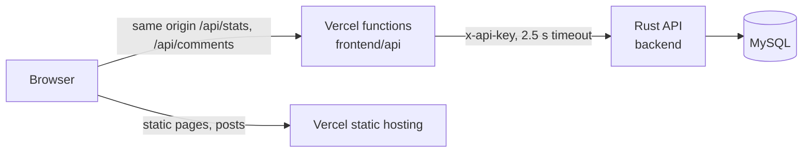

# selfie-portfolio

Source for [tanmaysinghx.com](https://www.tanmaysinghx.com): a portfolio and blog.

```text
frontend/   Angular 21 site + Vercel functions (api/) — deployed on Vercel
backend/    Rust (Axum + SQLx) API for views, likes, shares and comments — MySQL, deployed as a container
render.yaml Render blueprint for the backend
```



The site works without the backend. Posts, pages and search are static. If the API is slow or down, reactions show "—" with a Retry link and comments show a retry state. The page then stops calling the API for 30 seconds so readers don't wait on timeouts.

## Develop

```sh
# API (needs backend/.env, see backend/.env.example)
cd backend && cargo run

# Site (from another terminal)
cd frontend && npm ci && npm run start:api   # or `npm start` without the API gateway
```

Writing posts: [frontend/BLOGGING.md](frontend/BLOGGING.md). API reference: [backend/README.md](backend/README.md).

## Deploy

**Frontend (Vercel).** Set the project's **Root Directory** to `frontend` (Project → Settings → Build and Deployment). Everything else is detected from `frontend/vercel.json` and `package.json`. Environment variables:

| Name | Value |
| --- | --- |
| `BACKEND_URL` | HTTPS URL of the deployed backend, e.g. `https://selfie-backend.onrender.com` |
| `BACKEND_API_KEY` | Same value as the backend's `SERVICE_API_KEY` |

**Backend.** See [backend/README.md → Deploy](backend/README.md#deploy). Render picks up `render.yaml`. Any container host can run `backend/Dockerfile`.

## Test

```sh
cd backend  && cargo test           # add TEST_DATABASE_URL=… for end-to-end MySQL tests
cd frontend && npm test && npm run test:api
```
