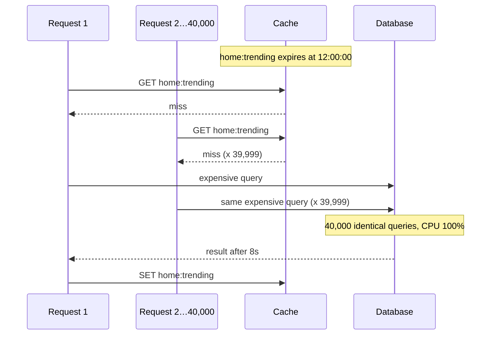
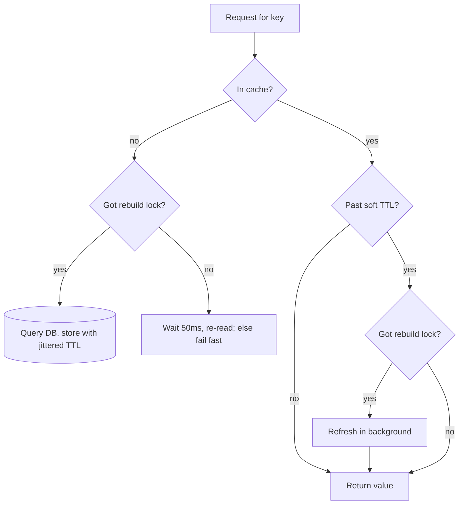

Your homepage is fast. It reads one key from Redis, `home:trending`, and the database has barely noticed you exist for months. The key has a 5-minute TTL. The database query behind it takes 800 ms.

At 12:00:00 the key expires.

In the next 800 ms, **40,000 requests** arrive, find nothing in the cache, and each one runs the same 800 ms query against the same database. The database, sized for a few hundred queries a second, slows down. The query now takes 8 seconds. More requests pile in behind it. Connection pools fill. Health checks fail. Your app servers restart, and when they come back their local caches are empty too.

Nothing was deployed. Nobody attacked you. **A timer ran out.**

This is part 2 of **How Systems Die**. [Part 1](/blog/irctc-tatkal-10am-rush) was about a crowd of *users* arriving at once. This one is about a crowd of *your own servers* arriving at once, and it's sneakier, because it hides behind a cache that worked perfectly for months.

## 1. What a cache stampede is

A cache doesn't just make reads faster. It **hides your real load** from the database. If your cache hit rate is 99.9%, your database sees 1 request in 1,000. Your database is sized for that 1, not the 1,000.

A **cache stampede** (also called **dog-piling**, or a **thundering herd** on a cache) is what happens when that hiding stops for one hot key, all at once:



Every one of those 40,000 queries computes **the same answer**. 39,999 of them are pure waste.

## 2. Do the maths before it does you

The size of the stampede is roughly:

> **duplicate queries ≈ request rate for the key × time to rebuild the value**

| Key | Requests/s | Rebuild time | Queries that pile up |
| --- | --- | --- | --- |
| User profile (cold) | 2 | 50 ms | 0.1, i.e. nothing |
| Product page, popular | 500 | 200 ms | 100 |
| Homepage trending list | 50,000 | 800 ms | **40,000** |
| Same, once the DB slows to 8 s | 50,000 | 8 s | **400,000** |

The last row is what makes it deadly: the rebuild time isn't fixed. The more queries pile on, the slower each one gets, which means more queries pile on. It's the same feedback loop as the [refresh loop in part 1](/blog/irctc-tatkal-10am-rush), just inside your own data centre.

```chart
{
  "type": "line",
  "height": 260,
  "caption": "Illustrative: concurrent DB queries for one hot key (50k req/s) as rebuild time grows under load",
  "data": {
    "labels": ["0.8s", "1.5s", "3s", "5s", "8s"],
    "datasets": [{ "label": "Queries in flight", "data": [40000, 75000, 150000, 250000, 400000] }]
  }
}
```

## 3. The five ways a herd gets started

It's rarely "one key expired". These are the usual triggers:

| Trigger | What happens |
| --- | --- |
| **Hot key expires** | The classic. One popular key, one TTL, one stampede. |
| **Synchronized expiry** | You warmed 100,000 keys at deploy time with `TTL=3600`. Exactly one hour later, all of them expire in the same second. |
| **Cache node restarts or is replaced** | A Redis or Memcached node holding 1/10th of your keys comes back empty. That's 10% of all traffic going to the database at once. |
| **Deploy flushes local caches** | Every app server restarts with an empty in-process cache, all within a few minutes. |
| **Invalidation storm** | Someone runs `DEL product:*` after a price update, or a bug invalidates keys it shouldn't. |

> [!WARNING]
> **Don't forget negative caching.** If a key's real answer is "not found" and you don't cache that, every request for it is a guaranteed miss. Attackers love this: request `/product/random-id-123` a million times and every one goes to your database.

## 4. A real one: Facebook, 23 September 2010

Facebook was down for about two and a half hours that day, and the cause is a textbook herd. [Robert Johnson's write-up](https://engineering.fb.com/2010/09/23/uncategorized/more-details-on-today-s-outage/) described it like this:

1. An automated system checked cached configuration values and, if it found an invalid one, **replaced it with a value from the database**.
2. Someone changed the database copy of a config value to something the system treated as **invalid**.
3. Every client saw the invalid value and tried to "fix" it by querying the database cluster. That cluster was hit with **hundreds of thousands of queries a second**.
4. When a database query errored, the client treated that as another invalid value and **deleted the cache key**, guaranteeing that the next request would also go to the database.

The fix-it logic *was* the stampede. Facebook had to stop the traffic to break the loop, turn off the automated "fix-it" system, let the databases recover, and then let people back in slowly.

It's worth noticing that this outage was **triggered by a config change** and **amplified by a cache**. Real outages love to combine our three villains: a crowd, a cache, and a change. Part 3 covers [the change](/blog/one-line-broke-the-internet).

## 5. Seven fixes, from simplest to smartest

### Fix 1: Add jitter to every TTL

The cheapest fix for synchronized expiry. Never give a batch of keys the same TTL.

```java
Duration ttlWithJitter(Duration base) {
    // base ± 10%, so 1 hour becomes anything between 54 and 66 minutes
    long spread = base.toMillis() / 10;
    long jitter = ThreadLocalRandom.current().nextLong(-spread, spread + 1);
    return base.plusMillis(jitter);
}
```

It does nothing for a single hot key, but it turns "100,000 keys expire at 13:00:00" into a gentle trickle over 12 minutes.

### Fix 2: Request coalescing (single-flight)

Inside one app server, make sure only **one** request rebuilds a given key. Everyone else waits for that result.

```java
final class SingleFlightCache<K, V> {
    private final ConcurrentHashMap<K, CompletableFuture<V>> inFlight = new ConcurrentHashMap<>();
    private final Cache<K, V> cache;

    V get(K key, Function<K, V> loader) {
        V hit = cache.getIfPresent(key);
        if (hit != null) return hit;

        CompletableFuture<V> mine = new CompletableFuture<>();
        CompletableFuture<V> existing = inFlight.putIfAbsent(key, mine);
        if (existing != null) return existing.join();   // someone else is loading: wait for them

        try {
            V value = loader.apply(key);                  // only this thread hits the DB
            cache.put(key, value);
            mine.complete(value);
            return value;
        } catch (RuntimeException e) {
            mine.completeExceptionally(e);
            throw e;
        } finally {
            inFlight.remove(key, mine);
        }
    }
}
```

Go has this built in as [`golang.org/x/sync/singleflight`](https://pkg.go.dev/golang.org/x/sync/singleflight), and Java's Caffeine does it for you when you use `cache.get(key, loader)`. With 200 app servers, a stampede of 40,000 becomes **at most 200** queries. Much better, but still 200.

### Fix 3: A distributed lock (or lease) per key

To get it down to **one** query across the whole fleet, the first server that misses takes a short lock in the shared cache. Everyone else either waits a moment and re-reads, or serves a stale value.

```java
String lockKey = "lock:" + key;
boolean iAmTheRebuilder = redis.set(lockKey, myId, SetParams.setParams().nx().px(5_000)) != null;

if (iAmTheRebuilder) {
    V value = loadFromDatabase(key);
    redis.set(key, serialize(value), SetParams.setParams().px(ttlWithJitter(TTL).toMillis()));
    redis.del(lockKey); // in production, delete only if the value is still myId (use a Lua script)
    return value;
} else {
    Thread.sleep(50);   // brief wait, then read again; or return a stale copy (Fix 4)
    return getFromCache(key).orElseGet(() -> loadFromDatabase(key));
}
```

Facebook built this idea into Memcache as **leases**. A client that misses gets a lease token; the cache hands out at most one token per key every few seconds, and other clients are told to wait briefly and retry. In the [Scaling Memcache at Facebook paper (NSDI 2013)](https://www.usenix.org/system/files/conference/nsdi13/nsdi13-final170_update.pdf), leases cut the peak database query rate for affected keys from **17,000/s to 1,300/s**.

> [!CAUTION]
> The lock needs a timeout (`px(5_000)` above). If the rebuilder crashes while holding it, you don't want every other server waiting forever. And the fallback after waiting must not be "everyone queries the DB", or you've just delayed the stampede by 50 ms.

### Fix 4: Serve stale while you revalidate

Users usually prefer a list that's 30 seconds old to an error page. So keep **two** expiry times:

- **soft TTL**: after this, the value is stale. Serve it anyway, and trigger **one** background refresh.
- **hard TTL**: after this, the value is really gone.

```java
record Cached<V>(V value, Instant softExpiry) {}

V get(String key) {
    Cached<V> c = cache.get(key);                    // stored with the longer hard TTL
    if (c == null) return rebuildWithLock(key);      // true miss: Fix 3
    if (Instant.now().isAfter(c.softExpiry()) && tryLock(key)) {
        executor.submit(() -> rebuildAndRelease(key));   // one refresher, in the background
    }
    return c.value();                                 // everyone gets an answer immediately
}
```

HTTP has this pattern as a header, [`stale-while-revalidate` (RFC 5861)](https://www.rfc-editor.org/rfc/rfc5861), so a CDN can do it for you too:

```http
Cache-Control: max-age=60, stale-while-revalidate=300, stale-if-error=86400
```

`stale-if-error` is the underrated one: if the origin is down, the CDN keeps serving the last good copy for a day. That converts a database outage into "the page is a bit old".

### Fix 5: Refresh early, probabilistically (XFetch)

What if the key never expired in the first place? Each reader rolls a dice, and the chance of refreshing early grows as expiry gets closer. With many readers, *one* of them refreshes a little before the deadline, and the rest never see a miss.

The paper [Optimal Probabilistic Cache Stampede Prevention (Vattani et al., VLDB 2015)](https://www.vldb.org/pvldb/vol8/p886-vattani.pdf) gives a neat formula:

```java
/**
 * delta = how long the last rebuild took (ms)
 * beta  = 1.0 by default; > 1 refreshes earlier
 */
boolean shouldRefreshEarly(long nowMs, long expiryMs, long deltaMs, double beta) {
    double r = ThreadLocalRandom.current().nextDouble();  // (0, 1)
    return nowMs - deltaMs * beta * Math.log(r) >= expiryMs;  // log(r) < 0, so this "jumps ahead" in time
}
```

Expensive keys (large `delta`) start refreshing earlier; cheap keys refresh close to the deadline. No locks, no coordination, and it works across any number of servers.

### Fix 6: Warm up before you take traffic

Cold starts are stampedes you schedule yourself. Before a new cache node or app instance joins:

- **Pre-load hot keys** from a list (yesterday's top 10,000 keys, say).
- For a replaced cache node, **copy from a warm replica** instead of starting empty. Facebook's paper describes a "cold cluster warmup" where a new cluster reads misses from a warm one rather than from the database.
- **Ramp traffic slowly**: 1%, 5%, 25%, 100% of requests over several minutes.

### Fix 7: Protect the database itself

Assume every fix above will fail one day. The database should still survive:

- **Cap concurrent queries** per query type with a semaphore or bulkhead. Query 41 waits or fails fast; it doesn't join a queue of 40,000.
- **Circuit breaker**: if the DB error rate spikes, stop sending it the expensive query for a while and serve stale or degraded results.
- **Connection pool limits** that are deliberately *smaller* than what the DB can take, so app servers can't collectively overload it.

## 6. Which fix when?

| Situation | Reach for |
| --- | --- |
| Many keys set at the same time | **TTL jitter** (always do this) |
| A few very hot keys | **Stale-while-revalidate** + **lock/lease** |
| Hot keys with expensive rebuilds | **XFetch** early refresh |
| Duplicate work inside one server | **Single-flight** (often free with your cache library) |
| Cache nodes restarting, deploys | **Warm-up** and **slow ramp** |
| Lookups for things that don't exist | **Negative caching** with a short TTL |
| "What if all of that fails?" | **Concurrency limits** and **circuit breakers** on the DB |

A sensible default for a hot key combines three: **jitter + stale-while-revalidate + one rebuilder**. That alone makes the classic stampede almost impossible.



## 7. How to know you're at risk

Things to put on a dashboard *before* the outage:

- **Hit rate per key prefix**, not just overall. 99.9% overall can hide one hot key at 0%.
- **Top keys by request rate.** Those are your stampede candidates. Most caches can sample this (`redis-cli --hotkeys` with an LFU eviction policy).
- **DB queries per second for the same query shape.** A sudden spike of *identical* queries is a stampede signature.
- **Rebuild time** for your expensive keys. If it creeps up, the herd gets bigger.
- **Expiry distribution.** A histogram of TTLs that's one tall bar means synchronized expiry is waiting for you.

## 8. Quick quiz

1. Your cache hit rate is 99%. You lose the cache entirely. How many times more queries does the DB see?
2. Why doesn't single-flight alone prevent a stampede across 200 servers?
3. What is `stale-if-error` good for?
4. Why does TTL jitter not help with a single hot key?
5. In XFetch, why does a bigger `delta` (slower rebuild) make early refresh more likely?

> [!NOTE]
> **Answers.** **1** — 100×. It used to see 1 in 100 requests, now it sees all of them. **2** — It only coalesces within one process, so you can still get up to 200 rebuilds at once. **3** — Serving the last good copy when the origin is failing, turning an outage into staleness. **4** — Jitter spreads *different* keys apart; one key still expires at one moment. **5** — The more expensive the rebuild, the earlier you want to start it, so the stampede window never opens.

## TL;DR

- A cache **hides** your real load. When a hot key expires, that load lands on the database **all at once**.
- Duplicate queries ≈ **request rate × rebuild time**, and rebuild time grows under load, so it spirals.
- Triggers: hot-key expiry, **synchronized TTLs**, cache restarts, deploys, invalidation storms, missing **negative caching**.
- Fixes: **TTL jitter**, **single-flight**, **locks/leases**, **stale-while-revalidate**, **probabilistic early refresh**, **warm-up**, and **DB-side limits**.
- Facebook's 2010 outage shows how "self-healing" logic can become the herd.

Next in **How Systems Die**: [One line broke the internet](/blog/one-line-broke-the-internet), about the outages that start with a tiny change and end with half the web offline.
