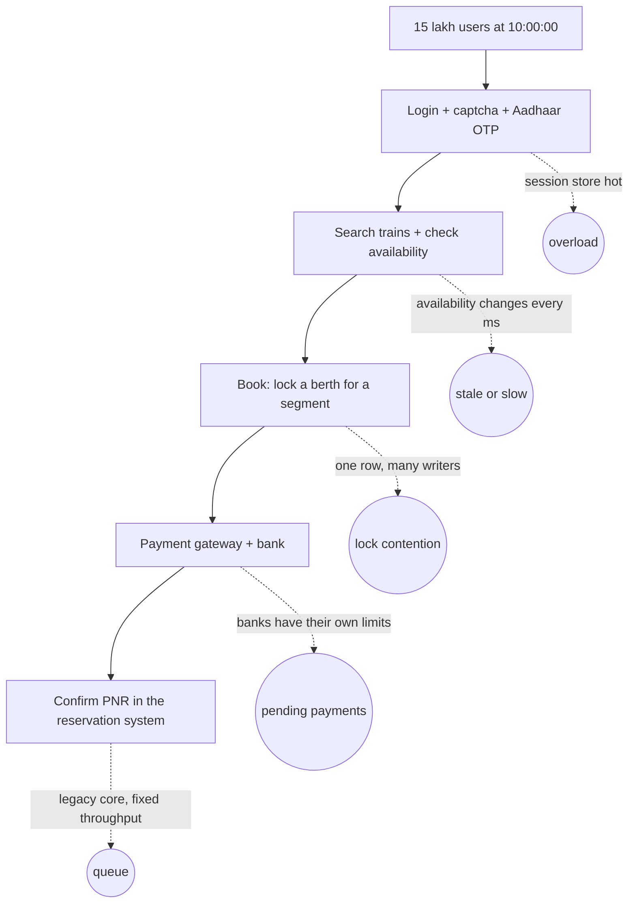
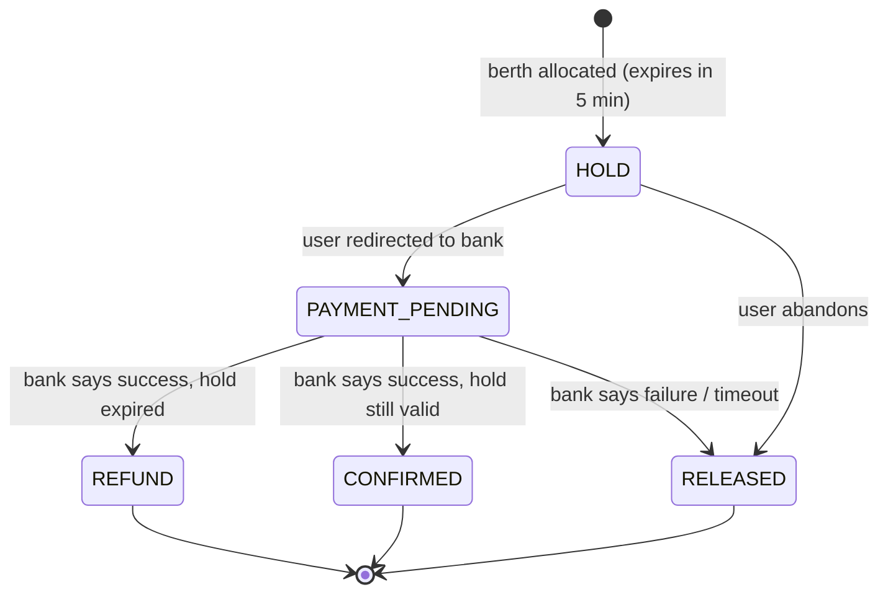
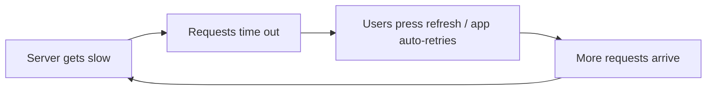
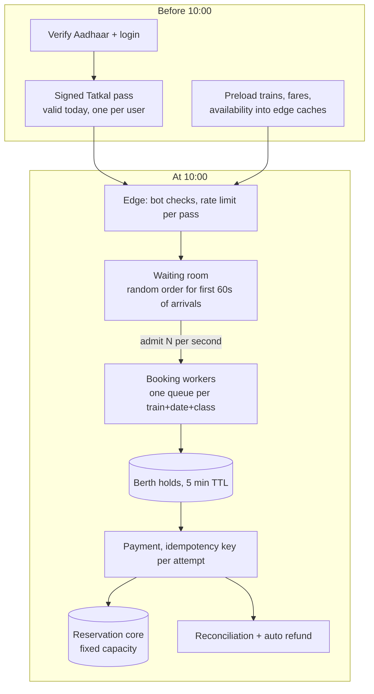

It is 9:59:50 AM. You are logged in. The passenger details are typed into a notepad, ready to paste. UPI is open on your phone. Somewhere in Patna, Pune and Pondicherry, a few lakh other people are doing exactly the same thing, staring at the same clock.

At **10:00:00** the Tatkal window opens for AC classes. Within two minutes most of the cheap berths on popular trains are gone. Within ten minutes, almost two-thirds of the day's online AC Tatkal tickets have been sold. For many people the screen just spins, the payment hangs, or the page says "Service Unavailable".

This is part 1 of **How Systems Die**, a short series about the three ways big systems fall over: **a crowd arrives at once** (this post), [**a cache forgets at once**](/blog/cache-stampede-thundering-herd), and [**a bad change ships everywhere at once**](/blog/one-line-broke-the-internet).

> [!IMPORTANT]
> **How to read this post.** IRCTC and CRIS (Centre for Railway Information Systems) have not published a detailed architecture of the booking path. Facts below are linked to their sources. The sizing exercises, code and diagrams are an **illustrative reference design** showing how a system like this *can* behave, not a map of IRCTC's production systems.

## 1. What we actually know

| Public fact | Source |
| --- | --- |
| Tatkal booking opens one day before the journey: **10:00 AM for AC** classes, **11:00 AM for non-AC** | [IRCTC](https://www.irctc.com/internet-ticketing.php) and Railway Ministry rules |
| About **2.25 lakh** passengers book Tatkal online every day. For AC classes, **5,615** tickets are booked in the first minute, **22,827** in the second, and **62.5%** of the day's online AC Tatkal tickets in the first 10 minutes | [Free Press Journal](https://www.freepressjournal.in/mumbai/irctc-tatkal-booking-trends-62-ac-tickets-sold-in-10-minutes-aadhaar-verification-to-be-mandatory-soon), analysis of 24 May – 2 June 2025 |
| The booking system (NGeT) can book **more than 26,000 tickets a minute**. It saw 28,434 in one minute on 12 Nov 2022 | [IRCTC](https://www.irctc.com/internet-ticketing.php) |
| **31,814 tickets** were booked in a single minute on 22 May 2025 | [The Statesman](https://www.thestatesman.com/india/31814-tickets-booked-in-a-single-minute-on-may-22-railway-ministry-1503441352.html) |
| More than **2.4 crore** users were deactivated or blocked in six months as part of an anti-bot drive; IRCTC has over **13 crore** active subscribers | [Free Press Journal](https://www.freepressjournal.in/mumbai/irctc-tatkal-booking-trends-62-ac-tickets-sold-in-10-minutes-aadhaar-verification-to-be-mandatory-soon) |
| From **1 July 2025**, only Aadhaar-authenticated users can book Tatkal online. Agents are barred for the **first 30 minutes** (10:00–10:30 AC, 11:00–11:30 non-AC) | [News On AIR](https://www.newsonair.gov.in/aadhaar-authentication-made-mandatory-for-online-tatkal-ticket-booking-from-july-15), [Business Standard](https://www.business-standard.com/india-news/aadhaar-verification-mandatory-irctc-tatkal-bookings-july-2025-125061101001_1.html) |
| A revamped website launched in July 2026 is **expected** to support more than 1.5 lakh bookings a minute, roughly five times the old figure | [Business Today](https://www.businesstoday.in/latest/trends/photo/irctcs-new-website-is-live-faster-tatkal-seat-choice-and-a-fare-calendar-heres-what-changed-543089-2026-07-15) |

Look at the shape of those numbers, not the size. Bookings jump **four times** from minute one to minute two. That's not a busy shop. That's a **wall of traffic** that arrives in the same second, every single day, at a time printed in the rulebook.

```chart
{
  "type": "bar",
  "height": 260,
  "caption": "Average online AC Tatkal tickets booked, by minute after 10:00 (24 May – 2 June 2025, Free Press Journal)",
  "data": {
    "labels": ["Minute 1", "Minute 2", "Minutes 3–10 (avg per minute)"],
    "datasets": [{ "label": "Tickets", "data": [5615, 22827, 4840] }]
  }
}
```

> [!NOTE]
> The third bar is derived: (67,159 tickets in the first 10 minutes − 5,615 − 22,827) ÷ 8 ≈ 4,840 a minute. Notice minute one is *lower* than minute two. That's what a system looks like when everyone arrives at once and most requests are stuck in login, captcha and payment, not in booking.

## 2. Why Tatkal is harder than a concert sale

In the [BookMyShow case study](/blog/bookmyshow-ticketing-at-scale), the hard part was a scarce seat that millions wanted. Tatkal has that problem and three more.

| | Concert on-sale | Tatkal |
| --- | --- | --- |
| How often? | A few times a year | **Every day**, twice |
| Start time | Announced weeks ahead | Fixed by rule, known to every bot author |
| What is the "seat"? | One seat, one show | One berth **for a range of stations** on one date |
| Who is buying? | Fans | Families, students, migrant workers, agents, and software pretending to be all of them |
| What does losing mean? | You miss a show | You may not get home |

The second row is the killer. A crowd that arrives *randomly* gets smoothed out by statistics. A crowd that arrives at **the same second** because the rule says so is the worst load pattern there is. Engineers call it a **thundering herd**: many clients woken by the same event, all charging at the same resource.

## 3. Size the problem

Round numbers. These are **assumptions** for a sizing exercise, not IRCTC measurements.

| Assumption or calculation | Result |
| --- | --- |
| People trying to book Tatkal at 10:00 | **15 lakh** (assumption) |
| Online AC Tatkal tickets sold in the first 10 minutes | **67,159** (reported average) |
| Requests per person before they reach "Pay" (login, captcha, search, availability, train select, passenger form, review) | **~8** |
| 15 lakh × 8 requests, half of them in the first 30 seconds | 60 lakh ÷ 30 ≈ **2 lakh requests/s** |
| Each failed page makes the user refresh about **3 times** | **6 lakh requests/s** at the front door |
| Peak booking capacity (NGeT, published) | 26,000+ tickets/min ≈ **430–530 bookings/s** |

Two things fall out of this:

1. **Front door traffic is over a thousand times bigger than booking traffic.** Login, captcha and availability lookups are where the load is. Booking is the narrow pipe at the end.
2. **Refreshing multiplies the problem.** Every timeout produces more requests, not fewer. That loop is what turns "slow" into "down".

## 4. Where it breaks: the five pressure points



### 4.1 Login: the herd hits the door first

Everyone logs in *before* 10:00, right? Not quite. Sessions expire, phones switch networks, people log in "fresh" at 9:59 to be safe. So the minute before the window becomes a **login spike**, and login is expensive: password hashing, captcha validation, OTP sending, session creation.

Aadhaar authentication made this step stricter, which is good for fairness, but it adds an external dependency (an OTP has to be generated, sent by SMS, and verified) right on the hottest path. Any system design that puts a third party on the critical path at peak inherits that third party's capacity limits.

> [!TIP]
> **Design move:** separate *proving who you are* from *buying a ticket*. Let people verify identity well before 10:00 and get a short-lived, signed **Tatkal pass** token. At 10:00 the booking path just checks a signature, which costs microseconds and no database calls.

### 4.2 Availability: the number that changes every millisecond

"AVAILABLE-0012" on a train is a read everyone wants, and it goes stale the moment someone books. You can't cache it for long, and you can't afford to compute it from the database for lakhs of readers a second.

The answer is to accept a **slightly stale** availability number for display (cached for a second or two, served from memory) and only check the **real** inventory when someone actually tries to book. The display says "about 12 left"; the booking step is the source of truth.

This is also where a cache can turn against you: if that availability key expires and lakhs of readers miss it at once, they all hit the database together. That's the [thundering herd on a cache](/blog/cache-stampede-thundering-herd), and it's part 2 of this series.

### 4.3 Booking: a berth is not one seat, it's a timeline

This is the fun part, and the reason railway inventory is harder than cinema inventory.

A berth on a train from Delhi to Howrah isn't sold once. It can be sold **Delhi → Kanpur** to one passenger and **Kanpur → Howrah** to another. So "is berth 23 free?" really means "is berth 23 free *on every segment between your boarding and your destination*?"

A neat way to model that is a bitmask per berth, one bit per segment between consecutive stations:

```java
/** One berth on one train on one date. Bit i = segment from station i to station i+1. */
final class Berth {
    private long occupied; // up to 64 segments per train

    /** Mask for stations [from, to): e.g. from=2, to=5 -> bits 2,3,4 */
    static long segment(int from, int to) {
        return ((1L << (to - from)) - 1) << from;
    }

    boolean isFree(int from, int to) {
        return (occupied & segment(from, to)) == 0;
    }

    /** Called only while holding this berth's lock (or inside a CAS loop). */
    void book(int from, int to) {
        long mask = segment(from, to);
        if ((occupied & mask) != 0) throw new IllegalStateException("Berth taken on part of the route");
        occupied |= mask;
    }
}
```

Now picture 2,000 people trying to book the same 40 Tatkal berths in the same coach class on the same train in the same second. They are all writing to **one tiny piece of data**. That's not a scale problem you fix with more servers. It's a **contention** problem.

Ways to make it survivable:

- **Partition by train + date + class.** Each partition is owned by one worker (or one database shard). No partition talks to another. Rajdhani to Howrah doesn't slow down because of Vande Bharat to Varanasi.
- **Serialize inside a partition.** Put booking requests for one partition into a queue and let a single thread allocate berths in order. One thread doing 5,000 in-memory allocations a second beats 2,000 threads fighting over a row lock.
- **Hold, then pay.** Allocate the berth as a **hold** with a short expiry (say 5 minutes), then send the user to payment. If payment doesn't succeed, the hold expires and the berth goes back.

### 4.4 Payment: when the bank is the bottleneck

At 10:01 tens of thousands of people hit "Pay" at the same time. The payment goes through IRCTC's gateway, then to a payment aggregator, then to a bank or UPI, then back. Every one of those has its own limits.

This creates the most hated outcome in Indian e-commerce: **money debited, ticket not booked.** It happens when:

1. The bank debits the money.
2. The success response is slow or lost on the way back.
3. The hold expires, or the user gives up and retries.

A correct design never "forgets" a payment. Every booking attempt gets an **idempotency key**, the payment is tracked as a state machine, and a reconciliation job matches bank settlements against bookings later. If the berth was lost, the money comes back automatically. That refund taking a few days is the visible cost of a system that chose "never double-book" over "always confirm".



### 4.5 The core: old, correct, and fixed in size

Behind the website sits the Passenger Reservation System, the same core that serves station counters. Systems like this are usually old, extremely correct and **not elastic**. You can't autoscale them in 30 seconds.

That's the real design constraint: a huge, spiky, elastic front end in front of a **fixed-throughput** core. Everything in front of the core has one job, which is to make sure the core never sees more than it can handle.

## 5. The refresh loop: how slow becomes down

This is the most important idea in the post, and it applies to every system you'll ever build.



Suppose the server can do 100,000 requests a second and 120,000 arrive. Twenty percent fail. If each failure makes the user try again, the next second has 144,000, then 173,000, and so on. The useful work the server does **drops**, because it spends its time on requests whose users have already given up.

```chart
{
  "type": "line",
  "height": 260,
  "caption": "Illustrative: load on a 100k req/s server when every failed request is retried once (thousands of req/s)",
  "data": {
    "labels": ["0s", "1s", "2s", "3s", "4s", "5s"],
    "datasets": [
      { "label": "Arriving load", "data": [120, 144, 173, 207, 249, 299] },
      { "label": "Capacity", "data": [100, 100, 100, 100, 100, 100] }
    ]
  }
}
```

The fixes are all about **breaking the loop**:

- **Shed load early and cheaply.** Reject at the edge with a clear "you're in the queue" page, not a timeout after 30 seconds.
- **Tell the client when to come back.** A `Retry-After` header, or a queue position with an ETA, stops people hammering refresh.
- **Back off with jitter** in the app. `retry after 2s, 4s, 8s` plus a random spread, never "retry immediately".
- **Drop dead work.** If a request has been waiting longer than the user would wait, don't process it. Nobody is on the other end anymore.

## 6. Bots: the users who never sleep

A bot doesn't need to be clever to beat you. It just needs to be **earlier and faster**:

| What you do | What a Tatkal bot does |
| --- | --- |
| Log in at 9:58 | Kept dozens of sessions alive since 9:00 |
| Type or paste passenger details | Fills the form in milliseconds via scripts |
| Solve the captcha | Uses captcha-solving services or OCR |
| Pick a train, a class, a berth | Already knows; fires the booking at 10:00:00.000 |
| Pay with UPI on your phone | Uses saved, pre-authorised payment methods |

The 2.4 crore deactivated accounts tell you how big this got. The countermeasures Indian Railways used map neatly onto system design principles:

| Measure | Principle |
| --- | --- |
| Aadhaar authentication for Tatkal | Make identities **expensive** to create, so one person can't be a thousand accounts |
| Agents barred for the first 30 minutes | **Separate traffic classes** so professionals don't crowd out individuals |
| Mass deactivation of suspicious accounts | **Behavioural detection**: humans don't log in 400 times from one IP |
| Captcha and OTP | Add **friction** that's cheap for one human and costly at bot scale |

> [!WARNING]
> Every anti-bot step is also load. An OTP is an SMS gateway call; a captcha is a service call; behavioural scoring is computation. If you add them to the hottest second of the day, design them to fail **open for verified users** and **closed for unknown ones**, or the cure takes down the patient.

## 7. A reference design for 10:00 AM

Putting it together. Again: this is how *a* system like this could work, not how IRCTC does.



The interesting choices:

1. **Identity work moves out of the peak.** By 10:00 the expensive checks are done.
2. **A waiting room admits people at the rate the core can handle.** Excess users get a position and an honest ETA, not a spinner.
3. **Randomize the first minute.** If everyone who arrives between 9:59:30 and 10:00:30 gets a random queue position, the bot that fires at 10:00:00.000 gains nothing over the human who clicked at 10:00:02. Being a millisecond early stops being an advantage. This is a design choice, and it trades "first come, first served" for fairness. Many concert waiting rooms already do this.
4. **Contention is serialized per train.** One queue per train + date + class, allocated in memory, written durably.
5. **Payments can't be lost.** Idempotency keys, a state machine and reconciliation mean the worst case is a refund, never a double charge or a phantom ticket.

## 8. What to steal for your own systems

You probably don't run a railway. You may well run:

- a **flash sale** at 12:00,
- a **result announcement** at 10:00,
- a **cron job** that thousands of servers run at `0 * * * *`,
- a **mobile app** that syncs when the push notification arrives.

All of those are synchronized crowds. The lessons carry over:

- **Never let a clock synchronize your clients** if you can avoid it. Add jitter to scheduled jobs and retries.
- **Put the cheap "no" in front of the expensive "yes".** A queue page served from the edge costs nothing.
- **Separate elastic from fixed.** Know which component can't scale, and protect it with admission control.
- **Make retries polite.** Exponential backoff, jitter, `Retry-After`.
- **Decide what fairness means** before the crowd arrives, then build it into the queue.

## 9. Quick quiz

1. Why is minute one of Tatkal bookings *lower* than minute two?
2. A berth is booked from station 2 to 5. Can someone book it from 5 to 8? From 4 to 6?
3. Why does "retry immediately on timeout" make an overload worse?
4. What does an idempotency key on a payment protect against?
5. Why might a random queue order in the first minute be *fairer* than first come, first served?

> [!NOTE]
> **Answers.** **1** — Most requests in the first minute are stuck in login, captcha, OTP and payment; bookings complete in minute two. **2** — 5 to 8: yes, segments 5–7 are free. 4 to 6: no, segment 4 overlaps. **3** — Every failure creates another request, so arriving load grows each second while useful work drops. **4** — A retried or duplicated payment being charged or booked twice. **5** — Being milliseconds early is easy for bots and impossible for humans; randomizing removes that advantage.

## TL;DR

- Tatkal opens at a **fixed second**, so lakhs of people and bots arrive **at once**: the worst load pattern there is.
- **62.5%** of online AC Tatkal tickets go in the first 10 minutes; bookings jump 4× from minute one to minute two.
- The front door (login, captcha, OTP, availability) sees **thousands of times** more traffic than booking.
- Railway berths are sold **per segment**, which makes inventory a contention problem, not a storage problem.
- **Retries and refreshes** turn slow into down. Shed load early, tell clients when to return, back off with jitter.
- Bots win on speed. Aadhaar, agent windows and account purges raise the cost of being a bot; **randomized admission** removes the speed advantage itself.

Next in **How Systems Die**: [One cache miss, a million queries](/blog/cache-stampede-thundering-herd), about what happens when the crowd isn't your users, but your own servers.
