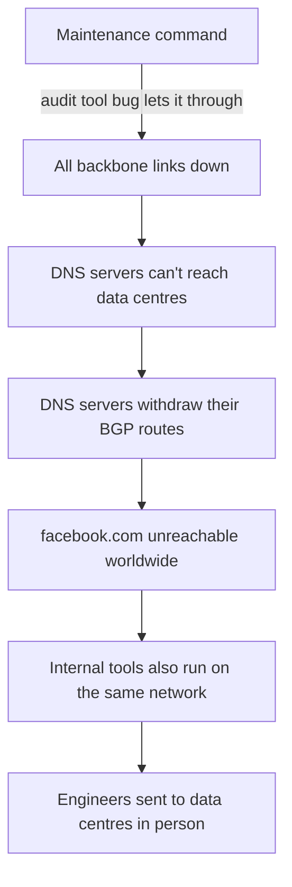
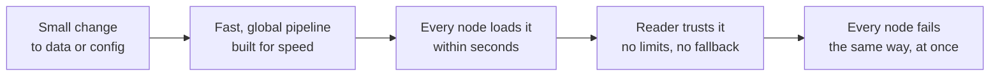
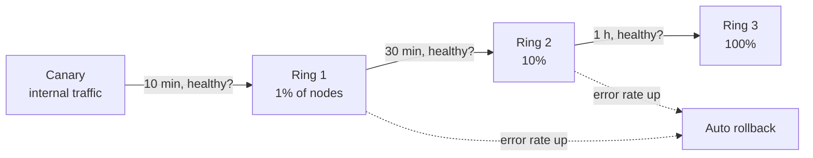

The scariest outages don't come from a server catching fire. They come from somebody changing **one value**: a database permission, a regex, a 21st field in a template, a single router command. The change looks harmless. It passes the tests. Then it ships to every machine on the planet in a few seconds, and a few seconds later those machines stop working.

This is part 3 of **How Systems Die**. [Part 1](/blog/irctc-tatkal-10am-rush) was a crowd of users arriving at once. [Part 2](/blog/cache-stampede-thundering-herd) was a cache forgetting at once. This one is the deadliest of the three: **a bad change arriving everywhere at once**.

> [!IMPORTANT]
> Every incident below comes from the company's own public postmortem, linked in each section. The analysis and the "what we can learn" parts are mine.

## 1. Five outages, one shape

| When | Who | The "one line" | Blast radius | Duration |
| --- | --- | --- | --- | --- |
| 2 Jul 2019 | Cloudflare | One WAF **regex** with catastrophic backtracking | ~100% CPU on every edge server worldwide | 27 min |
| 4 Oct 2021 | Facebook | One **command** during backbone maintenance | Facebook, Instagram, WhatsApp vanished from the internet | ~6 hours |
| 19 Jul 2024 | CrowdStrike | One **content file** that a template read past the end of | ~8.5 million Windows machines blue-screened | Fix out in 78 min, clean-up took days |
| 20 Oct 2025 | AWS | One **empty DNS record** from a race condition | DynamoDB in us-east-1, then much of AWS's own services | ~3 hours for DynamoDB, ~14 hours for EC2 |
| 18 Nov 2025 | Cloudflare | One **database permission** that doubled a file's size | 5xx errors across much of Cloudflare's network | ~3 hours main impact |

Look at the columns side by side and a pattern jumps out. In almost every case:

1. The change was **data or config**, not a code deploy.
2. It went out through a pipeline built to be **fast and global**, usually for a good reason.
3. The software that read it **trusted it completely**.
4. When the reader failed, it **failed closed**: it stopped serving instead of skipping the bad input.

Let's go through them.

## 2. Cloudflare, 2019: the regex that ate every CPU

[Postmortem](https://blog.cloudflare.com/details-of-the-cloudflare-outage-on-july-2-2019/)

Cloudflare's Web Application Firewall (WAF) blocks attacks using rules, many of them regular expressions. On 2 July 2019 an engineer merged a new rule. Tests passed. At **13:42 UTC** it was deployed globally. The critical part of the regex was:

```text
.*(?:.*=.*)
```

Two `.*` next to each other mean the regex engine can split the input in a huge number of ways, and when the match fails it tries **all of them**. That's *catastrophic backtracking*: matching time grows explosively with input length. On real HTTP traffic, every core that handled requests went to nearly **100% CPU**, and Cloudflare served 502 errors worldwide.

Why did it reach every server at once? WAF rules deliberately **skip the staged rollout** that Cloudflare uses for software, because when a new attack appears, customers want protection in seconds, not hours. The new rule was even in "simulate" mode, so it wasn't supposed to block anything. But simulated rules still *execute*, and execution was the problem.

The team turned off the WAF globally at 14:07, and traffic recovered by **14:09**. Fixes included reviewing all 3,868 managed rules for backtracking, adding CPU profiling to the rule tests, moving to regex engines with linear-time guarantees (re2, Rust's `regex`), and using staged rollouts for rules, keeping a global emergency path for active attacks.

> [!TIP]
> **Lesson:** "It's just a rule" is still code if it runs on the request path. And a fast global path needs a **guard rail on cost**, like a CPU or time budget per rule, not just on correctness.

## 3. Facebook, 2021: the command that deleted the map

[Postmortem](https://engineering.fb.com/2021/10/05/networking-traffic/outage-details/)

On 4 October 2021, during routine maintenance, an engineer issued a command meant to **check the capacity** of Facebook's global backbone. It took down **all** the backbone connections between Facebook's data centres instead. Facebook's systems audit commands like this one to stop exactly this mistake, but **a bug in the audit tool** let it through.

Then a sensible safety feature made it much worse. Facebook's DNS servers are designed to **stop advertising their BGP routes** if they can't reach the data centres, on the logic that an unhealthy DNS server shouldn't receive traffic. Every DNS server lost contact at once, so every one withdrew its routes. To the rest of the internet, `facebook.com` **stopped existing**.



Recovery took about **six hours**, partly because the tools engineers needed to fix it ran on the network that was down, and data centres are (sensibly) hard to walk into. Then they had to bring traffic back slowly, because switching on the power draw of a whole fleet at once is its own risk. Sound familiar? That's [part 2's](/blog/cache-stampede-thundering-herd) cold start problem.

> [!TIP]
> **Lesson:** Health checks that remove capacity are a loaded gun. If **every** node fails the same check at the same time, the problem is probably not every node. Cap how much capacity any automatic check can remove at once.

## 4. CrowdStrike, 2024: the 21st field

[Root cause analysis (PDF)](https://www.crowdstrike.com/wp-content/uploads/2024/08/Channel-File-291-Incident-Root-Cause-Analysis-08.06.2024.pdf)

CrowdStrike's Falcon sensor runs **inside the Windows kernel** to catch attacks. It's updated two ways: sensor software (code, rolled out carefully) and "Rapid Response Content" (detection data, pushed quickly so new threats are caught within hours).

On 19 July 2024 at **04:09 UTC**, a content update for "Channel File 291" was pushed. A detection template type had been defined with **21 input fields**, but the sensor code that fed it only supplied **20**. Earlier content never used the 21st field, so nothing broke. The new content did. The kernel code read **past the end of an array**, and in the kernel, an out-of-bounds read is a crash, and a crash is a **blue screen**. On reboot, the sensor loaded the same file and crashed again.

The content was reverted at **05:27 UTC**. That didn't help machines that were already stuck in a boot loop: by Microsoft's estimate around **8.5 million** Windows devices were affected, and many needed someone to physically boot them into safe mode and delete the file. Airlines, hospitals, banks and broadcasters were hit for days.

The validator that checked content had a bug that let the bad file pass. Afterwards CrowdStrike committed to bounds checks in the interpreter, more testing of content, and **staged deployment of Rapid Response Content** with customer control over when it lands.

```c
// The shape of the bug, simplified
void evaluate(const Template *t, const Inputs *in) {
    for (int i = 0; i < t->field_count; i++) {   // template says 21
        match(t->fields[i], in->values[i]);       // inputs only has 20 -> reads garbage on i = 20
    }
}

// The shape of the fix
if (t->field_count > in->count) {
    log_and_skip(t);   // bad content: skip it, keep the machine running
    return;
}
```

> [!TIP]
> **Lesson:** "It's just data" is the most dangerous sentence in operations. Data that changes what code *does* deserves the same rollout as code. And a parser in a privileged place must **reject** bad input, never crash on it.

## 5. AWS, 2025: two robots and an empty record

[Postmortem](https://aws.amazon.com/message/101925/)

DynamoDB's DNS in us-east-1 is managed by automation: a **Planner** produces DNS plans, and several **Enactors** apply them, independently, for resilience. On the night of 19–20 October 2025 (starting **11:48 PM PDT**), one Enactor was running unusually slowly. It applied an **old plan** over a newer one. A second Enactor then ran its clean-up, saw the old plan as stale, and deleted it, which **removed every IP address** for `dynamodb.us-east-1.amazonaws.com`.

No IPs, no DynamoDB. And a lot of AWS itself depends on DynamoDB, so EC2 launches, Lambda, load balancers and others degraded too. DynamoDB recovered in about **three hours**; some services took around **14 hours** to fully recover as backlogs drained.

There was no typo here. Two correct robots, a rare timing, and a state the system had no rule against: "an empty DNS record for a critical endpoint". AWS disabled the automation worldwide until the race was fixed and **protections against incorrect plans** were added.

> [!TIP]
> **Lesson:** Automation needs **invariants it refuses to break**. "Never publish an empty record for this name" is one line of code that would have turned this into a non-event.

## 6. Cloudflare, 2025: the file that got too big

[Postmortem](https://blog.cloudflare.com/18-november-2025-outage/)

Cloudflare's Bot Management assigns every request a bot score using a machine-learning model. The model needs a **feature file**, regenerated every few minutes from a ClickHouse database and pushed to every server worldwide, so the model keeps up with new bot behaviour.

At **11:05 UTC** on 18 November 2025, a permissions change in ClickHouse let a user see tables in one more database. The query that builds the feature file listed columns from `system.columns` **without filtering by database name**, so every feature now showed up **twice**. The file roughly doubled in size, from about 60 features to more than 200.

The proxy that loads this file had a hard limit of **200 features**, for performance: it preallocates memory. When the limit was exceeded, the code returned an error, and the code calling it did `unwrap()` on the result: "I'm sure this never fails". It failed. The proxy panicked:

```text
thread fl2_worker_thread panicked: called Result::unwrap() on an Err value
```

Because the file was regenerated every five minutes, and only some database nodes had the new permissions, the network **flapped**: good file, bad file, good file. That made it look like an attack at first. At **14:24** the team stopped generating new files and pushed a known-good one; main impact ended at **14:30** and everything was resolved by **17:06**.

```rust
// Roughly what failed
let features = load_features(&file).unwrap();   // Err -> panic -> 5xx for the request

// What "fail open" looks like
let features = match load_features(&file) {
    Ok(f) => f,
    Err(e) => {
        metrics::increment("feature_file_rejected");
        warn!("bad feature file, keeping last known good: {e}");
        last_known_good.clone()
    }
};
```

Cloudflare's follow-ups read like a checklist for this whole post: treat **internally generated** config files like **user input**, add more **global kill switches**, and review failure modes across every proxy module.

## 7. The pattern: fast, global, trusted, fatal

Put all five side by side and you get one diagram:



Each arrow is a place you can break the chain:

| Link | How to break it |
| --- | --- |
| Small change | **Validate**: schema, size limits, semantic checks ("no empty DNS record", "≤ 200 features") |
| Fast, global pipeline | **Stage it**: canary → 1% → 10% → 100%, with automatic health checks between steps |
| Every node at once | **Cells**: split the fleet so a bad change can only reach one cell before it's caught |
| Reader trusts it | **Fail open**: reject bad input, keep the **last known good** version, emit an alert |
| Everything fails the same way | **Kill switch**: one flag that turns the feature off globally in seconds |

## 8. How to ship config without breaking the world

### 8.1 Treat config like code

If it changes behaviour, it goes through review, CI and a staged rollout. This includes feature flags, WAF rules, ML features, routing tables, DNS plans and "content updates".

### 8.2 Validate twice: when you produce it, and when you load it

Producer-side validation catches mistakes early. **Loader-side** validation is what saves you when the producer has a bug, which is exactly what happened at CrowdStrike and Cloudflare.

```java
FeatureSet load(byte[] raw) {
    FeatureSet next = FeatureSet.parse(raw);                       // may throw: that's fine
    if (next.size() == 0)               throw new BadConfig("empty feature set");
    if (next.size() > MAX_FEATURES)     throw new BadConfig("too many features: " + next.size());
    if (next.hasDuplicates())           throw new BadConfig("duplicate features");
    if (next.size() > current.size() * 1.5)
        throw new BadConfig("grew more than 50% in one step: " + current.size() + " -> " + next.size());
    return next;
}

void onNewConfig(byte[] raw) {
    try {
        current = load(raw);
    } catch (Exception e) {
        alert("config rejected, keeping last known good", e);      // fail open, loudly
    }
}
```

That `grew more than 50% in one step` check is my favourite. It wouldn't need to know *what* went wrong at Cloudflare, only that a file doubling in five minutes is suspicious.

### 8.3 Roll out in rings, with bake time



"But some changes must be fast!" Yes: security rules against an active attack, for example. Then have **two** paths: a normal staged path for 99% of changes, and an **emergency** global path that needs extra approval and is used rarely. Cloudflare ended up with exactly this after 2019.

### 8.4 Fail open, unless failing open is the danger

When the loader rejects a bad config, what should it do?

| Component | Safer failure |
| --- | --- |
| Bot scoring, recommendations, analytics | **Fail open**: skip the feature, keep serving |
| Rate limiting | Usually **fail open** with a loose default limit |
| Authentication, payments authorization | **Fail closed**: deny, because letting everyone in is worse |
| Kernel drivers, boot path | **Skip the bad content**, never crash the machine |

The key is to decide this **on purpose**, per component, before the incident.

### 8.5 Limit what automation can remove

Health checks, auto-failover and clean-up jobs all remove things. Give each one a **velocity limit**: "never drain more than 10% of nodes per minute", "never publish fewer than N records". AWS added exactly this kind of control to its load balancers after the 2025 outage.

### 8.6 Don't let your tools depend on the thing they fix

Facebook's engineers couldn't use their remote tools because the tools needed the network that was down. Keep an **out-of-band** path: a separate network, a separate login, a runbook on paper. Test it, because a backup path nobody uses tends not to work when you need it.

## 9. A pre-flight checklist for any global change

Before you click "deploy" on something that reaches every node:

- [ ] Does the loader validate size, shape and sanity, and **keep the last known good** on failure?
- [ ] Is there a **canary** and at least one staged ring with automatic rollback?
- [ ] Is there a **kill switch** that turns this off everywhere in under a minute?
- [ ] Do we know whether this component should **fail open or fail closed**?
- [ ] Can a single bad input cause a **crash** rather than an error? (`unwrap()`, unchecked array index, unbounded regex)
- [ ] If every node rejects it, will an **alert** fire, or will it fail silently?
- [ ] Can we roll back **without** the system we're rolling back?

## 10. Quick quiz

1. Why did Cloudflare's 2019 rule hurt even though it was in "simulate" mode?
2. Facebook's DNS servers withdrew their routes on purpose. Why was that a reasonable design, and why did it fail?
3. Why did reverting CrowdStrike's file after 78 minutes not fix most machines?
4. What single invariant would have prevented the AWS DynamoDB outage?
5. Name two checks in a config loader that would have caught Cloudflare's 2025 feature file.

> [!NOTE]
> **Answers.** **1** — Simulated rules still execute the regex; the CPU cost was the problem, not the blocking. **2** — One unhealthy DNS server shouldn't get traffic; but when *all* of them lost the backbone at once, all of them withdrew. **3** — Machines that had already loaded it were stuck crashing on boot and couldn't download the fix; they needed manual repair. **4** — "Never publish an empty DNS record for a live endpoint." **5** — Any of: a maximum feature count checked *before* use with fallback, a duplicate check, or a "grew more than X% at once" check.

## TL;DR

- Big outages often start with a **small change to data or config**, not a code deploy.
- They spread through pipelines built to be **fast and global**, into readers that **trust** the input and **crash** on surprises.
- **Cloudflare 2019**: one regex, 100% CPU everywhere. **Facebook 2021**: one command, all routes withdrawn. **CrowdStrike 2024**: 21 fields vs 20 inputs, 8.5M blue screens. **AWS 2025**: a race left an empty DNS record. **Cloudflare 2025**: a permission change doubled a file past a hard limit.
- Break the chain: **validate** on load, **stage** rollouts, use **cells**, **fail open** where safe with **last known good**, keep **kill switches**, and put **velocity limits** on automation.

That's the end of **How Systems Die**. Three posts, one idea: systems rarely die from too much of something. They die from **too much of something at the same moment**, whether that's [users at 10 AM](/blog/irctc-tatkal-10am-rush), [cache misses at expiry](/blog/cache-stampede-thundering-herd), or a change landing on every server at once. Spread things out in time, and most of these failures get a lot smaller.
