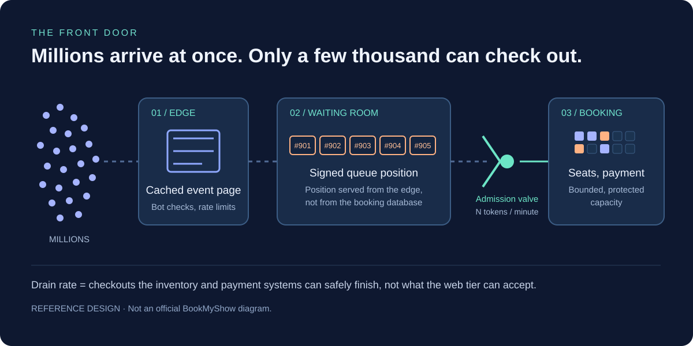
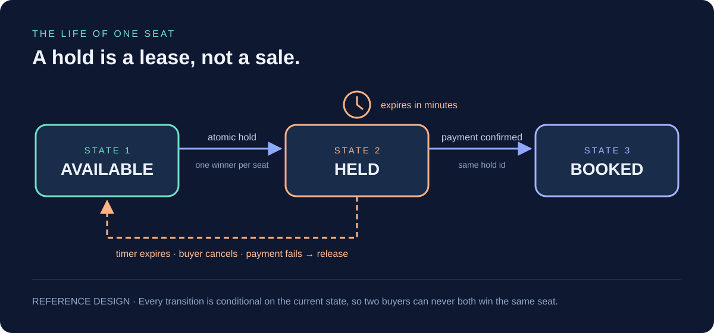
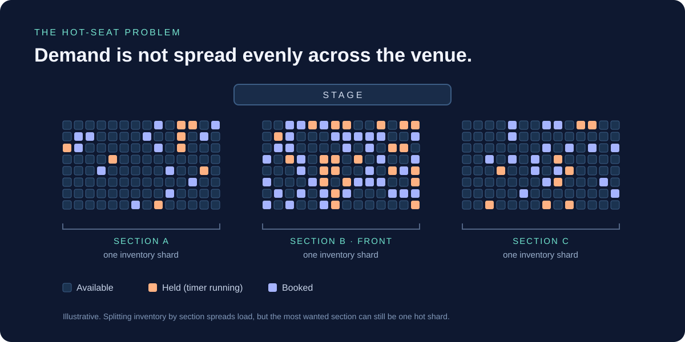
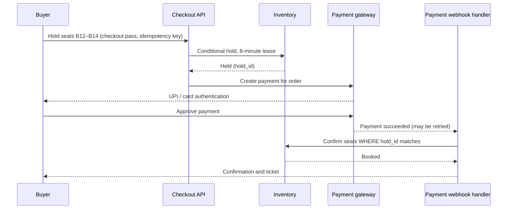
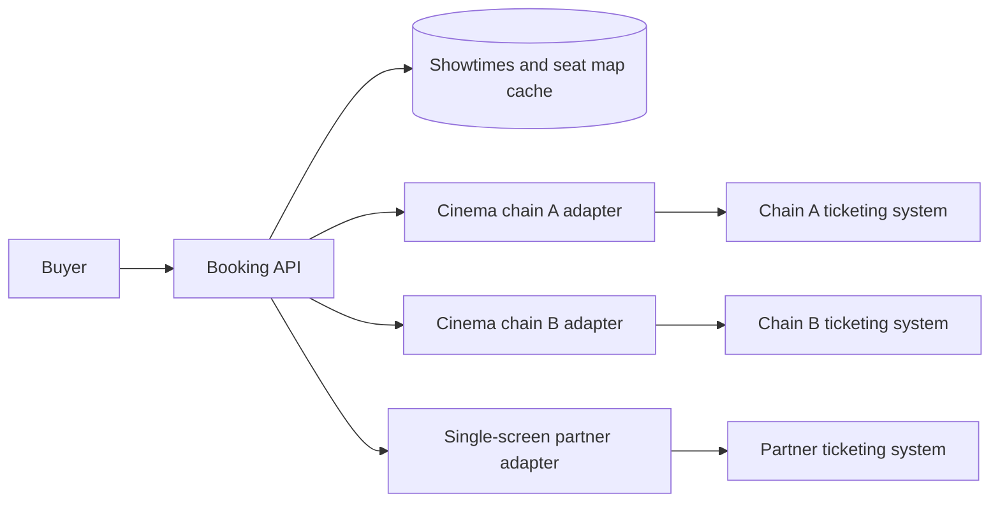
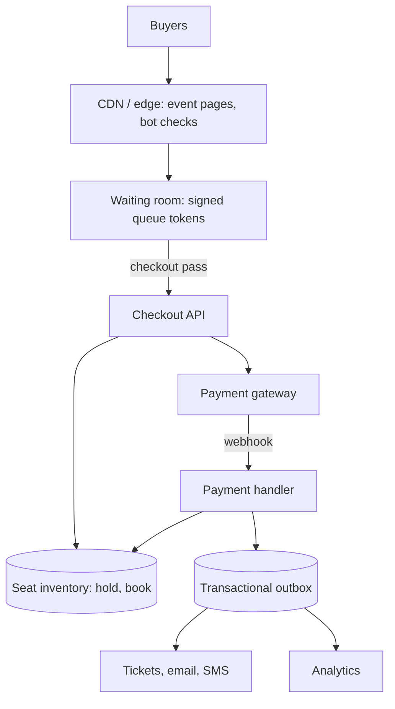

It is 11:59 on a Sunday. Millions of people have the same tab open, thumbs hovering over the same button. At 12:00 the sale opens, and for the next twenty minutes one ticketing platform has to answer a question millions of times a second: **“Can I have this seat?”**

Almost everyone will hear “no”. The engineering challenge is to say it quickly, fairly, and without ever telling two people “yes” for the same seat.

On 22 September 2024, BookMyShow opened sales for Coldplay’s three Mumbai shows. BookMyShow said **13 million people** tried to buy tickets. [Source: Pollstar](https://news.pollstar.com/2024/10/15/its-become-a-joke-coldplay-onsale-exposes-issues-with-indias-ticketing-systems/). Fans reported the site going down minutes before the sale, then waiting behind hundreds of thousands of people in an online queue. [Source: Business Today](https://www.businesstoday.in/amp/trending/story/coldplay-india-tour-2025-bookmyshow-crashes-minutes-before-the-concert-tickets-go-live-details-here-446937-2024-09-22). Within minutes, tickets were reportedly listed on resale sites at many times face value.

That one afternoon contains every hard problem in ticketing: a synchronized crowd, a tiny and indivisible inventory, payments that can succeed after the user gives up, and bots that are faster than people.

> [!IMPORTANT]
> **How to read this case study.** BookMyShow has not published a detailed architecture of its booking platform. Reported events below have sources. The diagrams, sizing exercises, code, and runbooks are an **illustrative reference design** showing how a platform at this scale *can* work, not a verified map of BookMyShow’s production systems.

## 1. First, separate evidence from architecture

| Public evidence | What it tells us | What it does not prove |
| --- | --- | --- |
| BookMyShow said 13 million people tried to buy tickets for Coldplay’s three Mumbai shows (sale opened 22 Sep 2024, 12 p.m.) | Demand exceeded supply by roughly two orders of magnitude | That 13 million people were connected at the same instant |
| Fans reported an outage just before the sale and queue screens showing lakhs of people ahead | A waiting room was in use; the front door was under heavy pressure | The queue’s implementation, vendor, or admission rate |
| BookMyShow capped purchases at **4 tickets per user** and filed a police complaint over unauthorized resale | Abuse controls were part of the response | How bots were detected, or how many were stopped |
| AWS published how BookMyShow moved a 15-year-old analytics platform to AWS, cutting analytics costs by 80% | The company runs significant workloads on AWS | Anything about the live booking path |

Sources: [Pollstar](https://news.pollstar.com/2024/10/15/its-become-a-joke-coldplay-onsale-exposes-issues-with-indias-ticketing-systems/), [Business Today on the outage](https://www.businesstoday.in/amp/trending/story/coldplay-india-tour-2025-bookmyshow-crashes-minutes-before-the-concert-tickets-go-live-details-here-446937-2024-09-22), [Business Today on the four-ticket limit](https://businesstoday.in/india/story/coldplay-india-tour-2025-bookmyshow-limits-concert-tickets-to-4-per-person-fans-upset-446935-2024-09-22), and the [AWS Big Data blog](https://aws.amazon.com/blogs/big-data/how-bookmyshow-saved-80-in-costs-by-migrating-to-an-aws-modern-data-architecture/).

The rest of this article asks: **what architecture and operating decisions would let a ticketing platform survive that kind of afternoon — and still sell movie tickets smoothly on an ordinary Friday?**

## 2. Ticketing is not streaming

In the [JioHotstar case study](/blog/jiohotstar-streaming-at-scale), the hard part was delivering the *same* bytes to tens of millions of people. A CDN can copy a video segment as many times as needed.

A seat cannot be copied. Row B, seat 14 exists exactly once, and every buyer wants to *write* to it. That turns a bandwidth problem into a **contention** problem.

| | Live streaming | Concert on-sale |
| --- | --- | --- |
| What users want | The same media | A scarce, unique item |
| Dominant operation | Read | Conditional write |
| Can you cache it? | Yes, almost all of it | Only the page around it |
| What does overload look like? | Buffering | Double-booking, double charges, angry users |
| What does “success” look like for most users? | Watching | A fast, honest “sold out” |

A ticketing platform therefore splits its traffic into three very different paths:

1. **Browse** — event pages, venue maps, prices. Mostly static and cacheable.
2. **Wait** — the virtual queue. Huge volume, but each request is cheap if designed well.
3. **Book** — seat holds, payment, confirmation. Low volume by comparison, but every request must be correct.

The central design move is to stop the first two paths from ever touching the third.

## 3. Size the problem before drawing boxes

Use round numbers. These are **assumptions** for a sizing exercise, not BookMyShow measurements.

| Assumption or calculation | Result |
| --- | --- |
| People trying to buy | 13 million (the publicly reported figure) |
| Seats on sale across three stadium shows | **150,000** (assumption) |
| Average tickets per order (cap is 4) | 3 → **50,000 successful orders** |
| 13,000,000 ÷ 50,000 | **260 people per successful order** |
| 40% of buyers arrive in the first minute | 5.2 million ÷ 60 ≈ **87,000 arrivals/s** |
| Every waiting user refreshes their position every 20 s | 13 million ÷ 20 = **650,000 status checks/s** |

Two conclusions fall out immediately.

**More than 99% of visitors will not get a ticket.** The system is mostly a machine for managing disappointment, so “sold out” must be a cheap, fast, accurate answer.

**Queue status traffic dwarfs booking traffic.** If each of those 650,000 status checks per second hits a database, the queue itself becomes the outage. The queue must be designed so that answering “where am I?” costs almost nothing.

## 4. The front door: a virtual waiting room



A waiting room is a buffer between an unpredictable crowd and a system with a known, tested capacity. It is the ticketing equivalent of a queue at a stadium gate.

### Make the position check almost free

The neat trick is that a queue position does not need to be stored per user and looked up per request.

1. When a buyer joins, the queue service issues a **signed token** containing their sequence number, the event ID, and an expiry — for example, an HMAC-signed blob.
2. The admission system publishes a single number: **“now serving up to #N”**.
3. The buyer’s position is simply `their number − N`.

“Now serving” is one tiny object for the whole event. It can be cached at the CDN edge with a TTL of a second or two. Thirteen million clients polling it costs roughly what thirteen million clients loading one small image costs — a load CDNs are built for. The booking database never hears about it.

```text
token   = sign({ event: 4512, seq: 901233, exp: 12:45 })
serving = GET /queue/4512/serving   → 640000   (edge-cached, 2s TTL)
ahead   = 901233 − 640000           → 261233 people ahead of you
```

When the buyer’s number comes up, they exchange the queue token for a short-lived **checkout pass**. The booking API rejects any request without a valid pass, so skipping the queue by calling the API directly does not work.

### Be fair about who goes first

If position is assigned strictly by arrival time, the winner is whoever hits refresh at 11:59:59.97 with the lowest latency — often a bot in a data centre. A common pattern is:

- Everyone who arrives **before** the sale opens lands in a pre-queue.
- At 12:00, the pre-queue is **randomly shuffled** into positions.
- People who arrive **after** 12:00 are appended in arrival order.

Refreshing harder before the sale no longer helps. Opening ten tabs gets you ten positions, which is why the pass should also be bound to a logged-in, verified account, and why only one pass per account should be allowed into checkout.

### Set the drain rate from checkout capacity

The admission valve should be tuned to what the **booking core** can finish safely, not to how many requests the web tier can accept.

Suppose a load test shows checkout can safely sustain 10,000 buyers in progress at once, and a typical buyer spends four minutes choosing seats and paying. Then the steady admission rate is about 10,000 ÷ 4 = **2,500 buyers per minute**. At 50,000 orders, the sale lasts roughly 20 minutes before abandonment and payment failures are accounted for.

Admission should also be **inventory-aware**. When the remaining unheld seats can no longer serve the next batch, the valve stops, and every waiting client receives “sold out” through the same cached status object. Telling 12 million people the truth in seconds is far kinder — and cheaper — than letting them wait an hour for nothing.

```chart
{
  "type": "line",
  "caption": "Illustrative on-sale shape, as a percentage of each series' maximum. Synthetic values, not BookMyShow data. Note the small rise in available seats after 12:20 when unpaid holds expire.",
  "height": 320,
  "data": {
    "labels": ["11:55", "12:00", "12:02", "12:05", "12:10", "12:15", "12:20", "12:25", "12:30"],
    "datasets": [
      { "label": "People in the waiting room (% of peak)", "data": [3, 70, 100, 96, 85, 70, 55, 20, 5] },
      { "label": "Seats still available (% of total)", "data": [100, 100, 97, 85, 60, 33, 4, 7, 0] }
    ]
  }
}
```

## 5. The heart of the system: one winner per seat

Inside checkout, thousands of buyers are clicking on the same few rows. The rule is absolute: **two people must never both be told they have the same seat.**



A seat goes through three states:

- **AVAILABLE** — anyone may take it.
- **HELD** — one buyer has a time-limited lease while they pay. Everyone else sees it as taken.
- **BOOKED** — payment is confirmed; the seat is sold.

The hold is what makes the user experience work. Without it, you could pick seats, spend three minutes entering a UPI PIN, and then be told someone else paid faster.

### Option A: a conditional update in the database

The simplest correct approach puts the check and the change in a single atomic statement:

```sql
UPDATE seat_inventory
SET    state      = 'HELD',
       hold_id    = :hold_id,
       held_until = now() + interval '8 minutes'
WHERE  show_id = :show_id
  AND  seat_id = ANY(:seat_ids)
  AND  (state = 'AVAILABLE'
        OR (state = 'HELD' AND held_until < now()));
-- In the same transaction: if rows updated != number of seats requested, ROLLBACK.
```

If two buyers race for the same seat, the database serializes the row updates. One updates the row; the other finds the condition no longer true and updates zero rows. Nobody needs to “check then write”, which is where race conditions live.

Notice the second condition: an expired hold counts as available. This is **lazy expiry**. Expired holds do not need a perfectly timed background job to be released; the next buyer simply claims them. A sweeper can still run periodically to make seat maps look accurate.

Asking for “all or nothing” matters too. A family of four should not end up with three seats held and one lost; the transaction either holds the whole group or nothing.

### Option B: an in-memory hold layer for the hottest events

A relational database row lock is correct, but the best seats in a sold-out stadium concentrate thousands of attempts on a few thousand rows. For the very hottest events, a reference design can put the hold step in an in-memory store such as Redis, with an atomic script so that a multi-seat hold is still all-or-nothing:

```lua
-- KEYS: seat keys, e.g. "{show:4512:B}:seat:14"
-- ARGV[1] = hold id, ARGV[2] = hold TTL in milliseconds
for _, key in ipairs(KEYS) do
  if redis.call('EXISTS', key) == 1 then
    return 0                       -- someone else holds one of these seats
  end
end
for _, key in ipairs(KEYS) do
  redis.call('SET', key, ARGV[1], 'PX', ARGV[2])
end
return 1
```

Redis runs a script without interleaving other commands, so the check and the set cannot be split by another buyer. The TTL implements expiry for free. In Redis Cluster, every key in one script must live in the same hash slot, which is why the key uses a `{show:4512:B}` hash tag: all seats in one section live together.

The trade-off is durability. A hold is a short lease, so losing it in a crash is survivable. **A sale is not.** The final `HELD → BOOKED` transition should still be written to a durable database with the same conditional-update pattern.

### Shard by section — and expect a hot shard anyway



Partitioning inventory by `show_id + section` keeps a multi-seat hold on one partition and spreads different sections across machines. But demand is not uniform: everyone wants front-centre. That section becomes a **hot partition** no matter how many shards you add.

Useful responses:

- **Best-available allocation.** Instead of letting 10,000 people click the same seat, let buyers choose a section and quantity, and have the server assign adjacent seats. Contention turns into a counter-like allocation that rarely conflicts.
- **Batch admissions by section.** Admit buyers in waves and spread them across price bands.
- **General admission counters.** For standing areas, there are no seat IDs at all — just a count. Split the count into several sub-counters (for example, ten buckets of 1,000) so concurrent decrements land on different keys, and rebalance when a bucket empties.

## 6. Payment: the part you do not control

Holding a seat is easy compared with what follows: an external payment system, a mobile network, and a human with a phone.



*Illustrative flow. Real flows add fraud checks, convenience fees, and asynchronous notifications.*

Three rules keep this path honest.

**1. Every request has an idempotency key.** A buyer on a flaky network will tap “Pay” twice. The checkout API stores the key with the first result and returns the same result for the retry, so the buyer is charged once.

**2. Webhooks are delivered at least once.** The handler must treat a duplicate “payment succeeded” as a no-op, not a second booking.

**3. A payment can succeed after the hold expires.** UPI approvals and bank redirects sometimes complete late. The system needs an explicit policy for that, decided in advance:

```java
@Transactional
public BookingResult onPaymentSucceeded(PaymentEvent event) {
    // Gateways retry webhooks; a unique key on the event id turns duplicates into no-ops.
    if (!processedEvents.insertIfAbsent(event.id())) {
        return bookings.findByOrderId(event.orderId());
    }

    // UPDATE ... SET state = 'BOOKED' WHERE hold_id = ? AND state = 'HELD'
    int confirmed = seats.confirmHeld(event.showId(), event.holdId(), event.orderId());
    if (confirmed == event.seatCount()) {
        outbox.publish(new TicketIssued(event.orderId()));
        return bookings.confirm(event.orderId());
    }

    // The hold expired and someone else took a seat: never double-book, always refund.
    refunds.enqueue(event.paymentId(), RefundReason.HOLD_EXPIRED);
    return bookings.markRefunded(event.orderId());
}
```

Thanks to lazy expiry, a late payment still wins if nobody has claimed the expired seats yet: the rows remain `HELD` with this buyer’s `hold_id`. If they have been claimed, the buyer gets an automatic refund rather than a seat someone else already owns.

The `outbox.publish` call writes the “ticket issued” event in the same transaction as the booking. A separate relay sends it to email, SMS, and the ticket wallet. If the notification system is slow, the sale is still recorded, and the message goes out later. That is the **transactional outbox** pattern.

> [!WARNING]
> A timeout from a payment gateway does **not** mean the payment failed. Mark the order *pending*, keep the hold briefly, and reconcile against the gateway’s records. Blindly retrying a charge is how people get billed twice.

### Expired holds create a second wave

Suppose 30% of holds expire because buyers abandon the payment page or their bank declines. In the 50,000-order example, that is roughly 15,000 orders’ worth of seats returning to inventory over the following minutes.

This is why a show can appear sold out at 12:18 and have tickets again at 12:24. A well-behaved system keeps a small tail of the queue alive after the main sale and admits buyers as holds are released, instead of letting people discover them by frantic refreshing.

## 7. Bots, scalpers, and fairness

In the Coldplay sale, tickets reportedly appeared on resale sites within minutes, and BookMyShow publicly emphasised its 4-ticket limit and filed complaints with the police. [Source: Pollstar](https://news.pollstar.com/2024/10/15/its-become-a-joke-coldplay-onsale-exposes-issues-with-indias-ticketing-systems/).

No single control stops scalping. A reference design layers several, each making automation more expensive:

| Layer | Control | What it costs a bot operator |
| --- | --- | --- |
| Edge | Rate limits per IP and device, reputation lists, challenge pages | Rotating proxies and devices |
| Queue | Randomised pre-queue, one pass per verified account | Many real, aged accounts |
| Account | Phone OTP, payment instrument verification | SIM cards and bank accounts |
| Checkout | Per-account and per-card ticket caps, velocity checks across linked accounts | Distributing purchases thinly |
| Ticket | Name on ticket, dynamic QR revealed close to the event, official resale only | Resale becomes risky for buyers |

The final layer matters most. If a ticket can only be transferred through the platform, at a capped price, a scalper’s inventory is worth far less. Detection after the sale — cancelling tickets tied to suspicious account clusters — is also an option, but it must be careful: a false positive cancels a real fan’s night.

## 8. The everyday rush: movies on a Friday

Concerts are the dramatic case. Most of BookMyShow’s traffic is the familiar rhythm of movies: new releases on Friday, evening and weekend peaks, and occasional mini-stampedes when bookings open for a superstar’s first-day-first-show.

Movie booking has a different shape:

- **The inventory is spread out.** Thousands of screens, each with a few hundred seats. Contention per seat is low; the total request rate is high.
- **The cinema often owns the seat map.** Tickets are also sold at the box office and through other channels, so the seat state may live in the cinema’s own ticketing system. An aggregator must lock seats *there*, through an integration, before taking payment.
- **The slowest partner sets the pace.** If one cinema chain’s API is slow, it should not exhaust the connection pool used by every other chain.



*Reference design: one adapter per partner, each with its own timeouts, connection pool, and circuit breaker — a pattern called bulkheading.*

Showtimes, prices, and seat layouts change rarely and can be cached aggressively. Seat *availability* is cached briefly to draw the map, but the final lock always goes to the source of truth. When a partner system is down, the honest response is “booking unavailable for this cinema right now” — not a confirmation that the cinema will later refuse.

## 9. Degrade gracefully, never incorrectly

When something struggles in the middle of an on-sale, there is a strict line between what may degrade and what must stay exact.

| Component under pressure | Reference-design response | Boundary to preserve |
| --- | --- | --- |
| Recommendations, offers, banners | Turn them off for the event | Never block checkout on them |
| Seat-map images and availability colours | Serve slightly stale maps | The hold itself always checks live state |
| Queue position updates | Slow the polling interval | Never reorder people already in line |
| Notification service | Queue emails and SMS for later | The booking record is written first |
| Payment gateway | Route to a healthy gateway, or pause admissions | Never retry a charge with unknown outcome |
| Inventory store | Stop the admission valve | Never accept a booking you cannot record |

The most important lever is the valve itself. If checkout latency rises, admitting fewer buyers per minute is a graceful, visible slowdown. Admitting everyone and letting checkout collapse turns a slow sale into a failed one.

Retries need the same discipline as in any large system. If every client retries instantly when a request fails, load spikes exactly when capacity drops. Clients should use exponential backoff with jitter, and the queue should be the only place a user “waits”.

## 10. Rehearse the sale, not just the request rate

A load test that hammers the homepage proves very little. A realistic on-sale rehearsal includes:

- A synchronized crowd arriving at a precise second, including a burst of logins and OTP requests.
- Millions of clients polling queue status for the full duration.
- Checkout traffic concentrated on one section of one show.
- Payment success, failure, timeout, and *late* success — plus duplicate webhooks.
- Mass hold expiry, then a second wave of buyers.
- A partner or gateway slowing down halfway through.

An illustrative event runbook:

| Phase | Engineering focus |
| --- | --- |
| Weeks before | Forecast demand from pre-registrations; agree drain rate with payment partners; run a full rehearsal |
| Day before | Load seat inventory and verify counts; pre-warm caches and pre-scale stateless tiers |
| One hour before | Open the pre-queue page; freeze deploys; confirm feature flags for non-essential features |
| 12:00 | Shuffle the pre-queue; start admissions slowly, then raise the rate while checkout latency stays healthy |
| During the sale | Watch hold success, payment success, queue throughput, and remaining inventory per section |
| Sold out | Broadcast sold-out status; keep a tail queue for released holds |
| After | Reconcile payments with bookings; process refunds; review bot activity and cancel abuse carefully |

### Measure what buyers experience

- **Time in queue** — median and tail, plus how many people abandon.
- **Hold success rate** — how often a seat click results in a hold. A low number means people are fighting over stale seat maps.
- **Checkout completion** — holds that become bookings.
- **Payment outcomes** — success, failure, pending, and late success, by gateway and payment method.
- **Time to “sold out”** — how long after the last seat sold every waiting user was told.
- **Correctness alarms** — any seat with two bookings, any payment without a booking or refund. The target for these is zero.

## 11. The whole design on one page



*Reference architecture, not an official BookMyShow diagram.*

The pattern generalizes far beyond concerts — flash sales, exam registrations, vaccine slots, train tickets during a festival rush. In each, the same three ideas carry the load:

1. **Keep the crowd at the edge.** A queue whose status is a cached number scales almost for free.
2. **Admit at the speed of correctness.** The drain rate comes from what inventory and payments can safely finish.
3. **Make every state change conditional and idempotent.** One winner per seat, one charge per order, one refund when things go wrong.

The Coldplay sale showed what demand looks like when 13 million people want 150,000-odd seats. No architecture can make that many people happy. A good one can make sure the system stays up, the queue is fair, nobody is charged twice, and everyone learns the outcome quickly.

## Sources and further reading

- [Pollstar: Coldplay on-sale exposes issues with India’s ticketing systems](https://news.pollstar.com/2024/10/15/its-become-a-joke-coldplay-onsale-exposes-issues-with-indias-ticketing-systems/) — the 13 million figure, on-sale date and time, resale and complaints.
- [Business Today: BookMyShow crashes minutes before Coldplay tickets go live](https://www.businesstoday.in/amp/trending/story/coldplay-india-tour-2025-bookmyshow-crashes-minutes-before-the-concert-tickets-go-live-details-here-446937-2024-09-22) — reported outage and queue.
- [Business Today: BookMyShow limits Coldplay tickets to 4 per person](https://businesstoday.in/india/story/coldplay-india-tour-2025-bookmyshow-limits-concert-tickets-to-4-per-person-fans-upset-446935-2024-09-22) — purchase cap.
- [AWS: How BookMyShow saved 80% in costs by migrating to an AWS modern data architecture](https://aws.amazon.com/blogs/big-data/how-bookmyshow-saved-80-in-costs-by-migrating-to-an-aws-modern-data-architecture/) — analytics platform migration.
- Related on this blog: [How JioHotstar scales live streaming](/blog/jiohotstar-streaming-at-scale) and [Uber system design](/blog/uber-system-design).
