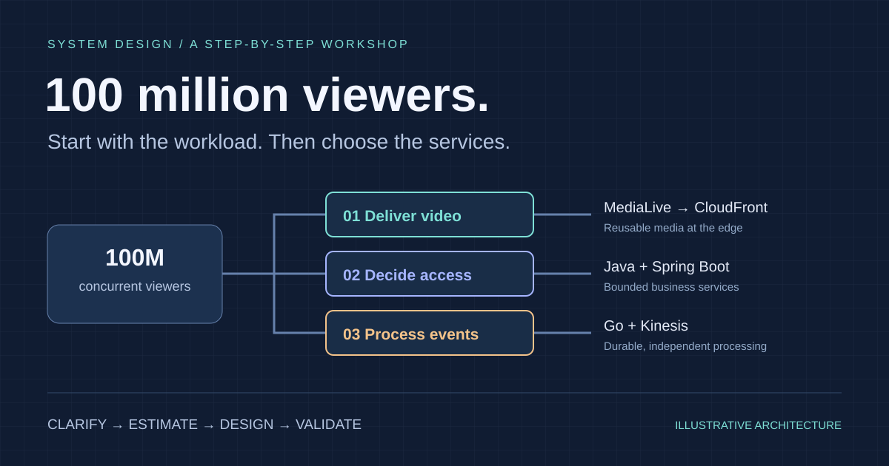
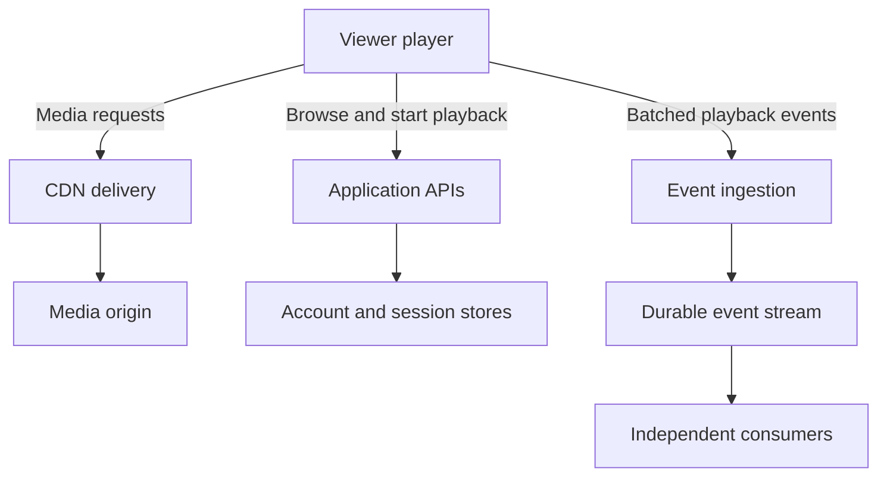
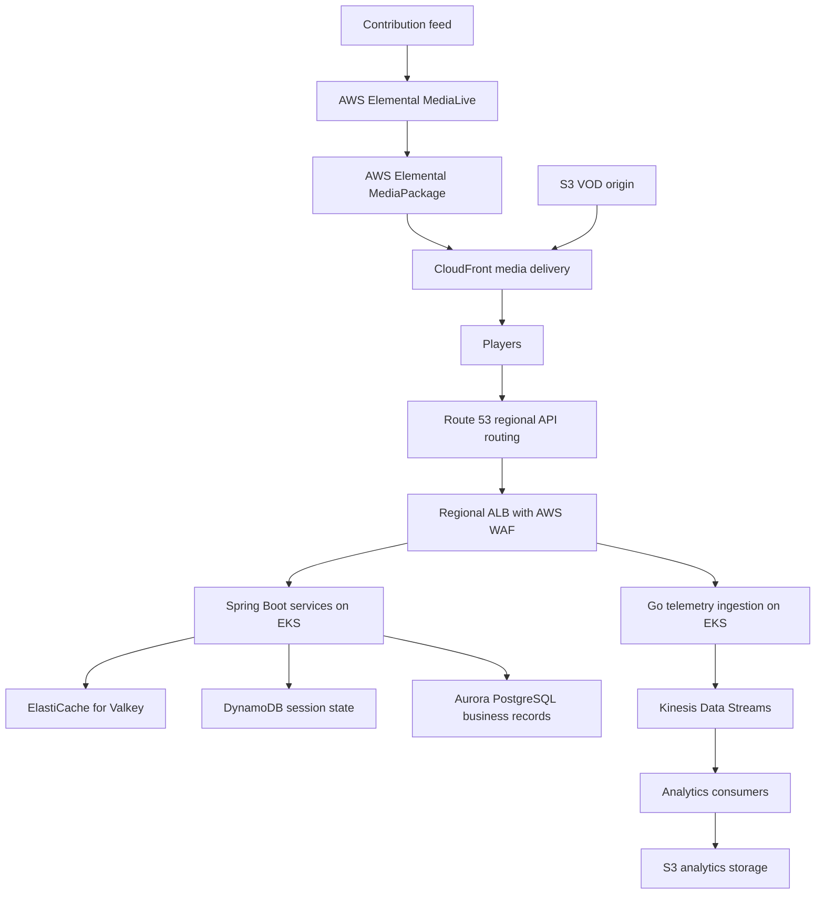
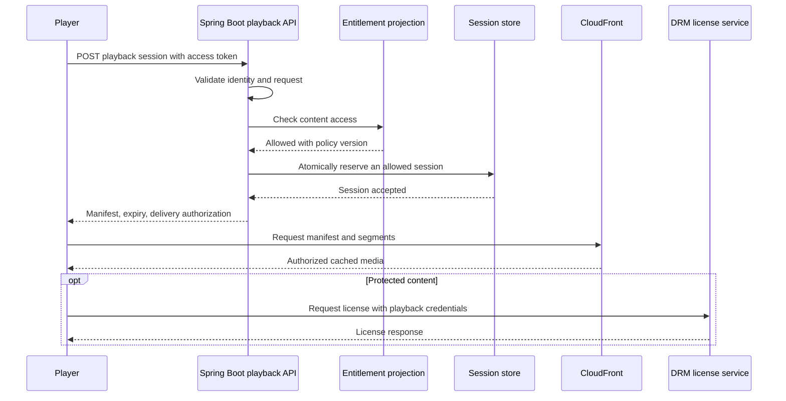
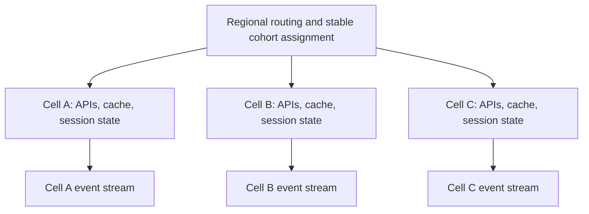

You sit down for a system design interview. The prompt is simple: **“Build a streaming platform that can handle 100 million concurrent requests.”**

It is tempting to start drawing boxes: Spring Boot, Go, Redis, Kafka, Kubernetes, AWS. But a list of technologies is not a design. Before choosing a service, you need to know what work it performs, how much work arrives, what can fail, and what users should experience when it does.

In this workshop, we will build the design one decision at a time. We will use **Java and Spring Boot for business services, Go for a bounded ingestion service, and AWS for media delivery and infrastructure**. At every step, we will ask why that choice fits—and when a simpler choice would be better.

> [!NOTE]
> This is a proposed architecture and a capacity-planning exercise, not a claim that this exact system has served 100 million viewers. All traffic assumptions, instance benchmarks, regional splits, and service objectives are illustrative. AWS capabilities are linked to official documentation; actual quotas, regional availability, capacity, and commercial delivery arrangements must be confirmed before deployment.

## Step 1. Fix the question before designing the answer

“Concurrent requests” can mean several things:

| Term | Meaning | What we need to size |
| --- | --- | --- |
| Concurrent viewers | People watching at the same time | Delivery bandwidth, media request rate, periodic API work |
| Requests per second, or RPS | Requests arriving during each second | Throughput of every affected service |
| In-flight requests | Requests accepted but not yet completed | Memory, connections, queues, and execution capacity |

For a stable system, Little’s Law relates averages: **in-flight requests = arrival rate × average time in the system**. Measure all three over the same boundary. Tail latency is important, but you cannot substitute p99 latency into that average relationship.

For example, 1 million RPS at an average response time of 0.2 seconds means about **200,000 requests in flight**. Conversely, 100 million requests in flight at that response time implies **500 million RPS**. Long-lived connections are another workload again: an open connection does not necessarily mean continuous application work.

For the main design, interpret the product goal as **100 million concurrent streaming viewers**. We will derive the request rates instead of treating every viewer as a permanent request to a Spring Boot server. If the interviewer really means 100 million RPS, ask about payload size, operation type, cacheability, and latency before continuing.

**Thinking habit:** put a unit beside every big number. “100 million” without a unit is not a capacity requirement.

## Step 2. Define the product and its promises

We are building a service for a major live event, with on-demand replays afterward. Viewers can browse, sign in, start an authorized stream, switch quality, and resume compatible content. Publishers can provision an event and supply a live feed.

Keep chat, social feeds, recommendation training, and complex personalized advertising outside the first release. They have independent scaling problems and should not quietly become mandatory playback dependencies.

| Proposed objective | Why it shapes the design |
| --- | --- |
| 100M concurrent viewers at the planned peak | Media delivery needs distributed edge capacity |
| 10M playback starts in one minute | Joining is a separate burst from steady viewing |
| p99 playback-session API latency below 300 ms within a serving region | Downstream calls need budgets and bounded fan-out |
| First frame within 3 seconds at p95 on a defined supported network/device cohort | Client, license, CDN, and encoding behavior matter together |
| At least 99.95% successful eligible playback starts during the event | Define failures and exclusions explicitly before testing |
| Target live latency of 15–30 seconds for the first version | Allows a more forgiving buffer than an ultra-low-latency product |
| No duplicate charges and no unauthorized playback | Correctness requirements constrain retries and failover |

These are **proposed targets**, not measured results or AWS guarantees. Define “eligible” precisely: for example, a supported client with valid access and sufficient connectivity. Report excluded attempts separately so the metric cannot conceal a real incident.

**Thinking habit:** a user-visible objective is more useful than “high availability.” It tells you what to test and what you may degrade.

## Step 3. Do the arithmetic before choosing machines

Assume 100M viewers, an average delivered media bitrate of 2 Mbps, four-second video segments, and one telemetry event every 30 seconds per viewer. Decimal units are used below.

| Workload | Calculation | Estimated demand |
| --- | --- | --- |
| Media bandwidth | 100M × 2 Mbps | **200 Tbps** |
| Media bytes per hour at a constant peak | 200 Tbps ÷ 8 × 3,600 | **90 PB/hour** |
| Video segment requests | 100M ÷ 4 seconds | **25M RPS** |
| Playback starts during the arrival burst | 10M ÷ 60 seconds | **166,667 starts/s** |
| Four external API requests per start | 166,667 × 4 | **about 667K RPS** across those APIs |
| Telemetry events | 100M ÷ 30 seconds | **about 3.33M events/s** |
| Telemetry payload at 300 bytes/event | 3.33M × 300 bytes | **about 1 GB/s**, before overhead |

Audio segments, playlist reloads, subtitles, DRM requests, retries, and low-latency partial segments add request traffic. The bitrate assumption represents average delivered media; wire overhead adds bandwidth. A peak does not usually last all day, so do not multiply a peak-hour estimate into an invoice without a traffic curve.

Here is a useful sensitivity exercise:

```chart
{
  "type": "bar",
  "caption": "Illustrative aggregate media bandwidth at 100 million concurrent viewers. Bitrate is average delivered media per viewer; protocol overhead is excluded.",
  "height": 300,
  "data": {
    "labels": ["1 Mbps", "1.5 Mbps", "2 Mbps", "3 Mbps", "4 Mbps"],
    "datasets": [{ "label": "Delivery bandwidth (Tbps)", "data": [100, 150, 200, 300, 400] }]
  }
}
```

That chart explains why video quality and codec efficiency are architecture decisions. Saving a database query is useful; changing average delivered bitrate by 10% changes a much larger flow of bytes.

**Thinking habit:** split the workload before estimating infrastructure. Video bytes, account decisions, and telemetry events should not share one capacity number.

## Step 4. Draw three paths, not one giant backend





The **media path** delivers reusable objects. The **control path** decides who can watch and where. The **event path** records what happened. An analytics delay should not stop a video segment from arriving.

The player requests media from the CDN directly after authorization. Java and Go services do not proxy all 200 Tbps through their containers. That one boundary is more important than the language choice.

This follows naturally from the estimates: the largest bandwidth workload is highly reusable, while the smaller API workload contains personalized decisions.

## Step 5. Build the smallest complete version first

Start with one region, a small audience, one live channel, and one Spring Boot application with clear internal modules. Deploy it on **Amazon ECS with Fargate** if the team wants managed container execution without operating Kubernetes. Put the API behind an Application Load Balancer, or ALB, and use PostgreSQL for the initial catalogue and account records. [AWS Fargate documentation](https://aws.amazon.com/documentation-overview/fargate/).

Build one complete journey: sign in → browse one event → authorize playback → watch → report a playback event. Add a CDN from the beginning; routing video through an API is not a useful stepping stone.

| Stage | What to build | Evidence needed before progressing |
| --- | --- | --- |
| Working prototype | One channel, one API application, one region | A real player reaches a first frame and rejects invalid access |
| Load-tested service | Multiple API instances, cache, bounded pools, telemetry pipeline | Measured throughput and latency under realistic traffic |
| Isolated services | Extract playback, billing, and ingestion where needed | Independent load or ownership justifies the split |
| Regional cells | Repeat a tested service unit across failure boundaries | One cell can fail without exhausting its neighbors |
| 100M-viewer readiness | Prepared CDN capacity, quotas, regional recovery, event rehearsal | End-to-end evidence, not a diagram or a successful small load test |

There is no audience threshold at which Kubernetes becomes mandatory. ECS can remain a valid production platform. For the large-scale design below, choose **Amazon EKS** because we assume a platform team already operates Kubernetes and needs standardized deployments, per-service scaling, and repeatable regional cells. That is an organizational decision as well as a technical one.

## Step 6. Assign Java and Go jobs they can justify

Language selection should follow team experience, workload, library support, profiling, and operational cost. Both Java and Go can serve concurrent network workloads; neither language removes a slow database or unlimited queue.

| Service | Proposed implementation | Reason for the choice |
| --- | --- | --- |
| Catalogue and editorial APIs | Java + Spring Boot | Familiar domain modeling, validation, persistence, and administration |
| Entitlement and subscription | Java + Spring Boot | Explicit access rules and transaction-oriented business logic |
| Playback-session API | Java + Spring Boot initially | Reuse authorization libraries and operational tooling; profile before rewriting |
| Billing and reconciliation | Java + Spring Boot | Transaction boundaries, idempotency, and provider integration |
| Telemetry ingestion | Go | A narrow network service with bounded concurrency and batching; validate memory and CPU with benchmarks |
| Media encoding and packaging | Managed media services | Avoid implementing codecs and packaging in ordinary API services |

If the team only knows Java well, implement ingestion in Java first. Two languages mean two dependency ecosystems, debugging workflows, and maintenance paths. Extract the Go service when its operational benefit is demonstrated.

Spring Boot supports virtual threads with `spring.threads.virtual.enabled=true` on a compatible Java runtime. That can help certain blocking-I/O workloads, but database connections, CPU, memory, and downstream capacity still need limits. Benchmark the actual application and drivers. [Spring Boot threading documentation](https://docs.spring.io/spring-boot/reference/features/spring-application.html).

Go’s goroutines and channels help structure concurrent work, but an unbounded goroutine per downstream operation can still exhaust resources. Use request cancellation, bounded worker concurrency, explicit timeouts, and bounded batches. [Effective Go: concurrency](https://go.dev/doc/effective_go#concurrency).

**Thinking habit:** “Go is fast” is not an architecture argument. “This measured ingestion workload uses less memory at our target latency and our team can support it” is.

## Step 7. Map the design to AWS services

Here is the proposed destination architecture. Each box represents replicated, capacity-planned resources; one icon does not mean one instance, distribution, database, or global bottleneck.



### Media delivery

Use **MediaLive** to create live encoded outputs and **MediaPackage** for live packaging and origination. **CloudFront** delivers the resulting HTTP media to viewers. AWS documents this media-service delivery pattern; it does not promise that a default deployment is ready for our target audience. [AWS streaming guidance](https://docs.aws.amazon.com/solutions/live-streaming-on-aws/).

For VOD, store source and packaged assets in **S3**, and use **MediaConvert** for offline transcoding. Keep the S3 origin private with CloudFront origin access controls. Live origin protection requires the supported authentication/access mechanism for the selected MediaPackage configuration; S3 access controls cannot simply be copied onto every origin type. See [AWS VOD delivery](https://docs.aws.amazon.com/AmazonCloudFront/latest/DeveloperGuide/on-demand-streaming-video.html) and [private-origin access](https://docs.aws.amazon.com/AmazonCloudFront/latest/DeveloperGuide/private-content-overview.html).

### APIs and application state

Use **Route 53** for regional endpoint selection and **ALB** for regional request routing. DNS failover is not instantaneous and does not move existing requests. Attach **AWS WAF** where appropriate for application filtering and rate-based rules; do not confuse a WAF rule with complete capacity planning.

Deploy API containers through **ECR** and EKS across Availability Zones. Store secrets through **Secrets Manager**, manage encryption keys with **KMS**, and give each workload scoped IAM permissions. Separate public ingress from private application and data networks.

Use **Cognito or another established OIDC identity provider** for authentication. Keep sign-in and token-refresh demand in the capacity model. Validate appropriate token signatures, issuer, audience, and expiry locally with cached, rotated public keys rather than calling the identity provider for every segment or API request.

### Asynchronous work

Choose **Kinesis Data Streams** for the telemetry path in this design. Use **SQS** for discrete retryable jobs such as notification or reconciliation tasks, and **EventBridge** for suitable low-volume domain/event routing. Introduce **Amazon MSK** instead of Kinesis when Kafka compatibility, existing expertise, or required stream semantics justify it. Running both for the same job needs a reason.

Use **CloudWatch** and OpenTelemetry-compatible instrumentation for operational metrics, logs, and traces. Apply sampling and retention policies: logging every media request or attaching a viewer ID to every metric label can create a second scale problem.

## Step 8. Design playback as a short, bounded workflow



The response might look like this. These are example fields, not a complete security protocol:

```json
{
  "sessionId": "ps_8f42",
  "manifestUrl": "https://media.example.com/events/final/master.m3u8",
  "expiresAt": "2026-10-30T18:15:00Z",
  "refreshAfterSeconds": 240,
  "drmLicenseUrl": "https://license.example.com/widevine"
}
```

For supported clients, CloudFront signed cookies can authorize a set of protected media objects. Signed URLs are another option when the client or delivery integration needs them. Do not put private signing keys in the player. Choose cookie domains and browser credential behavior deliberately; a response from an unrelated domain cannot set cookies for the media domain. [CloudFront signed URLs versus cookies](https://docs.aws.amazon.com/AmazonCloudFront/latest/DeveloperGuide/private-content-choosing-signed-urls-cookies.html).

The delivery layer validates access while still using cached media. Keep genuinely personalized responses private and out of shared caches. Use cache keys that distinguish real media variants without unnecessarily fragmenting identical media by viewer. [CloudFront signed-cookie request handling](https://docs.aws.amazon.com/AmazonCloudFront/latest/DeveloperGuide/private-content-signed-cookies.html).

Refresh introduces recurring work. If 100M active players refresh every five minutes, that is about **333K refreshes/s on average**. Synchronizing expiration creates a much larger burst. Jitter refresh schedules, provision the refresh path, and choose the authorization lifetime with revocation requirements in mind. DRM renewal has its own cadence and capacity constraints.

**Thinking habit:** calculate periodic work as carefully as initial joins. A tiny per-viewer action becomes a large shared service at this scale.

## Step 9. Choose storage by access pattern and correctness

| Data | Proposed store | Access pattern and consistency requirement |
| --- | --- | --- |
| Catalogue and publishing metadata | Aurora PostgreSQL, with cached read models | Editorial transactions; many cacheable reads |
| Purchases and billing records | Aurora PostgreSQL owned by the billing service | Durable transactions, unique idempotency keys, reconciliation |
| Playback sessions and device leases | DynamoDB | Keyed account/session access; atomic conditions for admission |
| Watch progress | DynamoDB | Viewer/content keys; explicit policy for conflicting updates |
| Frequently read catalogue/entitlement projections | ElastiCache for Valkey plus durable backing state | Bounded staleness, refresh, invalidation, and miss handling |
| Media and analytics objects | S3 | Object storage; not an interactive transaction database |

Avoid a single DynamoDB partition key such as `MATCH#FINAL` for every viewer event. High-cardinality keys spread work; time buckets and sharding can help workloads that naturally concentrate on a small key space. Every added secondary index also needs its own traffic analysis. [DynamoDB partition-key guidance](https://docs.aws.amazon.com/amazondynamodb/latest/developerguide/bp-partition-key-design.html).

A possible session model uses `ACCOUNT#<id>` as the partition key and session IDs as sort keys. Enforcing a device limit requires an atomic admission design—such as a conditional update or transaction over the account’s lease state—not a separate “count then insert” sequence. Check expiry in application logic; background TTL cleanup is not a precise clock for releasing a seat. [DynamoDB expired-item behavior](https://docs.aws.amazon.com/amazondynamodb/latest/developerguide/ttl-expired-items.html).

Billing owns the durable purchase record and publishes changes through a **transactional outbox**: write the purchase and outbox entry in one database transaction, then publish asynchronously with retry and deduplication. Entitlement services consume those changes into regional read models. A just-paid viewer may need a bounded path to authoritative state while replication catches up.

Do not turn every playback start into a cross-region billing query. Also do not assume a stale cache is always acceptable for access revocation. Set and test an explicit freshness policy.

## Step 10. Scale a measured service unit, then repeat it

Suppose a realistic load test finds that one playback pod handles **800 session starts/s** while meeting the latency objective. This is a made-up benchmark for the arithmetic, not a Java throughput claim.

At a target operating level of 60% of that tested capacity:

```text
Effective planned capacity per pod = 800 × 0.60 = 480 starts/s
Pods for 166,667 starts/s           = ceil(166,667 / 480) = 348
```

That is only the playback-start service. It does not include the other three APIs from our earlier estimate, authorization refresh, telemetry, or failure reserves. Requests with different costs require a representative mix.

If equally spread across three Availability Zones and required to sustain the same load after losing one zone, the simple arithmetic becomes **522 pods total**, 174 per zone: the remaining 348 pods still provide the planned throughput. This is a lower-level capacity example; dependencies, network paths, regional traffic distribution, and recovery speed need separate tests.

Then check the constraint people often miss: **522 pods × a pool of 20 database connections = 10,440 potential connections**. The database might become the bottleneck long before the API CPUs. Set a global connection budget, use read models and caches appropriately, and avoid opening a large pool merely because a framework permits it.

Use a pod autoscaler for application replicas and a node provisioner such as Karpenter for underlying capacity when appropriate. They solve different delays. EKS scaling also depends on networking, control-plane interactions, and service quotas. [EKS scalability guidance](https://docs.aws.amazon.com/eks/latest/best-practices/scalability.html).

For a scheduled event, prepare capacity before arrivals. During the event, scale against workload and saturation signals, with stabilization to prevent oscillation. Scale down slowly after the final whistle, because homepage, highlight, and history traffic may rise as video traffic falls.

## Step 11. Use cells to limit the size of a failure

A cell is a repeatable, bounded service unit with its own capacity and failure boundary. It could contain playback services, caches, session state, and telemetry ingestion for a defined viewer cohort. The media CDN remains a separate delivery system; an API cell does not itself serve its share of the video bytes.



Start with a hypothetical tested envelope of 5M viewers per cell. Twenty cells would cover 100M viewers **without spare capacity**. That statement is not a production plan: viewer count is only a shorthand for the tested mix of joins, refreshes, catalogue access, and events. A different traffic mix changes the envelope.

Route by a stable account or session assignment, using a highly available mapping or an agreed deterministic scheme. Avoid a central router that performs a remote database lookup for every segment. Cross-cell dependencies weaken isolation; a shared regional identity service or billing store must be modeled as a shared failure domain.

AWS describes cells as a way to limit failure scope. The proposed unit sizes and routing decisions here still need our own validation. [AWS cell-based architecture guidance](https://docs.aws.amazon.com/solutions/cell-based-architecture-on-aws/).

For multi-region operation, assign an authoritative home for writes that require strict ordering. Aurora Global Database provides cross-region replication, but it is asynchronous; a regional disaster plan must consider replication lag, promotion, and reconciliation rather than assuming zero data loss. [Aurora replication behavior](https://aws.amazon.com/blogs/database/implementing-run-time-write-synchronization-in-amazon-aurora-global-database/).

If three regions normally carry one third of traffic each, losing one requires the other two to carry **50% more than their normal load**. Reserve that capacity or explicitly define a degraded admission policy. “Multi-region” is incomplete until the surviving system can actually serve the redirected demand.

## Step 12. Size the CDN and origin independently

At 25M video-segment RPS, a 99.9% request cache-hit ratio still leaves **25K upstream requests/s** at that cache layer. An origin shield may absorb many of them. This simplified calculation excludes other media requests and says nothing about byte-hit ratio.

Live segments are new objects, so prepare for synchronized misses. Request coalescing, origin shielding, and correct cache headers matter. Keep live playlists sufficiently fresh while caching immutable media objects efficiently.

CloudFront has quotas, and their applicability can depend on the distribution’s plan and configuration. Confirm required throughput, delivery geography, and account/distribution limits directly with AWS; do not assume that one distribution can accept tens of millions of RPS by default. [Current CloudFront quotas](https://docs.aws.amazon.com/AmazonCloudFront/latest/DeveloperGuide/cloudfront-limits.html).

At the proposed 200 Tbps, engage delivery providers well before launch. An additional CDN may improve resilience and routing options, but each provider needs compatible authorization, origins, manifests, observability, and a tested steering mechanism. Moving the entire audience to a cold alternate CDN can overwhelm both it and the origin.

**Thinking habit:** managed services remove operational work; they do not remove quotas, physical capacity, cache misses, or the need to rehearse failover.

## Step 13. Make event ingestion durable and bounded

Our Go ingestion service validates small batches and publishes them to Kinesis. Return success only after the durability contract promised to the client has been met. For partially failed batches, retry only failed records within a bounded budget. Events need identifiers when duplicate processing affects results.

With provisioned Kinesis capacity, AWS documents per-shard write limits of **1 MB/s or 1,000 records/s**, whichever binds first. At 3.33M events/s and 300 bytes/event, sending each event as a record would require roughly **3,334 shards for record rate**, versus about **1,000 for payload bytes**, before headroom and overhead. Batching API calls alone does not reduce the number of logical records; aggregation into records changes that calculation and the consumer design. [Kinesis capacity documentation](https://docs.aws.amazon.com/streams/latest/dev/working-with-streams.html).

Choose capacity mode, partitioning, stream/account distribution, and quotas deliberately. On-demand does not mean unlimited instant growth. Partition by a suitable session/account hash, not the one match that everybody is watching.

Use separate consumers for quality aggregates, watch progress, and analytics storage. Track the **age of the oldest unprocessed event**, not just queue depth. Consumers need enough excess throughput to drain backlog after recovery.

For SQS job consumers, assume standard-queue messages may be delivered more than once. An acknowledgment or queue feature alone cannot make an external payment effect exactly once; enforce idempotency at the application and transaction boundary. [SQS at-least-once delivery](https://docs.aws.amazon.com/AWSSimpleQueueService/latest/SQSDeveloperGuide/standard-queues-at-least-once-delivery.html).

## Step 14. Design overload behavior before an incident

Every service needs a timeout, a bound on concurrent work, and an answer for overload. A small illustrative policy might be:

```text
Playback API request budget: 250 ms inside the service
  identity verification:     local, with cached signing keys
  entitlement lookup:        bounded dependency call
  session admission:         atomic store operation
  response signing:          local operation with protected key material

When a dependency exceeds its budget:
  cancel outstanding work
  return a controlled error or permitted cached result
  do not create an unbounded queue
```

The numbers must come from tracing and tests. If a dependency consumes the budget, adding retries at every layer makes the situation worse. Retry safe operations selectively, with backoff, jitter, a total deadline, and a retry budget.

| Failure | Intended response | What must stay correct |
| --- | --- | --- |
| Recommendations unavailable | Show cached editorial content | Playback remains independent |
| Catalogue refresh delayed | Serve acceptable stale metadata | Respect takedown requirements |
| Telemetry consumers behind | Buffer within retention; reduce optional diagnostics if necessary | Preserve required accounting events |
| One cell saturated | Shed or defer bounded work, use tested spare capacity | Do not overload healthy cells |
| Entitlement state uncertain | Follow the documented access policy | Do not silently grant access |
| Payment provider times out | Mark pending and reconcile | Do not assume failure and charge again |
| CDN route degrades | Steer a limited cohort to a prepared alternate | Avoid a mass cold-cache event |

The player also needs a policy: start at a sustainable bitrate, adapt using observed throughput and buffer state, retry with limits, and avoid synchronized reconnects. A smooth lower-quality picture may satisfy the product objective better than an impressive resolution followed by repeated stalls.

## Step 15. Build and validate in an executable order

Here is a practical implementation sequence for a learning project that can grow into a serious prototype:

1. **Write the design contract.** Record workload units, audience geography, latency goals, authorization rules, and explicit exclusions.
2. **Make a playable media path.** Package a sample video, serve it through a private origin and CDN, then add one live test channel. Verify several devices and network conditions.
3. **Implement the Spring Boot API.** Add authenticated catalogue and playback endpoints, input validation, bounded connection pools, idempotent session creation where appropriate, and structured error responses.
4. **Implement access enforcement.** Connect entitlement decisions to delivery authorization and, if needed, a compatible DRM license provider. Test expiry and denial as thoroughly as successful playback.
5. **Add persistence and events.** Model keys from access patterns. Add a transactional outbox for durable business changes and a bounded Go ingestion service for telemetry.
6. **Containerize and automate infrastructure.** Use infrastructure as code for networks, IAM roles, data stores, container deployment, alarms, and rollback configuration. Keep environments isolated.
7. **Measure one service unit.** Use realistic request mixes, payloads, dependency latency, and cache misses. Find the first limiting resource and publish the benchmark assumptions.
8. **Add controlled scaling.** Test pod and node startup, cache warming, connection limits, deployment rollouts, and pre-event capacity preparation.
9. **Repeat the unit into cells and regions.** Validate routing, state ownership, spare capacity, and failover behavior before increasing blast radius.
10. **Rehearse the entire event.** Include the arrival wave, steady viewing, authorization renewal, network degradation, match-end exits, and backlog recovery.

This article is a design and build roadmap, not a runnable deployment template. A working demo proves integration; it does not establish 100M-viewer capacity. Large delivery tests require coordination with providers and a realistic budget.

### What should the tests prove?

| Test | Useful evidence |
| --- | --- |
| Burst arrival with cold caches | Time to first frame and session API tail latency remain within agreed limits |
| Token and license renewal wave | Renewals do not interrupt healthy playback or overload access services |
| Zone failure during peak | Remaining capacity and data paths sustain the required workload |
| Slow dependency | Deadlines, cancellation, and load shedding prevent cascading queues |
| Duplicate event or payment callback | Consumers and transaction handlers preserve intended effects |
| Regional failover | Routing, data freshness, spare capacity, and recovery objectives all hold |
| Post-match exit wave | Homepage and history traffic remain healthy while video demand falls |

Use open-arrival-rate load generation when testing arrival bursts so an increasingly slow server does not accidentally reduce the offered workload and make the test look healthy. Test media delivery separately from API throughput, then validate their integration. Track p95/p99 latency, error rate, first-frame success, rebuffering, live-edge distance, dependency saturation, and consumer lag.

## Step 16. Explain the cost and the trade-offs

The 2 Mbps assumption produces 90 PB of media per peak hour. At 1.8 Mbps, it becomes 81 PB: **9 PB less per peak hour**. The financial result depends on negotiated delivery rates, traffic location, commitments, and quality requirements; multiplying this by an arbitrary public per-GB rate would be misleading.

Other cost drivers include live encoding channels and renditions, packaging, CDN requests, DRM, event ingestion, data retention, database capacity, standby compute, logs, and cross-region transfer. Track **cost per viewer-hour at an acceptable quality level**, alongside reliability.

Reserve predictable essential capacity, scale variable work with demand, and put interruptible capacity only where interruption is tolerable. Spend redundancy where it protects an explicit requirement. A secondary region that cannot take traffic is a cost without the recovery behavior the design promised.

## The design you should be able to defend

At the end of this exercise, you should be able to explain these decisions in your own words:

- **Why a CDN?** Media bytes dominate traffic and can be reused near viewers.
- **Why Spring Boot?** The team can implement and operate business decisions reliably, with measured service limits.
- **Why a Go service?** A bounded ingestion workload may benefit from it, provided profiling and team skills justify a second language.
- **Why several stores?** Transactions, keyed session state, caches, and objects have different access patterns and correctness needs.
- **Why cells?** A repeatable tested unit gives failures a boundary and makes expansion more predictable.
- **Why pre-scaling?** A scheduled arrival wave can outrun infrastructure startup and cache warming.
- **Why not promise 100M from the diagram?** The claim requires measured capacity, approved quotas, prepared delivery networks, and failure rehearsals.

The skill to practice is the sequence: **clarify → estimate → separate workloads → choose boundaries → select services → define failure behavior → validate**. Once those decisions are clear, the AWS boxes have a reason to exist.

For more context, read [the JioHotstar case study](/blog/jiohotstar-streaming-at-scale) for published milestones and historical engineering lessons, and [HLS streaming with FFmpeg and Java](/blog/hls-streaming-ffmpeg-java) for the media mechanics underneath this design.

## The complete architecture: bring every decision together

This is the final map of what we have designed. Follow the **teal media path**, the **purple application path**, and the **orange event path** separately, then look at the shared services underneath. The repeated player and ALB labels refer to the same logical entry points, drawn again to keep the paths readable.


[Open the full-resolution SVG](architecture-overview.svg) · [Open the PNG version](architecture-overview.png)

### Read the whole design in six moves

| Move | Follow these services | What we learned |
| --- | --- | --- |
| **1. Prepare the media** | Live feed → MediaLive → MediaPackage; uploaded VOD → MediaConvert → S3 | Create reusable media renditions once; do not encode a separate stream for each viewer. |
| **2. Deliver close to viewers** | Media origins → CloudFront → adaptive players | The CDN carries video bytes. Cache policy, authorization, bitrate and delivery capacity shape this path. |
| **3. Make the access decision** | Player → regional endpoint selected through Route 53 → ALB → Spring Boot services on EKS | Authenticate, check entitlement and admit a session. Return playback configuration; do not proxy media through the API. |
| **4. Use the right state store** | Spring Boot services → ElastiCache, DynamoDB and Aurora PostgreSQL | Cache bounded-staleness reads, atomically manage keyed sessions, and preserve transactional business records. |
| **5. Process events independently** | Player → ALB → Go ingestion on EKS → Kinesis → consumers → S3 analytics | Bound ingestion, acknowledge according to durability guarantees, and let consumers catch up without blocking playback. Progress consumers also update DynamoDB. |
| **6. Operate and recover** | Cognito, the DRM provider, WAF, IAM, Secrets Manager, KMS, ECR and CloudWatch | Identity, licensing, filtering, deployment and observability support the main paths. Repeat tested cells and reserve recovery capacity. |

Route 53 selects an endpoint through DNS; it is not an HTTP proxy. WAF is attached to the ALB in this design. Cognito and DRM exchanges are separate player interactions. The diagram’s bottom row groups shared capabilities rather than showing a sequence of calls.

Secondary mechanisms are deliberately summarized rather than connected with dozens of crossing arrows: the billing outbox feeds entitlement projections, SQS workers run retryable jobs, and replicated regional cells provide tested recovery options. An alternate CDN and regional data-replication topology require their own detailed designs.

**The takeaway:** deliver reusable bytes at the edge, keep access decisions bounded, process events asynchronously, and scale a measured unit with an explicit failure plan. That is the reasoning the service icons represent.

Icons come from the [official AWS Architecture Icons package](https://aws.amazon.com/architecture/icons/) (July 2026 release). The diagram is an independent educational design, not an AWS reference architecture or endorsement.

## Official references

- [AWS live streaming guidance](https://docs.aws.amazon.com/solutions/live-streaming-on-aws/) and [CloudFront streaming overview](https://docs.aws.amazon.com/AmazonCloudFront/latest/DeveloperGuide/live-streaming.html).
- [CloudFront quotas](https://docs.aws.amazon.com/AmazonCloudFront/latest/DeveloperGuide/cloudfront-limits.html), [signed URL/cookie selection](https://docs.aws.amazon.com/AmazonCloudFront/latest/DeveloperGuide/private-content-choosing-signed-urls-cookies.html), and [signed-cookie behavior](https://docs.aws.amazon.com/AmazonCloudFront/latest/DeveloperGuide/private-content-signed-cookies.html).
- [Spring Boot application and threading configuration](https://docs.spring.io/spring-boot/reference/features/spring-application.html) and [Effective Go](https://go.dev/doc/effective_go).
- [EKS scalability](https://docs.aws.amazon.com/eks/latest/best-practices/scalability.html) and [cell-based architecture](https://docs.aws.amazon.com/solutions/cell-based-architecture-on-aws/).
- [DynamoDB partition design](https://docs.aws.amazon.com/amazondynamodb/latest/developerguide/bp-partition-key-design.html), [Kinesis capacity](https://docs.aws.amazon.com/streams/latest/dev/working-with-streams.html), and [SQS delivery semantics](https://docs.aws.amazon.com/AWSSimpleQueueService/latest/SQSDeveloperGuide/standard-queues-at-least-once-delivery.html).
