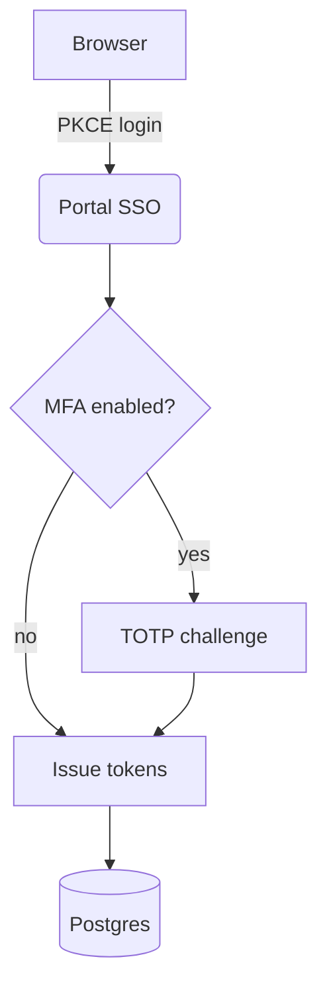
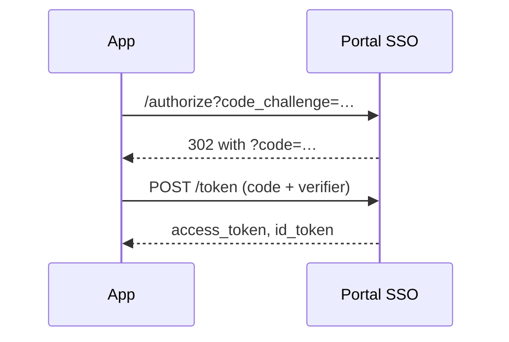

This post is a living cheat sheet. It's marked `draft: true`, so it shows up while you run
`npm start` but never ships to production. Copy whatever block you need into a real post.

## Images with captions

Put images next to `index.md` and reference them relatively, e.g. ``.
The quoted title becomes the caption, and readers can click any image to zoom.


## Flowcharts with Mermaid

Write a fenced block with the language `mermaid`. Flowcharts, sequence diagrams, ER diagrams,
state machines and timelines all work. Prefer `TD` (top-down) for long flows: a wide `LR`
chart shrinks to fit the column.





## Interactive charts

A `chart` block takes a [Chart.js](https://www.chartjs.org/docs/latest/) config as JSON.
Colours, fonts, tooltips and a "View data" table are added for you. Optional extras:
`caption` and `height`.

```chart
{
  "type": "line",
  "caption": "p95 latency before and after moving to virtual threads (ms)",
  "data": {
    "labels": ["Mon", "Tue", "Wed", "Thu", "Fri", "Sat", "Sun"],
    "datasets": [
      { "label": "Platform threads", "data": [182, 176, 190, 210, 198, 160, 158] },
      { "label": "Virtual threads", "data": [96, 92, 101, 108, 99, 88, 85] }
    ]
  }
}
```

```chart
{
  "type": "bar",
  "height": 260,
  "caption": "Where the time goes in a cold start (ms)",
  "data": {
    "labels": ["JVM boot", "Spring context", "Flyway", "Cache warm-up"],
    "datasets": [{ "label": "Cold start", "data": [420, 1380, 310, 540] }]
  }
}
```

## YouTube videos

A `youtube` block takes a video id or URL on the first line and an optional caption on the second.
Nothing loads from YouTube until the reader presses play.

```youtube
https://www.youtube.com/watch?v=aqz-KE-bpKQ
Big Buck Bunny, a stand-in for your own talk or demo.
```

## Callouts

> [!NOTE]
> Useful context that readers shouldn't miss.

> [!TIP]
> A shortcut or a better way to do something.

> [!WARNING]
> Something that will bite if you ignore it.

> [!CAUTION]
> Destructive or risky. Back it up first.

## Code

```java
@Bean
SecurityFilterChain api(HttpSecurity http) throws Exception {
    return http
        .authorizeHttpRequests(auth -> auth.anyRequest().authenticated())
        .oauth2ResourceServer(oauth -> oauth.jwt(Customizer.withDefaults()))
        .build();
}
```

```bash
git add public/posts/my-new-post && git commit -m "post: my new post" && git push
```

### Tables, quotes and the rest

| Setting        | Default | Why change it            |
| -------------- | ------- | ------------------------ |
| `pool.size`    | 10      | Bursty traffic           |
| `timeout.ms`   | 3000    | Slow downstream services |

> Make it work, make it right, make it fast, in that order.

- [x] Write the post
- [ ] Add a cover image
- [ ] Push to `main`
