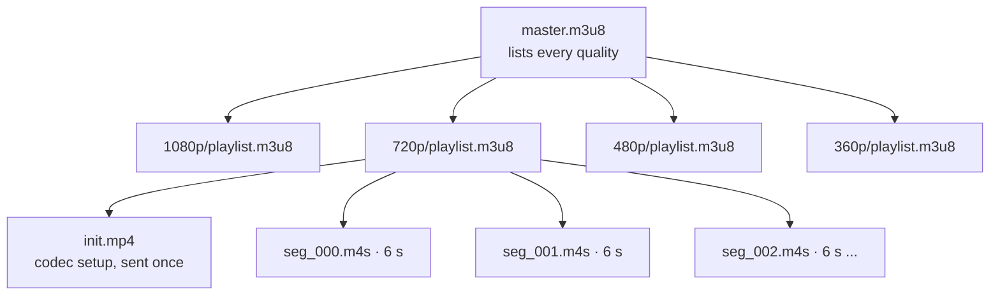
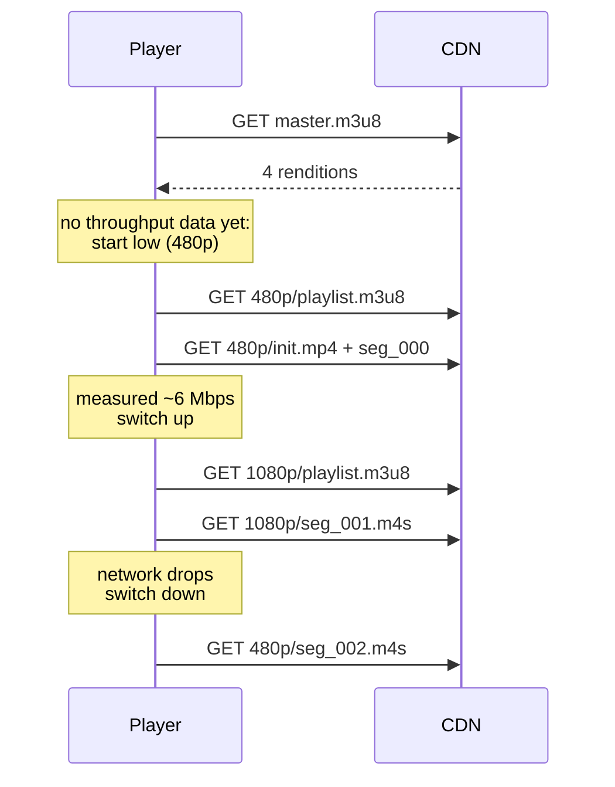
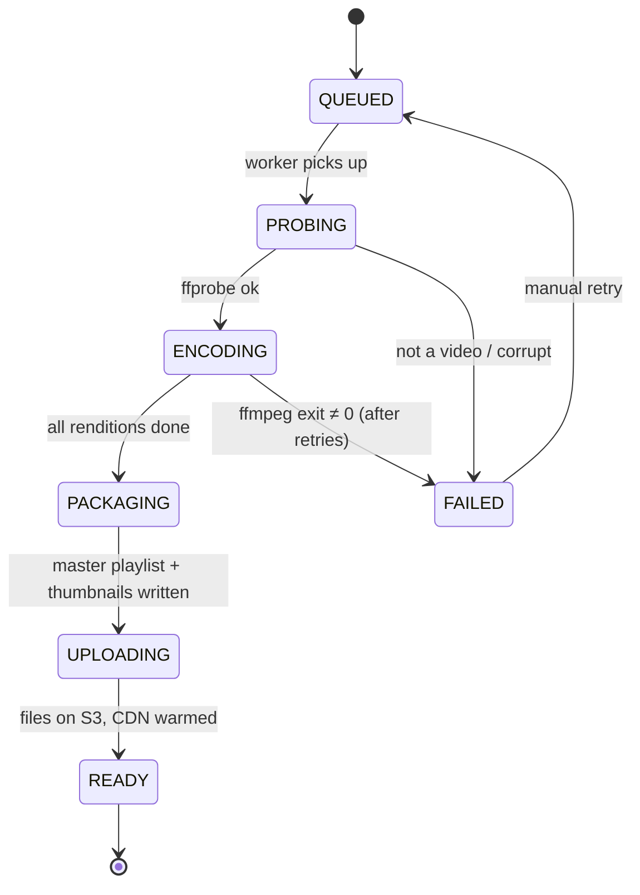
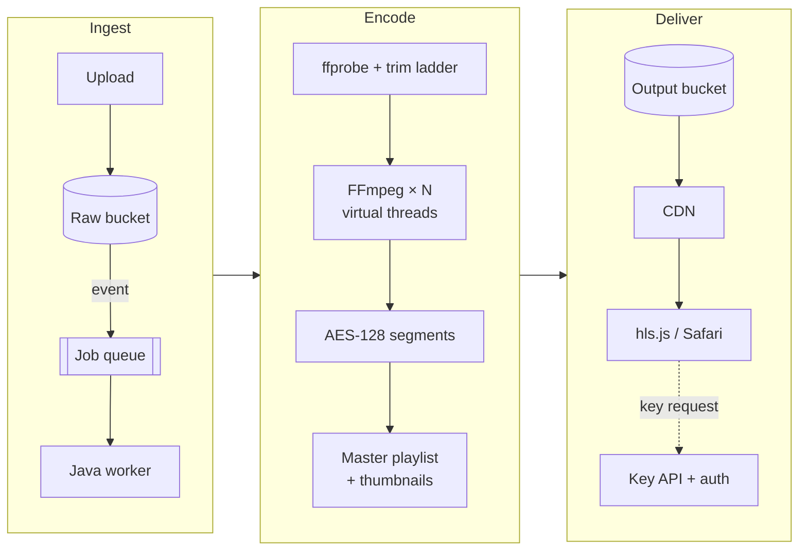

Put an `.mp4` behind a `<video>` tag and it works... until someone watches on a train. The player
picks one file at one quality. If the network drops, it stalls. If the viewer leaves after 30 seconds,
you've still paid to send them several minutes of buffered video.

**HTTP Live Streaming (HLS)** fixes this with a surprisingly simple idea: cut the video into small
files, encode them at several qualities, and let the player choose, segment by segment. Every
request is plain HTTP, so any CDN can cache it.

This post builds the whole thing: the FFmpeg commands, the reasoning behind each number, and a Java
pipeline that drives it all. It's the design behind my
[TranscodeX SDK](https://github.com/tanmaysinghx/transcodex-sdk).

> [!NOTE]
> Charts marked *illustrative* show the typical shape of the trade-off, not a benchmark of a specific
> machine. Storage and request counts are plain arithmetic, so those numbers are exact.

## 1. How HLS works

An HLS stream is three kinds of files:



The **master playlist** advertises the available qualities (renditions):

```bash
#EXTM3U
#EXT-X-VERSION:7
#EXT-X-STREAM-INF:BANDWIDTH=5478000,RESOLUTION=1920x1080,CODECS="avc1.640028,mp4a.40.2"
1080p/playlist.m3u8
#EXT-X-STREAM-INF:BANDWIDTH=3124000,RESOLUTION=1280x720,CODECS="avc1.64001f,mp4a.40.2"
720p/playlist.m3u8
#EXT-X-STREAM-INF:BANDWIDTH=1594000,RESOLUTION=854x480,CODECS="avc1.64001e,mp4a.40.2"
480p/playlist.m3u8
#EXT-X-STREAM-INF:BANDWIDTH=952000,RESOLUTION=640x360,CODECS="avc1.64001e,mp4a.40.2"
360p/playlist.m3u8
```

Each **media playlist** lists the segments for one quality:

```bash
#EXTM3U
#EXT-X-VERSION:7
#EXT-X-TARGETDURATION:6
#EXT-X-PLAYLIST-TYPE:VOD
#EXT-X-MAP:URI="init.mp4"
#EXTINF:6.000,
seg_000.m4s
#EXTINF:6.000,
seg_001.m4s
#EXTINF:4.320,
seg_002.m4s
#EXT-X-ENDLIST
```

The player then repeats one simple loop:



All the intelligence lives in the player. The server just serves static files, which is why HLS
scales so cheaply.

## 2. Designing the bitrate ladder

The **ladder** is the set of renditions you encode. Here's a solid default for 16:9, 30 fps H.264:

| Rendition | Resolution | Video bitrate | Max rate (×1.07) | Buffer (×1.5) | Audio |
| --- | --- | --- | --- | --- | --- |
| 1080p | 1920×1080 | 5000 kbps | 5350 kbps | 7500 kbps | 128 kbps AAC |
| 720p | 1280×720 | 2800 kbps | 2996 kbps | 4200 kbps | 128 kbps AAC |
| 480p | 854×480 | 1400 kbps | 1498 kbps | 2100 kbps | 96 kbps AAC |
| 360p | 640×360 | 800 kbps | 856 kbps | 1200 kbps | 96 kbps AAC |

```chart
{
  "type": "bar",
  "height": 260,
  "caption": "The default ladder: video bitrate per rendition (kbps)",
  "data": {
    "labels": ["360p", "480p", "720p", "1080p"],
    "datasets": [{ "label": "Video bitrate", "data": [800, 1400, 2800, 5000] }]
  },
  "options": { "indexAxis": "y" }
}
```

Each step roughly **doubles** the bitrate. That spacing gives the player useful choices without
switching so often that the viewer notices.

### Why not just "more bitrate = better"?

Quality rises fast at first, then flattens out. Each resolution also has a range where it's the best
choice: at low bitrates, a *smaller* picture encoded cleanly looks better than a large one full of
compression blocks.

```chart
{
  "type": "line",
  "height": 320,
  "caption": "Illustrative quality curves (VMAF, 0–100) for one title at three resolutions. The best rendition at each bitrate is whichever curve is on top.",
  "data": {
    "labels": ["300", "600", "1000", "1500", "2500", "3500", "5000", "7000"],
    "datasets": [
      { "label": "360p", "data": [58, 70, 76, 79, 81, 82, 82.5, 83] },
      { "label": "720p", "data": [44, 62, 75, 83, 89, 91, 92, 92.5] },
      { "label": "1080p", "data": [35, 52, 67, 78, 88, 93, 96, 97] }
    ]
  },
  "options": {
    "scales": {
      "x": { "title": { "display": true, "text": "Bitrate (kbps)" } },
      "y": { "beginAtZero": false, "min": 30, "max": 100, "title": { "display": true, "text": "VMAF" } }
    }
  }
}
```

Read the chart from left to right. Below ~1000 kbps the 360p curve is on top, then 720p takes over,
and 1080p only wins above roughly 3000 kbps. The ladder should follow whichever curve is on top
(that top edge is called the **convex hull**).

> [!TIP]
> A cartoon or a screen recording reaches high quality at a fraction of the bitrate of a grainy action
> film. **Per-title encoding** runs a few quick test encodes for each video, finds that video's own hull,
> and builds a custom ladder. Netflix popularised it, and it often cuts storage and bandwidth by 20–50%
> for simple content.

## 3. The FFmpeg command, line by line

One FFmpeg process can decode once and encode all four renditions:

```bash
ffmpeg -i input.mp4 \
  -filter_complex "[0:v]split=4[a][b][c][d]; \
    [a]scale=-2:1080[v1080]; [b]scale=-2:720[v720]; \
    [c]scale=-2:480[v480];   [d]scale=-2:360[v360]" \
  -map "[v1080]" -c:v:0 libx264 -b:v:0 5000k -maxrate:v:0 5350k -bufsize:v:0 7500k \
  -map "[v720]"  -c:v:1 libx264 -b:v:1 2800k -maxrate:v:1 2996k -bufsize:v:1 4200k \
  -map "[v480]"  -c:v:2 libx264 -b:v:2 1400k -maxrate:v:2 1498k -bufsize:v:2 2100k \
  -map "[v360]"  -c:v:3 libx264 -b:v:3 800k  -maxrate:v:3 856k  -bufsize:v:3 1200k \
  -map a:0 -map a:0 -map a:0 -map a:0 -c:a aac -ac 2 \
  -b:a:0 128k -b:a:1 128k -b:a:2 96k -b:a:3 96k \
  -preset veryfast -profile:v high \
  -g 60 -keyint_min 60 -sc_threshold 0 \
  -f hls -hls_time 6 -hls_playlist_type vod \
  -hls_segment_type fmp4 -hls_flags independent_segments \
  -hls_segment_filename "out/%v/seg_%03d.m4s" \
  -master_pl_name master.m3u8 \
  -var_stream_map "v:0,a:0,name:1080p v:1,a:1,name:720p v:2,a:2,name:480p v:3,a:3,name:360p" \
  "out/%v/playlist.m3u8"
```

The flags that matter most:

| Flag | What it does | Why |
| --- | --- | --- |
| `split=4` + `scale=-2:H` | Decode once, scale four ways | Decoding is expensive; `-2` keeps the aspect ratio with an even width |
| `-maxrate` / `-bufsize` | Caps short bitrate spikes | Without a cap, an explosion scene can be 3× the average and stall a viewer on a weak connection |
| `-g 60 -keyint_min 60` | A keyframe every 60 frames = 2 s at 30 fps | Segments must **start with a keyframe**, so 6 s segments get clean cuts |
| `-sc_threshold 0` | No extra keyframes on scene changes | Keeps keyframes aligned **across all renditions**, so switching quality is seamless |
| `-hls_segment_type fmp4` | Fragmented MP4 instead of MPEG-TS | Less overhead, and the same files work for DASH and modern codecs |
| `-hls_time 6` | Target segment length | The big trade-off, covered next |

> [!WARNING]
> If keyframes don't line up across renditions, switching quality makes the picture glitch or freeze.
> Use a fixed GOP (`-g`, `-keyint_min`, `-sc_threshold 0`), or force keyframes by time with
> `-force_key_frames "expr:gte(t,n_forced*2)"` when the source frame rate varies.

## 4. How long should a segment be?

Shorter segments mean faster starts and quicker quality switches, but many more HTTP requests and
playlist entries.

```chart
{
  "type": "line",
  "height": 280,
  "caption": "Illustrative time to first frame on a typical 4G connection vs. segment length",
  "data": {
    "labels": ["1 s", "2 s", "4 s", "6 s", "8 s", "10 s"],
    "datasets": [{ "label": "Time to first frame (s)", "data": [0.9, 1.2, 1.9, 2.6, 3.4, 4.1] }]
  }
}
```

The request count is exact arithmetic, for **one viewer watching one hour**:

| Segment length | Segment requests / hour | Requests for 100k concurrent viewers |
| --- | --- | --- |
| 2 s | 1,800 | 50,000 req/s |
| 4 s | 900 | 25,000 req/s |
| **6 s** | **600** | **~16,700 req/s** |
| 10 s | 360 | 10,000 req/s |

**6 seconds** is a good default for on-demand video and is Apple's own recommendation. Go down to 2 s,
or use Low-Latency HLS with partial segments, only for live streams where a few seconds of delay matter.

## 5. What it costs to store

Storage is just *bitrate × duration*. For **one hour** of video with the ladder above:

```chart
{
  "type": "doughnut",
  "height": 300,
  "caption": "Storage per rendition for a 1-hour video (MB). Total ≈ 4.7 GB, and 1080p is about half of it.",
  "data": {
    "labels": ["1080p (5000k)", "720p (2800k)", "480p (1400k)", "360p (800k)", "Audio (4 tracks)"],
    "datasets": [{ "label": "MB", "data": [2250, 1260, 630, 360, 202] }]
  }
}
```

1080p takes about half the space, but on mobile it's watched far less than half the time. That's a strong
reason to try per-title encoding, or a better codec (HEVC and AV1 reach similar quality at roughly
30–50% less bitrate, at the cost of slower encodes and patchier device support).

## 6. Speed: presets and parallelism

x264 presets trade encoding time for compression efficiency:

```chart
{
  "type": "bar",
  "height": 280,
  "caption": "Illustrative 1080p encoding speed by x264 preset (multiple of real-time on an 8-core machine)",
  "data": {
    "labels": ["ultrafast", "superfast", "veryfast", "faster", "fast", "medium", "slow", "slower"],
    "datasets": [{ "label": "Speed (× real-time)", "data": [14, 9.5, 6.2, 4.4, 3.3, 2.4, 1.3, 0.6] }]
  }
}
```

`veryfast` is a good choice for a self-hosted pipeline. Going from `veryfast` to `slow` usually saves
around 10–15% in file size, for **4–5× the CPU time**. That's only worth it when the same file is
watched millions of times.

### Run the renditions in parallel

One FFmpeg process with `split` is simple, but it's limited by the slowest rendition. On a machine with many
cores you can run **one process per rendition** at the same time:

```chart
{
  "type": "bar",
  "height": 260,
  "caption": "Illustrative timeline for encoding a 10-minute video: when each rendition runs (seconds)",
  "data": {
    "labels": ["Sequential", "Parallel"],
    "datasets": [
      { "label": "1080p", "data": [[0, 100], [0, 110]] },
      { "label": "720p", "data": [[100, 150], [0, 60]] },
      { "label": "480p", "data": [[150, 175], [0, 30]] },
      { "label": "360p", "data": [[175, 190], [0, 18]] }
    ]
  },
  "options": {
    "indexAxis": "y",
    "scales": { "x": { "min": 0, "max": 200, "title": { "display": true, "text": "Seconds" } } }
  }
}
```

Each rendition runs a little slower in parallel because they share the CPU, but the total time drops from the
*sum* of all renditions to the *longest* one: about 190 s down to about 110 s here. To go further,
**chunked encoding** splits the source at keyframes into, say, 30 s pieces, encodes them on many machines
and joins the segment lists. This is how big platforms turn a 2-hour film around in minutes.

## 7. Encrypting segments with AES-128

HLS has encryption built in. Every segment is encrypted, and the playlist tells the player where to fetch
the key:

```bash
openssl rand 16 > enc.key                  # 128-bit content key
openssl rand -hex 16                       # optional IV

cat > keyinfo.txt <<EOF
https://api.example.com/keys/video-42
/secure/keys/video-42/enc.key
EOF

ffmpeg ... -hls_key_info_file keyinfo.txt ...
```

FFmpeg writes this into every media playlist:

```bash
#EXT-X-KEY:METHOD=AES-128,URI="https://api.example.com/keys/video-42"
```

The segments can sit on a public CDN. Only the **key endpoint** needs protecting:

```java
@RestController
@RequestMapping("/keys")
class KeyController {

    private final KeyStore keys;
    private final Entitlements entitlements;

    @GetMapping(value = "/{videoId}", produces = MediaType.APPLICATION_OCTET_STREAM_VALUE)
    ResponseEntity<byte[]> key(@PathVariable String videoId, @AuthenticationPrincipal Jwt user) {
        if (!entitlements.canWatch(user.getSubject(), videoId)) {
            return ResponseEntity.status(HttpStatus.FORBIDDEN).build();
        }
        return ResponseEntity.ok()
            .cacheControl(CacheControl.noStore())          // never cache keys at the CDN
            .body(keys.contentKey(videoId));
    }
}
```

> [!CAUTION]
> AES-128 HLS keeps casual downloaders and hot-linkers out. It is **not DRM**: anyone who can play
> the video can capture the key. For studio content you need Widevine, FairPlay or PlayReady through
> a licence server. For courses, internal training and user uploads, AES-128 plus short-lived signed
> URLs is usually the right trade-off.

## 8. The Java pipeline

The orchestration is a small state machine, one job per uploaded video:



### Step 1: probe the source

Never trust an upload's file extension. Ask `ffprobe` what's really inside:

```java
record SourceInfo(double durationSec, int width, int height, double fps, boolean hasAudio) {}

SourceInfo probe(Path input) throws IOException, InterruptedException {
    Process p = new ProcessBuilder(
            "ffprobe", "-v", "error", "-print_format", "json",
            "-show_format", "-show_streams", input.toString())
        .redirectErrorStream(true)
        .start();

    JsonNode root = mapper.readTree(p.getInputStream());
    if (p.waitFor() != 0) throw new InvalidMediaException(input);

    JsonNode video = stream(root, "video").orElseThrow(() -> new InvalidMediaException(input));
    return new SourceInfo(
        root.at("/format/duration").asDouble(),
        video.get("width").asInt(),
        video.get("height").asInt(),
        parseRate(video.get("avg_frame_rate").asText()),   // "30000/1001" → 29.97
        stream(root, "audio").isPresent());
}
```

Use the result to **trim the ladder**. Never upscale: a 720p upload shouldn't get a fake 1080p rendition.

```java
List<Rendition> ladderFor(SourceInfo src) {
    return DEFAULT_LADDER.stream()
        .filter(r -> r.height() <= src.height())
        .toList();
}
```

### Step 2: encode with live progress

Pass `-progress pipe:1` and FFmpeg writes machine-readable `key=value` lines to stdout. That's
enough to drive a progress bar:

```java
void encode(Job job, Rendition r, SourceInfo src, Consumer<Double> onProgress) throws Exception {
    List<String> cmd = FfmpegCommand.hls(job.input(), job.outDir(), r, src)
        .withArgs("-progress", "pipe:1", "-nostats")
        .build();

    Process p = new ProcessBuilder(cmd)
        .redirectError(job.logFile(r).toFile())   // keep stderr for debugging
        .start();

    try (var lines = p.inputReader().lines()) {
        lines.filter(l -> l.startsWith("out_time_us="))
             .mapToLong(l -> Long.parseLong(l.substring(12)))
             .forEach(us -> onProgress.accept(Math.min(1.0, us / 1e6 / src.durationSec())));
    }

    if (p.waitFor() != 0) {
        throw new EncodeFailedException(job.id(), r.name(), job.logFile(r));
    }
}
```

### Step 3: run renditions in parallel with virtual threads

Each FFmpeg process does its heavy work in native code. The Java thread just waits on the process,
so virtual threads are a perfect fit. A semaphore stops you starting more encodes than the CPU can handle:

```java
private final Semaphore encodeSlots = new Semaphore(Runtime.getRuntime().availableProcessors() / 2);

void encodeAll(Job job, SourceInfo src) throws Exception {
    List<Rendition> ladder = ladderFor(src);
    Map<String, Double> progress = new ConcurrentHashMap<>();

    try (var executor = Executors.newVirtualThreadPerTaskExecutor()) {
        List<Future<?>> tasks = ladder.stream()
            .map(r -> executor.submit(() -> {
                encodeSlots.acquire();
                try {
                    encode(job, r, src, pct -> {
                        progress.put(r.name(), pct);
                        job.reportProgress(average(progress, ladder.size()));
                    });
                } finally {
                    encodeSlots.release();
                }
                return null;
            }))
            .toList();

        for (Future<?> task : tasks) task.get();   // rethrows the first failure
    }
    writeMasterPlaylist(job, ladder);
}
```

With one process per rendition, the **master playlist** is written by the Java code instead of
FFmpeg. It's just a text file built from the ladder, and building it in Java lets you set accurate
`BANDWIDTH` values from the actual peak segment bitrates.

### Step 4: publish with the right headers

| File | Content-Type | Cache-Control | Why |
| --- | --- | --- | --- |
| `*.m3u8` (VOD) | `application/vnd.apple.mpegurl` | `public, max-age=300` | Small; lets you re-publish a fix quickly |
| `*.m3u8` (live) | `application/vnd.apple.mpegurl` | `max-age=1` | Changes every segment |
| `init.mp4`, `*.m4s` | `video/mp4` | `public, max-age=31536000, immutable` | Content never changes, so it can be cached forever |
| Key endpoint | `application/octet-stream` | `no-store` | Must be checked on every request |

## 9. Adaptive bitrate in action

Here's what a good player does during one minute on a commuter train. The chosen rendition stays a step
**below** the measured bandwidth, so the buffer has room to absorb a sudden drop:

```chart
{
  "type": "line",
  "height": 320,
  "caption": "Illustrative ABR trace: measured bandwidth vs. the rendition the player chose (kbps)",
  "data": {
    "labels": ["0s", "6s", "12s", "18s", "24s", "30s", "36s", "42s", "48s", "54s", "60s"],
    "datasets": [
      { "label": "Measured bandwidth", "data": [3200, 7800, 8400, 6900, 2100, 900, 1600, 4200, 7200, 8100, 7900], "tension": 0.35 },
      { "label": "Chosen rendition", "data": [1400, 1400, 5000, 5000, 2800, 800, 800, 1400, 2800, 5000, 5000], "stepped": "before", "pointRadius": 0 }
    ]
  },
  "options": { "scales": { "y": { "title": { "display": true, "text": "kbps" } } } }
}
```

What's going on:

- **Start low** (0–6 s): with no measurements yet, start at 480p so the first frame appears quickly.
- **Climb in steps** (6–18 s): only switch up after the higher rendition has been sustainable for a while.
- **Drop quickly** (24–30 s): in the tunnel, fall straight to 360p. Stalling is far worse than a softer picture.
- **Recover carefully** (36–60 s): step back up one rung at a time to avoid bouncing between qualities.

On the web, [hls.js](https://github.com/video-dev/hls.js) does all of this for you. Safari plays HLS natively:

```javascript
const video = document.querySelector('video');
const src = 'https://cdn.example.com/videos/42/master.m3u8';

if (Hls.isSupported()) {
  const hls = new Hls({
    capLevelToPlayerSize: true,       // match quality to player size
    xhrSetup: xhr => (xhr.withCredentials = true)  // cookie for key API
  });
  hls.loadSource(src);
  hls.attachMedia(video);
} else if (video.canPlayType('application/vnd.apple.mpegurl')) {
  video.src = src;                   // Safari / iOS
}
```

> [!TIP]
> `capLevelToPlayerSize` is the easiest saving available. A 1080p rendition in a 400 px-wide
> embedded player wastes bandwidth the viewer can't even see.

## 10. The full picture



### Checklist

- [x] Probe every upload; never upscale
- [x] Ladder spaced about 2× apart, with `maxrate`/`bufsize` caps
- [x] Fixed GOP aligned across renditions (`-g`, `-sc_threshold 0`)
- [x] 6 s fMP4 segments for on-demand video
- [x] Renditions in parallel, limited by a semaphore
- [x] Segments cached `immutable`; playlists cached briefly; keys `no-store`
- [x] AES-128 for access control; real DRM only if you actually need it
- [ ] Next: per-title ladders, HEVC/AV1 renditions and Low-Latency HLS

The complete pipeline, with Spring auto-configuration, thumbnails and the key endpoint, is in
[TranscodeX SDK](https://github.com/tanmaysinghx/transcodex-sdk). If you build something with it,
or find a flag I've got wrong, [tell me](mailto:tanmaysinghx@gmail.com).
