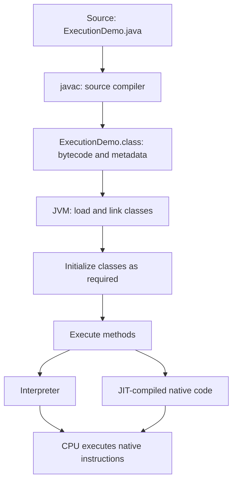
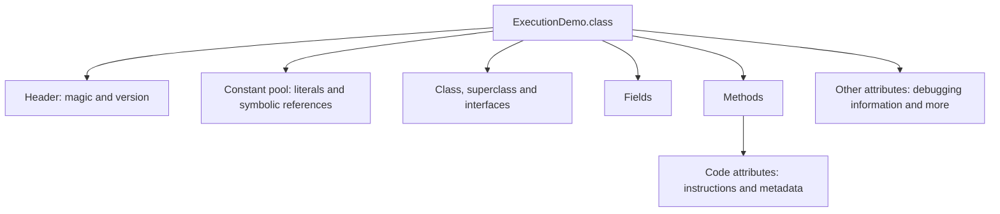
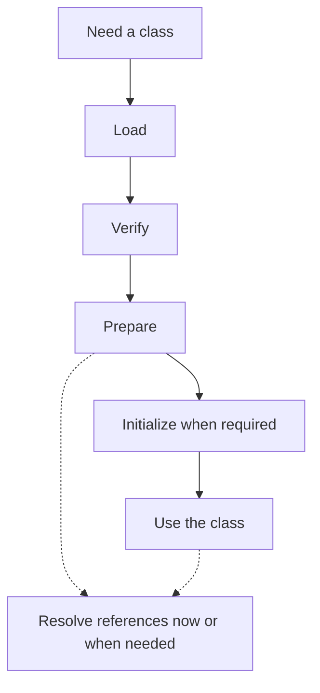
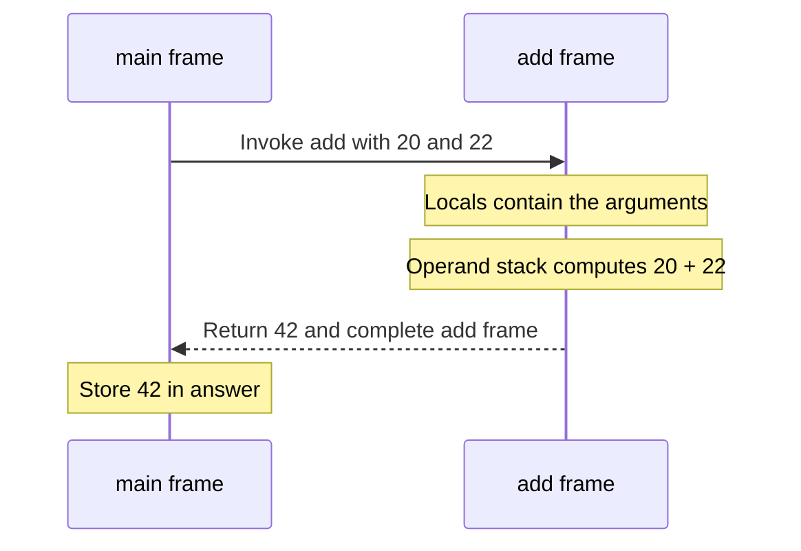
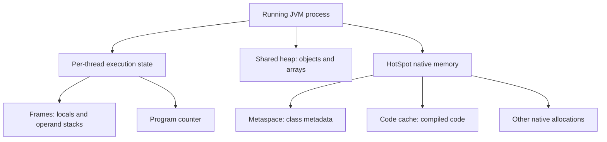
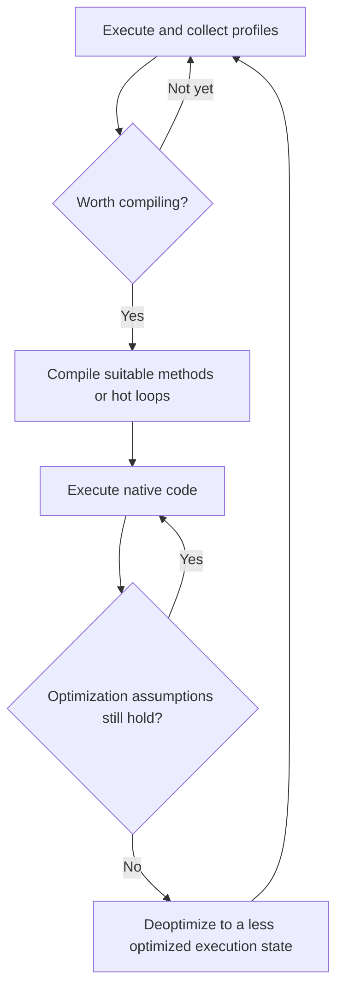
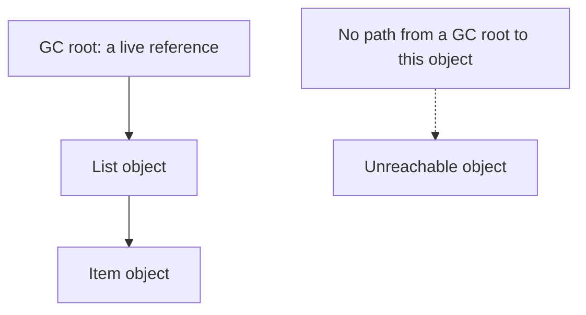

Writing Java usually means thinking about classes, methods and objects. Press Run, and those abstractions turn into something a processor can execute. But what actually happens between those two moments?

For my first post, I want to walk through that gap. We will compile a small program, read its bytecode, trace a method's operand stack, and connect those instructions to memory, runtime compilation and garbage collection. By the end, you should be able to explain what happens after `java ExecutionDemo` without treating the JVM as a black box.

**The examples use JDK 25.** The execution story applies broadly to modern Java. When we discuss C1, C2, Metaspace or the code cache, we are discussing HotSpot, a JVM implementation commonly shipped with OpenJDK distributions. JVM requirements and HotSpot implementation choices are different things.

## 1. The whole journey

There are two different compilations in this story. `javac` translates source into class files containing bytecode. Later, a JVM implementation such as HotSpot can compile frequently executed bytecode into native machine code. Those are different inputs, different outputs and different compilers. [Sources: javac documentation](https://docs.oracle.com/en/java/javase/25/docs/specs/man/javac.html), [HotSpot compilation](https://docs.oracle.com/en/java/javase/25/vm/java-hotspot-virtual-machine-performance-enhancements.html).



Read this as a map, not a rule that every class in an application finishes loading before the first method runs. Execution can cause more classes to be needed later.

### JDK, runtime and JVM

| Term | What it means here |
| --- | --- |
| Java language | The source-level rules: types, expressions, classes and control flow. |
| JVM | The abstract execution machine, or a particular implementation of it, depending on context. |
| Runtime environment | The VM plus libraries and supporting runtime components needed by an application. |
| JDK | The development kit, including tools such as `javac`, `java` and `javap`. |
| HotSpot | One implementation of the JVM, with its own runtime and optimization strategies. |

`java` is the launcher command. It starts an application using a JVM; the command itself is not the virtual-machine specification. Also, `java Example.java` is a supported source-launch mode that compiles source for execution. It does not mean the CPU understands Java source. [Source: java launcher documentation](https://docs.oracle.com/en/java/javase/25/docs/specs/man/java.html).

## 2. Start with a program we can inspect

Save this as `ExecutionDemo.java`, or [download the source](ExecutionDemo.java):

```java
public class ExecutionDemo {
    static int multiplier = initializeMultiplier();

    static int initializeMultiplier() {
        System.out.println("1. Class initialization");
        return 2;
    }

    static int add(int left, int right) {
        int sum = left + right;
        return sum;
    }

    public static void main(String[] args) {
        System.out.println("2. Enter main");
        int answer = add(20, 22);
        System.out.println("3. Answer = " + answer);
        System.out.println("4. Scaled = " + answer * multiplier);
    }
}
```

Compile and run it in the directory containing that file:

```bash
java -version
javac -version
javac -g ExecutionDemo.java
java -cp . ExecutionDemo
```

The output is:

```text
1. Class initialization
2. Enter main
3. Answer = 42
4. Scaled = 84
```

There are already two useful observations. First, our initializer prints before the first line in `main`. Second, the addition and multiplication happen inside a running process; `javac` has not simply replaced our whole application with its final output.

I have kept `add` deliberately small. We can account for every instruction without a framework, dependency injection or an HTTP request hiding the mechanism. The `-g` flag asks the compiler to include debugging information, which makes the inspection more informative.

## 3. What is inside a class file?

A `.class` file is structured binary data. Alongside method bytecode, it describes fields, methods, access flags and other attributes. Its constant pool includes literals and symbolic information used to identify classes and members. The magic number at the beginning is `CAFEBABE`; a version identifies the class-file format. Java 25 uses major version **69**. [Source: class-file specification](https://docs.oracle.com/javase/specs/jvms/se25/html/jvms-4.html#jvms-4.1).



Try inspecting the actual file:

```bash
javap -c -p ExecutionDemo
javap -v ExecutionDemo
```

`-c` displays the instructions; `-p` includes private members; `-v` expands the metadata. Constant-pool indexes in the output are references into that particular file, not universal instruction numbers. They can change when the source changes. [Source: javap documentation](https://docs.oracle.com/en/java/javase/25/docs/specs/man/javap.html).

Portability comes with conditions. A VM must understand the class-file version, and the required libraries must be present. Native dependencies still depend on the target platform. For a lower Java target, `javac --release 17 Example.java` checks against the supported Java 17 API and language target; code using newer features may need changes. [Source: javac options](https://docs.oracle.com/en/java/javase/25/docs/specs/man/javac.html#options).

## 4. Loading, linking and initialization

Before code from a class can execute, the runtime must establish that class. These three words describe separate responsibilities:

| Stage | Responsibility |
| --- | --- |
| Loading | Find the binary representation and create the runtime class. |
| Verification | Check class-file constraints and bytecode safety rules. |
| Preparation | Establish static storage and default values for ordinary static fields. |
| Resolution | Turn symbolic references into resolved runtime references. |
| Initialization | Execute required class initialization code, such as static field initializers and static blocks. |

Verification, preparation and resolution belong to **linking**. Resolution may be eager or lazy within the specification's constraints; it is not necessarily a single up-front pass. Constant-valued static fields receive special treatment, so ordinary default-value examples should not be generalized to every `static final` field. [Source: loading and linking](https://docs.oracle.com/javase/specs/jvms/se25/html/jvms-5.html).



### Why our initializer ran before main

In our example, the launcher causes `ExecutionDemo` to be initialized before invoking its entry method. The compiler collects static initialization work into a special method named `<clinit>`. Our assignment calls `initializeMultiplier()`, so that print happens before `main` starts. [Source: Java execution and initialization](https://docs.oracle.com/javase/specs/jls/se25/html/jls-12.html).

An instance constructor is different: its JVM name is `<init>`. A class initializer establishes class-level state; an instance constructor initializes a particular new instance. Neither should be confused with the normal method `initializeMultiplier`, whose name we chose ourselves.

### Why two classes with the same name can be different

Class identity includes its defining loader as well as its binary name. Two loaders can define distinct classes called `com.example.Plugin`. This is why plugin systems and application servers can produce apparently surprising cast failures even when the printed class names match. Parent delegation is common, but custom loaders can use other strategies within the VM's constraints. [Source: runtime class identity](https://docs.oracle.com/javase/specs/jvms/se25/html/jvms-5.html#jvms-5.3).

When debugging that situation, inspect the class loaders as well as the class names. A name alone is incomplete evidence.

## 5. Trace the bytecode one instruction at a time

Here is the `add` method from our compiled example:

```text
static int add(int, int);
  Code:
     0: iload_0
     1: iload_1
     2: iadd
     3: istore_2
     4: iload_2
     5: ireturn
```

The numbers on the left are bytecode offsets. They are not Java line numbers. This method happens to use one-byte instructions; other instructions have operands and occupy more space.

The JVM instruction set uses an **operand stack**. `iload_0` pushes local slot 0's integer value. `iadd` pops two integers and pushes their sum. `istore_2` moves the top integer into local slot 2; `ireturn` returns an integer result to the caller. [Source: instruction definitions](https://docs.oracle.com/javase/specs/jvms/se25/html/jvms-6.html).

For `add(20, 22)`, read the operand-stack column from left to right, with the top at the right:

| Next completed instruction | Local slots `[0, 1, 2]` | Operand stack |
| --- | --- | --- |
| Method entry | `[20, 22, —]` | `[]` |
| `iload_0` | `[20, 22, —]` | `[20]` |
| `iload_1` | `[20, 22, —]` | `[20, 22]` |
| `iadd` | `[20, 22, —]` | `[42]` |
| `istore_2` | `[20, 22, 42]` | `[]` |
| `iload_2` | `[20, 22, 42]` | `[42]` |
| `ireturn` | Frame completes | Result `42` passed to caller |

Because `add` is static, slot 0 holds its first parameter. For an ordinary instance method, slot 0 holds `this`. The dash means the slot has not been assigned a usable value in this execution; it does not stand for an implicit zero.

The chart below visualizes that exact trace. Hover or tap a point, or expand **View data**. These are instruction counts from our example, not performance measurements.

```chart
{
  "type": "line",
  "height": 260,
  "caption": "Operand-stack depth for add(20, 22). Exact values from the bytecode trace; not a benchmark.",
  "data": {
    "labels": ["Entry", "iload_0", "iload_1", "iadd", "istore_2", "iload_2", "Return"],
    "datasets": [{ "label": "Values on operand stack", "data": [0, 1, 2, 1, 0, 1, 0], "stepped": true }]
  },
  "options": {
    "scales": {
      "y": { "min": 0, "max": 3, "ticks": { "stepSize": 1 }, "title": { "display": true, "text": "Stack values" } },
      "x": { "ticks": { "maxRotation": 45, "minRotation": 0 } }
    }
  }
}
```

The return point means the callee frame has completed. It does not mean the caller lost the result.

## 6. A method call creates a frame

A JVM stack holds frames. A frame describes an active invocation, including local-variable storage, an operand stack and a reference to its class's runtime constant pool. These structures explain how a method can have private working state while referring to shared runtime information. A normal return or an exception leaving the method completes the invocation. [Source: JVM frames and runtime areas](https://docs.oracle.com/javase/specs/jvms/se25/html/jvms-2.html#jvms-2.6).



Think of locals as named workspaces that become numbered slots, and the operand stack as a short-lived calculation workspace. They are two parts of a frame. Neither is the same thing as the complete call stack.

Inlining can remove a physical call boundary in optimized code. The JVM must still preserve the behavior that the program is entitled to observe; a bytecode-level frame diagram is an execution model, not a promise about native stack layout after optimization.

## 7. Where memory fits into the picture

Here is a conceptual map. It is deliberately not a proportional memory-allocation chart.



A reference in a local variable and the object it refers to are different things. In this snippet, `second` receives a copy of the reference:

```java
StringBuilder first = new StringBuilder("Java");
StringBuilder second = first;
second.append(" 25");
System.out.println(first); // Java 25
```

Java passes argument values by value, including reference values. Copying a reference does not copy an object. The expression and invocation rules explain why both variables can still reach the same builder. [Source: Java expression evaluation](https://docs.oracle.com/javase/specs/jls/se25/html/jls-15.html#jls-15.12.4.5).

The specification's **method area** is a logical runtime area. HotSpot's **Metaspace** is an implementation mechanism for class metadata; it is not a synonym for every non-heap allocation. In particular, native compiled code has a code cache. A process can therefore use substantially more memory than its configured Java heap. [Source: HotSpot runtime options](https://docs.oracle.com/en/java/javase/25/docs/specs/man/java.html#advanced-runtime-options-for-java).

> [!NOTE]
> Avoid the rule “primitives are on the stack, objects are on the heap.” An object's primitive fields belong to that object, and optimizations can eliminate allocations. Ask what the value is part of, and whether you mean the language model or a measured physical layout.

## 8. Interpreter, C1, C2 and hot code

In HotSpot's tiered execution, interpretation and compiled execution can coexist. Profiling helps the VM identify useful optimization targets. C1 can produce compiled code with profiling support; C2 performs more expensive optimization for suitable hot code. Decisions depend on runtime policy and observed behavior, not a universal call count. [Source: HotSpot tiered compilation](https://docs.oracle.com/en/java/javase/25/vm/java-hotspot-virtual-machine-performance-enhancements.html).



This is a simplified lifecycle, not a required sequence of every compilation level. A method can have multiple compiled versions over its lifetime.

The interpreter itself is native software. It reads bytecode instructions and performs their operations; the CPU is executing the interpreter's machine instructions. With JIT compilation, the CPU instead executes generated native instructions for the compiled method or region.

Hot loops matter as well as repeated calls. **On-stack replacement**, or OSR, lets execution enter compiled code during an already-running method, rather than waiting for its next invocation. **Deoptimization** goes the other way when an optimized assumption becomes invalid: runtime state is reconstructed for a less optimized execution path. These are implementation mechanisms, not extra steps a Java programmer writes into the method.

### Why warm-up matters

Try this second program, also available as [WarmupDemo.java](WarmupDemo.java):

```java
public class WarmupDemo {
    static long sumSquares(int limit) {
        long total = 0;
        for (int i = 0; i < limit; i++) {
            total += (long) i * i;
        }
        return total;
    }

    public static void main(String[] args) {
        long checksum = 0;
        for (int run = 0; run < 20_000; run++) {
            checksum += sumSquares(1_000);
        }
        System.out.println("Checksum = " + checksum);
    }
}
```

Compile and observe it:

```bash
javac WarmupDemo.java
java -XX:+PrintCompilation WarmupDemo
```

Look for `WarmupDemo::sumSquares` in the compilation log. The application also prints `Checksum = 6656670000000`. Compilation lines can interleave with program output. The precise levels, ordering and timestamps vary by build and environment; they are not correctness assertions for the example. `PrintCompilation` is a HotSpot diagnostic option. [Source: JIT options](https://docs.oracle.com/en/java/javase/25/docs/specs/man/java.html#advanced-jit-compiler-options-for-java).

This loop is for **observing compilation**, not claiming a speedup. A useful benchmark needs to control warm-up, inputs, dead-code elimination and measurement noise. Returning and printing a checksum gives our experiment an observable result, but does not turn it into a robust benchmark.

### Inlining and escape analysis

Inlining can let an optimizer reason across method boundaries. Escape analysis can show that some objects need not be materialized, allowing scalar replacement. This is more precise than claiming HotSpot always puts non-escaping objects on a stack. [Source: HotSpot escape analysis](https://docs.oracle.com/en/java/javase/25/vm/java-hotspot-virtual-machine-performance-enhancements.html).

The useful question is often “did this allocation survive optimization?” rather than “where did the source-level `new` go?”

## 9. Garbage collection follows reachability

Leaving a method does not imply that all objects created during it are immediately freed. An object may still be reachable elsewhere. Conversely, an object can become unreachable before the end of the source-level scope if nothing needs it anymore.



Collectors discover and reclaim memory according to their algorithms. Many Java workloads allocate numerous short-lived objects, motivating generational strategies. But pauses, concurrent work and heap organization depend on the chosen collector; one “Eden to survivor to old” drawing does not describe every collector configuration. [Source: garbage-collector implementation guide](https://docs.oracle.com/en/java/javase/25/gctuning/garbage-collector-implementation.html).

There is also an important difference between memory and resources. A database connection or file descriptor should be closed explicitly using its lifecycle API, commonly through `try`-with-resources. Waiting for memory reclamation is not a resource-management strategy.

Observe rather than guess:

```bash
java -Xlog:gc* WarmupDemo
```

This small program might not allocate enough to trigger a collection. A quiet GC log is a valid result; do not invent a heap problem to explain it. The flag enables logging; it does not request that a collection take place. [Source: java unified logging options](https://docs.oracle.com/en/java/javase/25/docs/specs/man/java.html).

## 10. Shared memory still needs coordination

Heap sharing does not make a data race safe. Two threads running `counter++` are performing a read, an addition and a write; the expression is not automatically an atomic transaction.

The Java Memory Model defines ordering and visibility guarantees. Unlocking a monitor happens-before a later lock of that monitor, and a volatile write happens-before a subsequent read of the same variable. These rules constrain both compiler and hardware behavior. A `volatile int` alone still does not make `counter++` atomic. [Source: Java Memory Model](https://docs.oracle.com/javase/specs/jls/se25/html/jls-17.html#jls-17.4.5).

```java
import java.util.concurrent.atomic.AtomicInteger;

AtomicInteger counter = new AtomicInteger();
counter.incrementAndGet();
```

Choosing an atomic counter, a lock or another coordination mechanism depends on the whole operation you need to protect. Visibility and atomicity are separate questions. A faster JIT cannot repair a missing synchronization rule in your program.

## 11. Connect failures to the right layer

The point of this model is to make investigation more specific:

| Symptom | First question to ask |
| --- | --- |
| `UnsupportedClassVersionError` | Was this class compiled for a newer Java target than this runtime understands? |
| `ClassNotFoundException` | Did an explicit class lookup fail with this loader and search path? |
| `NoClassDefFoundError` | Did a required definition become unavailable, or did an earlier class initialization fail? Inspect the cause and earlier logs. |
| `NoSuchMethodError` | Does the runtime dependency actually contain the method the compiled caller expects? |
| `ExceptionInInitializerError` | What failed while executing class initialization? |
| `StackOverflowError` | Is recursion or unusually deep call nesting exhausting stack capacity? |
| Heap `OutOfMemoryError` | Is there excessive live data, excessive allocation pressure or an unsuitable memory limit? |

The linking and initialization error rules explain several of these distinctions. An error mentioning a missing class does not always mean “add a JAR”; failed initialization can be the underlying problem. [Sources: JVM linking errors](https://docs.oracle.com/javase/specs/jvms/se25/html/jvms-5.html), [Java initialization procedure](https://docs.oracle.com/javase/specs/jls/se25/html/jls-12.html#jls-12.4.2).

For a longer-running local application, start with its process ID:

```bash
jcmd -l
```

Then substitute its numeric PID for `12345`:

```bash
jcmd 12345 help
jcmd 12345 VM.version
jcmd 12345 VM.flags
jcmd 12345 GC.heap_info
jcmd 12345 Thread.print
jcmd 12345 JFR.start name=investigation settings=default duration=30s filename=execution.jfr
```

Available commands and their impact vary by JVM. Use `help` on the actual process; attachment also requires appropriate local access. A JFR recording lets you investigate runtime events rather than infer them solely from elapsed request time. [Source: jcmd diagnostic commands](https://docs.oracle.com/en/java/javase/25/docs/specs/man/jcmd.html).

## 12. Test your understanding

Before looking at the answers, try these questions:

1. Does `javac` normally produce CPU-specific native instructions?
2. Why does our initializer print before `main`?
3. What does `iadd` consume and produce in our trace?
4. If two variables refer to one object, does setting one to `null` free the object?
5. Does a compiled method necessarily stay in one optimized form forever?
6. Is `-Xmx` a limit on the entire Java process?

**Answers:** `javac` normally produces class files with bytecode. Our class initialization must precede its entry-method execution. `iadd` consumes two integers and produces their integer sum. The second reference can keep the object reachable. Optimized code may be replaced or deoptimized. And heap capacity is only one component of process memory.

The next time you press Run, follow one concrete value: source expression, class-file instruction, method frame, runtime execution, observable result. If you can trace `20 + 22` all the way to `42`, you have a useful foundation for understanding the larger application around it.

## References and further experiments

The links throughout this post point to Java 25 documentation. These are useful starting points for going deeper:

- [JVM runtime data areas and frames](https://docs.oracle.com/javase/specs/jvms/se25/html/jvms-2.html): the abstract runtime structures.
- [Class-file format](https://docs.oracle.com/javase/specs/jvms/se25/html/jvms-4.html): inspect the binary structure alongside `javap -v`.
- [Loading, linking and initialization](https://docs.oracle.com/javase/specs/jvms/se25/html/jvms-5.html): the lifecycle and error rules.
- [JVM instruction set](https://docs.oracle.com/javase/specs/jvms/se25/html/jvms-6.html): look up an instruction from your own program.
- [Java execution](https://docs.oracle.com/javase/specs/jls/se25/html/jls-12.html): initialization and startup from the language perspective.
- [HotSpot performance enhancements](https://docs.oracle.com/en/java/javase/25/vm/java-hotspot-virtual-machine-performance-enhancements.html): tiered compilation and escape analysis.

For a small extension, change `add` to use `long`, recompile, and compare the instructions. Then make it an instance method and inspect how the local slots change. Keep the program small enough that every new instruction has an explanation.
