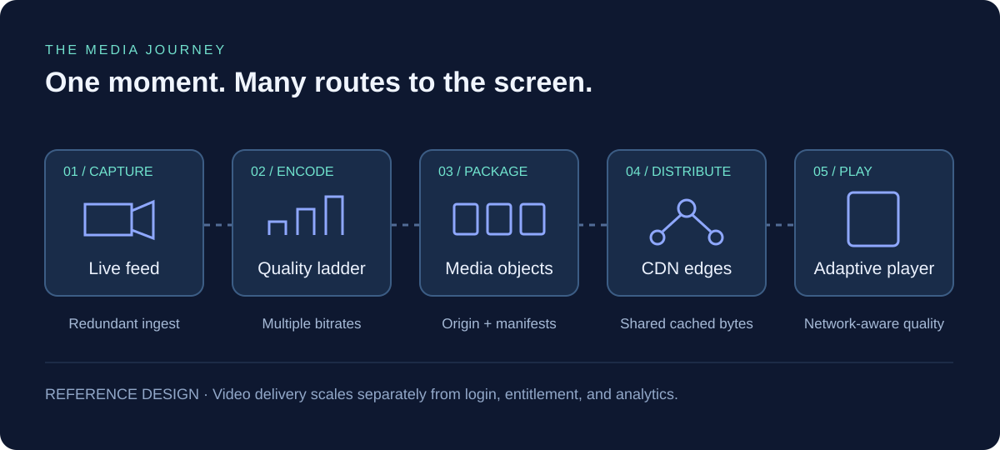
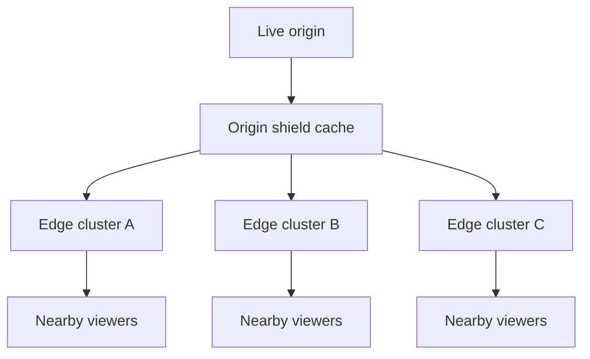
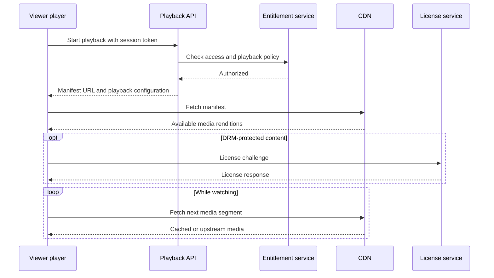
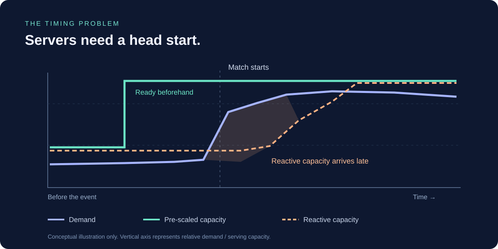
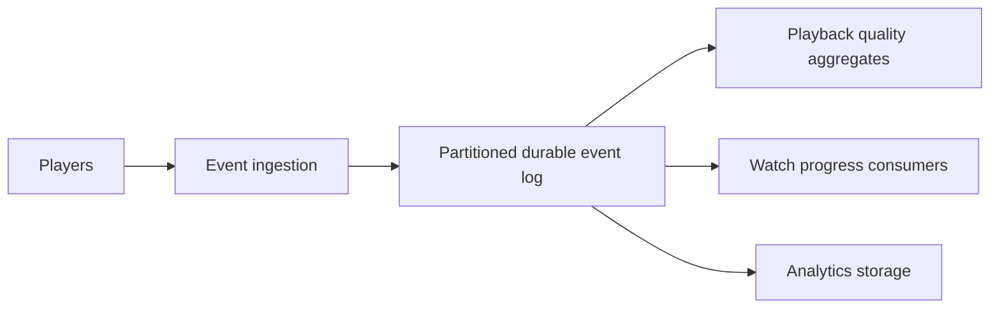

The match is down to the last over. Someone sends a message: **“You have to watch this.”** Across the country, people unlock their phones, open the app, and tap Play within seconds of one another.

For a streaming platform, that moment creates two different emergencies: deliver an uninterrupted picture to people already watching, and get a sudden wave of new viewers through the front door. A third wave arrives after the final ball, when everyone returns to the homepage at once.

JioHotstar operates at a scale where these details matter enormously. Reliance’s FY 2025–26 report says the platform delivered **72.5 million concurrent streams** during the ICC Men’s T20 World Cup final. That is a simultaneous audience, not a season’s total reach. [Source: Reliance annual report](https://www.ril.com/ar2025-26/media-and-entertainment.html).

How does a service make that possible? The useful answer is a combination of distributed video delivery, careful separation of workloads, capacity prepared ahead of demand, and a willingness to simplify the experience when dependencies struggle.

> [!IMPORTANT]
> **How to read this case study.** JioHotstar combines the former JioCinema and Disney+ Hotstar services. Public Hotstar engineering talks describe earlier systems; they do not establish every detail of the merged platform today. Reported milestones and historical practices below have sources. The architecture diagrams, sizing exercises, failure policies, and operational walkthrough are an **illustrative reference design**, not a leaked or verified map of JioHotstar’s current infrastructure.

## 1. First, separate evidence from architecture

| Public evidence | What it tells us | What it does not prove |
| --- | --- | --- |
| AWS reported 18.6 million simultaneous Hotstar viewers for the 2019 IPL final | Large live audiences were already a core engineering problem | Today’s cloud provider mix or deployment topology |
| Hotstar’s AWS re:Invent 2019 session discussed 25.3 million concurrent viewers, limitations of traditional autoscaling, Hulk load testing, and game days | Capacity preparation and failure rehearsal were explicit historical practices | That the same tools and scaling policies remain in production |
| JioStar reported 55.2 million peak concurrency and 652 million digital reach for IPL 2025 | Peak simultaneous demand and tournament reach are distinct metrics | 652 million viewers watching at the same moment |
| Reliance reported 72.5 million concurrent streams for the 2026 T20 World Cup final | The scale of a more recent streaming event | Exact segment lengths, server counts, cache hit ratios, or latency |

Sources: [AWS’s 2019 report](https://aws.amazon.com/blogs/media/in-the-news-hotstar-sets-new-global-record-for-live-viewership/), [Hotstar’s re:Invent session](https://www.youtube.com/watch?v=mFpqrVxxwKc), [JioStar’s IPL 2025 report](https://cdn.jiostar.com/jiostar/wp-content/uploads/2025/08/From-Stadiums-to-Screens_-JioStars-%E2%80%98TATA-IPL-2025_-A-Year-of-Firsts-Report-Highlights-how-a-Billion-Viewers-Came.pdf), and [Reliance’s FY 2025–26 report](https://www.ril.com/ar2025-26/media-and-entertainment.html). The platform integration is described in [Reliance’s FY 2024–25 report](https://www.ril.com/ar2024-25/media-and-entertainment.html).

The rest of this article asks: **what architecture and operating decisions explain how a service at this scale can work?**

## 2. One app, three very different traffic patterns

A viewer sees a single app. Engineers need to distinguish at least three workloads.

| Workload | Examples | Dominant constraint | Useful response |
| --- | --- | --- | --- |
| Video delivery | Playlists, video segments, audio segments | Bandwidth, edge capacity, freshness | CDN caching and adaptive playback |
| Interactive APIs | Login, catalogue, entitlement, playback session | Request rate, tail latency, dependency limits | Stateless capacity, bounded caches, admission control |
| Background events | Playback telemetry, watch progress, analytics | Write volume and processing lag | Queues, batching, independently scaled consumers |

An evening entertainment peak typically builds over minutes: people arrive home and browse different titles. A live match produces synchronized arrivals, synchronized requests for newly published media, and synchronized exits. A push notification can also turn an ordinary premiere into a flash crowd.

```chart
{
  "type": "line",
  "caption": "Illustrative traffic shapes, normalized to a baseline of 1. These are synthetic values, not JioHotstar measurements; the match-end API surge need not coincide with peak video demand.",
  "height": 320,
  "data": {
    "labels": ["Before", "Build-up", "Start", "Mid-event", "Close finish", "Match ends", "After"],
    "datasets": [
      { "label": "Ordinary browsing demand", "data": [1, 1.4, 2, 2.8, 3.2, 2.7, 2] },
      { "label": "Live video demand", "data": [1, 3, 8, 10, 16, 7, 2] },
      { "label": "App API demand", "data": [1, 4, 13, 5, 12, 18, 4] }
    ]
  }
}
```

Notice the last spike. Fewer people watching does not necessarily mean less backend work. Leaving a stream can trigger homepage requests, recommendations, watch-history writes, and searches for highlights.

## 3. Follow one ball from the stadium to the screen

The media path starts with a production feed. A redundant ingest layer receives it; encoders create several quality levels; a packager exposes media segments and manifests; an origin makes those objects available to a content delivery network, or CDN.



For HTTP Live Streaming, or HLS, the player reads playlists and fetches media over HTTP. The protocol supports adaptive playback as network conditions change and works with web servers and CDNs. [Source: Apple’s HLS documentation](https://developer.apple.com/streaming/).

### Encode once per rendition, distribute many times

Imagine three illustrative video renditions: 0.6 Mbps, 1.5 Mbps, and 3 Mbps. A phone on a congested connection can request the lower bitrate; a television on a stable connection can request a higher one. There is no need to encode a unique full video stream for every viewer.

Languages, camera angles, codecs, encryption requirements, and ad variants increase the number of objects. The goal is still to reuse as much media as possible across compatible viewers.

### Live is different from a movie

A movie’s next segment already exists and may already be cached. The next ball in a live match has not happened yet. Each new live segment creates a fresh burst of demand when it becomes available.

Versioned media objects can be cached for a relatively long time. A live playlist needs a freshness policy appropriate to its update cadence. Making that playlist stale for too long can leave a healthy player looking at yesterday’s live edge—or, more realistically, falling seconds behind the action.

## 4. The CDN carries the bandwidth

Use a round **50 million concurrent viewers** for a sizing exercise. This is an assumption, not a claim about a particular match.

| Assumption or calculation | Result |
| --- | --- |
| Average delivered bitrate: 2 Mbps per viewer | Includes a simplified media bitrate assumption |
| 50 million × 2 Mbps | **100 Tbps** of aggregate delivery |
| 100 Tbps ÷ 8 | **12.5 TB per second**, in decimal units |
| 12.5 TB/s × 3,600 | **45 PB per hour** if that load stays constant |
| One video segment every 4 seconds per viewer | **12.5 million video segment requests/s** on average |

The request calculation excludes audio, playlist refreshes, retries, subtitles, and low-latency partial segments. The bandwidth calculation excludes protocol overhead and assumes a steady audience and bitrate. It is a scale estimate, not a bill.

Sending that workload through application servers would couple every video byte to the backend. A CDN moves delivery onto geographically distributed servers, where many viewers can reuse the same cached media object.



*Reference topology: arrows show media delivery. Cache misses travel upstream in the reverse direction.*

An **origin shield** is an additional cache layer between edge clusters and origin. **Request coalescing** lets many simultaneous misses for one object share an upstream fetch instead of triggering identical origin requests.

Even excellent cache ratios need context. If 12.5 million requests/s had a 99% edge hit ratio, approximately 125,000 requests/s would still travel upstream from that layer. At 99.9%, that becomes 12,500. Those requests may hit a shield; they are not automatically origin requests. Request-hit ratio also differs from byte-hit ratio.

### Personalization can quietly destroy cache efficiency

Suppose every viewer gets a different query token in a segment URL. If the cache keys on the entire URL, identical media can become millions of distinct cache entries.

A reference design validates authorization while using a safe shared cache key for identical media. Signed cookies or carefully configured token handling can help. Authorization must remain enforced: stripping security-relevant fields without an equivalent access check would expose protected content.

Multiple CDNs can provide additional delivery options, but failover is not free. Moving a large audience to a cold provider creates cache misses and sudden capacity demand. Steer traffic gradually, maintain tested spare capacity, and use regional playback signals rather than only a global availability number. These are design recommendations, not a claim about JioHotstar’s provider contracts.

## 5. Keep playback bytes separate from playback permission

The backend still has essential work. Before playback starts, it may need to validate a session, check entitlement, enforce concurrency policy, and issue a playback URL. Protected content may also require a DRM license exchange.



*Illustrative playback flow; actual clients can order requests differently and refresh authorization during a session.*

The expensive permission decision is not repeated as a database round trip for every video segment. Access remains enforced through the delivery mechanism, with an appropriate expiration and revocation model.

Now consider **5 million viewers arriving in one minute**. That averages roughly 83,333 playback starts per second. If each start needs four backend requests, the aggregate is roughly 333,333 requests/s, before retries or internal fan-out. These numbers are synthetic, but the distinction matters: a CDN can be healthy while the playback API prevents new viewers from joining.

## 6. Handle everyday spikes with elastic, bounded services

For a gradually rising evening peak, reactive scaling can work well if the system has enough headroom to cover startup time.

In this reference design, load balancers spread requests across stateless service instances. Shared session state lives outside individual instances. Frequently requested catalogue data is cached; durable data remains in a system of record. Services scale independently so a search surge does not require scaling every component.

### Scale using the bottleneck that matters

CPU is one signal, but an API waiting on database connections can fail with modest CPU usage. Useful inputs include requests per ready instance, in-flight work, queue age, dependency latency, and connection-pool saturation.

For example, assume a load test finds that one instance safely handles 400 requests/s at the desired tail latency. A forecast of 80,000 requests/s needs 200 instances at that tested limit. Operating at 65% of the limit requires approximately **308 ready instances**: 80,000 ÷ (400 × 0.65), rounded up. This assumes sufficiently similar requests and no shared downstream bottleneck.

### Bound the work, not just the instance count

Every queue and connection pool needs a limit. Otherwise, “accept everything” becomes “make everything slow.” Rate limits protect expensive operations; deadlines prevent requests from waiting indefinitely; circuit breakers prevent repeated calls to an unhealthy dependency.

Cache expiration also needs care. If a popular title expires everywhere at once, every instance may query the database simultaneously. Jittered TTLs, a single refresh per key, and stale-while-revalidate for suitable catalogue data reduce this stampede. Stale subscription or payment state requires stricter treatment than stale artwork.

## 7. Match-day spikes need capacity before the crowd

Historical Hotstar engineers explicitly discussed why traditional autoscaling was insufficient for their traffic, along with Hulk load testing and pre-event game days. [Source: AWS re:Invent 2019 session](https://www.youtube.com/watch?v=mFpqrVxxwKc).

The general reason is straightforward: a new instance is not useful until infrastructure is allocated, software starts, caches and connections warm up, and readiness checks pass. Demand can arrive faster than that sequence completes.



A practical reference strategy combines three mechanisms:

1. **Scheduled preparation:** bring capacity online before a known match, notification campaign, or premiere.
2. **Forecast-based headroom:** allow for uncertain arrivals and a failure of part of the system, using measured service limits.
3. **Reactive correction:** adjust using actual traffic and saturation, then scale down cautiously.

Pre-scaling an API is only useful if its dependencies can keep up. Check compute quotas, network addresses, load-balancer capacity, database connections, cache memory, license service limits, and upstream identity providers. Doubling frontends can otherwise double pressure on an already saturated database.

Keep spare capacity through the post-match transition. The backend can be busiest when viewers stop watching.

## 8. Buffer analytics; preserve correctness for money

At 50 million viewers, one heartbeat every 30 seconds averages approximately **1.67 million events/s**. If every device fires on the same boundary, the instantaneous burst is worse. Randomize timing and batch where the product allows it.



*Reference event pipeline, independent of the video segment delivery path.*

A queue absorbs a temporary mismatch between production and consumption; it does not create infinite processing capacity. Track lag, retention, and recovery throughput. Partitioning only by match ID would put a massive match on one hot partition; a suitable viewer or session key can spread work while preserving the ordering a consumer actually needs.

Retries can produce duplicate events, so consumers need idempotency or deduplication where duplicates affect results. Sampling diagnostics under pressure may be acceptable. Silently dropping billing events or losing confirmed purchases is not.

For payments, retain durable transaction state, idempotency keys, and reconciliation. A timeout means the outcome may be unknown; it is not evidence that a charge failed.

## 9. Fail gracefully without compromising access rules

Imagine recommendations becoming slow during a close finish. Making playback wait for a personalized homepage converts an optional feature failure into a streaming outage.

| Component under pressure | Possible reference-design response | Boundary to preserve |
| --- | --- | --- |
| Recommendations | Serve a cached popular-content list | Avoid blocking playback initiation |
| Thumbnails and catalogue | Serve acceptable stale content | Respect content takedown requirements |
| Detailed telemetry | Sample or defer lower-priority events | Preserve essential accounting and security events |
| One delivery route | Shift a bounded share to a healthy route | Check alternate capacity and player compatibility |
| Entitlement or DRM | Use only permitted, time-bounded existing authorization | Do not invent access or bypass rights checks |
| Payments | Return a pending state and reconcile | Do not blindly retry a charge |

Retries deserve special attention. If every player retries instantly after a failure, the platform receives more traffic precisely when it can handle less. Use bounded retries, exponential backoff, jitter, and a shared deadline. An API chain with retries at several layers can multiply work far beyond the original request rate.

Failure domains also matter. A regional recovery plan needs enough surviving capacity and a tested way to move traffic. Replication alone does not prove that failover will fit within database, network, or delivery limits.

## 10. The player participates in reliability

A backend dashboard can be green while viewers see buffering. Playback depends on the device, access network, ISP route, CDN, and media pipeline together.

Adaptive bitrate selection balances visual quality against the risk of running out of buffered media. A conservative starting rendition can improve time to first frame; the player can step up after observing sustained throughput. Aggressive quality changes can create oscillation and repeated stalls.

Live latency introduces another trade-off. More buffered media provides protection against transient network trouble but moves the viewer farther from the action. Shorter segments or partial segments can reduce delay while increasing request frequency and tightening freshness requirements. A low-latency design must account for encoder, packager, cache, network, and player behavior together. [See Apple’s HLS resources](https://developer.apple.com/streaming/).

For a worked introduction to segments and playlists, see [building HLS streaming with FFmpeg and Java](/blog/hls-streaming-ffmpeg-java).

## 11. Rehearse the event, not just a high request rate

A realistic test includes login bursts, fresh-cache misses, playback starts, steady viewing, license renewals, ad breaks, reconnects, and mass exits. Replaying a constant stream of cheap homepage requests cannot establish match readiness.

An illustrative event runbook looks like this:

| Phase | Engineering focus |
| --- | --- |
| Days before | Forecast by service and geography; test failures; verify vendor limits and recovery capacity |
| Hours before | Prepare capacity, warm safe caches, verify redundant feeds and playable output |
| Before play | Confirm readiness, configuration, licenses, routing, and rollback options |
| During the match | Track playback quality by region, ISP, device, and delivery route; adjust cautiously |
| Final overs | Watch arrival rates, tail latency, retries, and the remaining capacity margin |
| After the match | Hold API capacity through exits, homepage demand, and highlights traffic |
| Recovery | Drain deferred work, reduce capacity gradually, and review user-visible failures |

Fault injection should answer concrete questions: What happens when an origin is slow? When a cache is cold? When a license dependency reaches its limit? When a delivery provider loses a region? The test is successful when the system responds within an explicit objective, not merely when a failover switch exists.

### Measure what viewers experience

- **Playback-start success:** how many eligible play attempts reach a first frame?
- **Time to first frame:** report tail percentiles as well as the median.
- **Rebuffering ratio:** define the denominator consistently, such as stalled time divided by playback-session duration.
- **Live-edge distance:** how far behind the action is the viewer?
- **Delivered quality:** bitrate and resolution alongside stalls, not in isolation.
- **Service health:** API tail latency, cache misses, origin errors, license failures, queue age, and retry volume.

A countrywide average can hide a severe issue on one ISP. Segment these measurements by meaningful cohorts, while avoiding excessive cardinality and unnecessary personal data. Set numerical objectives from product requirements and observed baselines; the public sources here do not disclose JioHotstar’s internal SLOs.

## 12. Efficiency means spending on the right layer

At this scale, bitrate affects both user experience and delivery cost. In the 50-million-viewer example, reducing average delivered bitrate from 2 Mbps to 1.8 Mbps saves **10 Tbps**, or **4.5 PB per hour** at a constant audience. Whether that is worthwhile depends on perceptual quality, codec support, encoding cost, and actual delivery pricing.

Similarly, better caching reduces upstream work, but aggressive caching must not sacrifice playlist freshness or authorization. Autoscaling saves compute during quieter periods, but eliminating all headroom makes a flash crowd harder to absorb. Queues smooth writes, but delayed processing has a product cost.

The central lesson is architectural: **reuse video bytes near viewers, reserve backend capacity for decisions that need it, and prepare the whole dependency chain for synchronized demand.** Ordinary evening traffic and a dramatic final over share the same infrastructure principles, but require different operating rhythms.

JioHotstar’s reported audience milestones show the scale of the challenge. Historical Hotstar disclosures show that preparation and rehearsal were part of the response. The reference design in this article connects those public facts to the engineering choices a streaming team must make—without pretending that a public case study reveals every production detail.

## Sources and further viewing

- [Reliance FY 2025–26: Media and Entertainment](https://www.ril.com/ar2025-26/media-and-entertainment.html) — reported 72.5 million concurrent streams for the 2026 final.
- [Reliance FY 2024–25: Media and Entertainment](https://www.ril.com/ar2024-25/media-and-entertainment.html) — JioCinema and Disney+ Hotstar integration context.
- [JioStar: IPL 2025, A Year of Firsts](https://cdn.jiostar.com/jiostar/wp-content/uploads/2025/08/From-Stadiums-to-Screens_-JioStars-%E2%80%98TATA-IPL-2025_-A-Year-of-Firsts-Report-Highlights-how-a-Billion-Viewers-Came.pdf) — digital reach and peak concurrency, separately reported.
- [AWS: Hotstar’s 2019 live-viewership milestone](https://aws.amazon.com/blogs/media/in-the-news-hotstar-sets-new-global-record-for-live-viewership/) — historical context.
- [Apple: HTTP Live Streaming](https://developer.apple.com/streaming/) — protocol and adaptive-streaming resources.

```youtube
https://www.youtube.com/watch?v=mFpqrVxxwKc
Historical engineering talk: Scaling Hotstar.com for 25 million concurrent viewers, AWS re:Invent 2019. This describes the earlier Hotstar platform.
```
