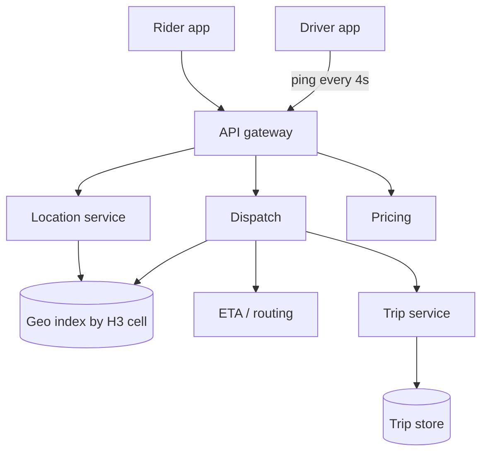
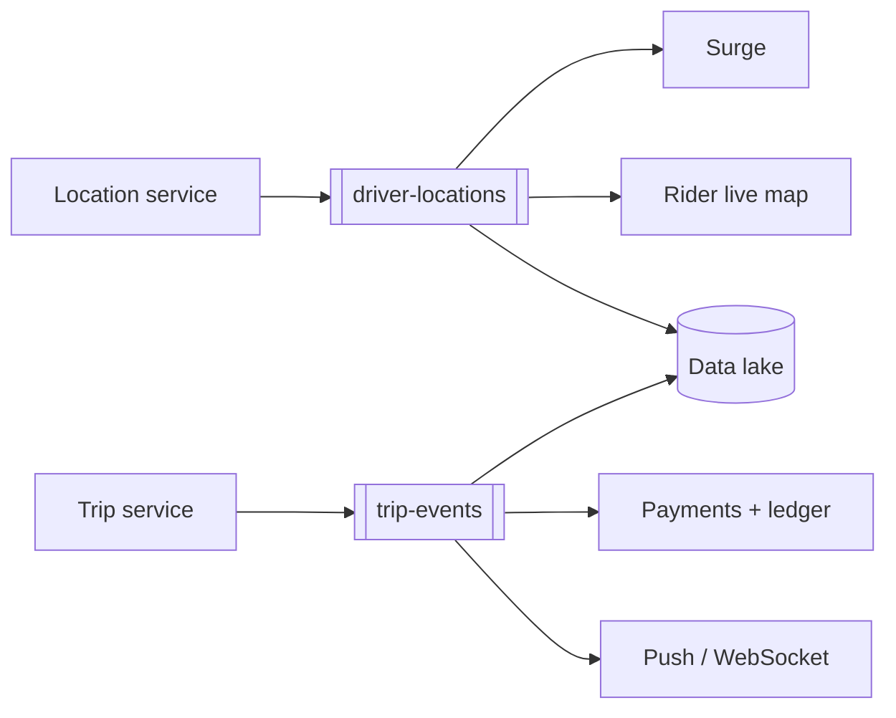
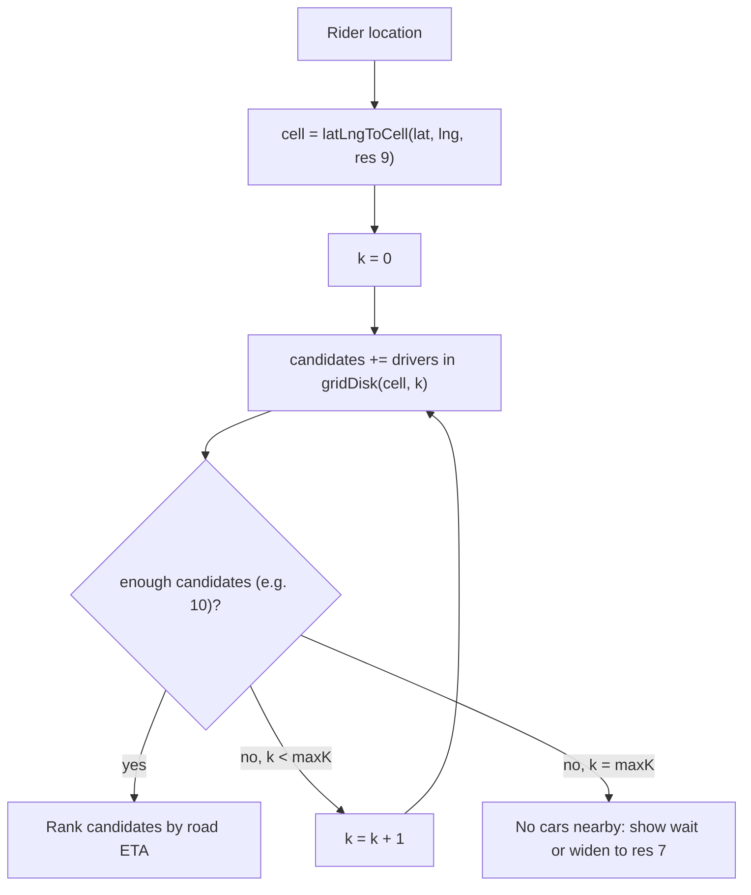
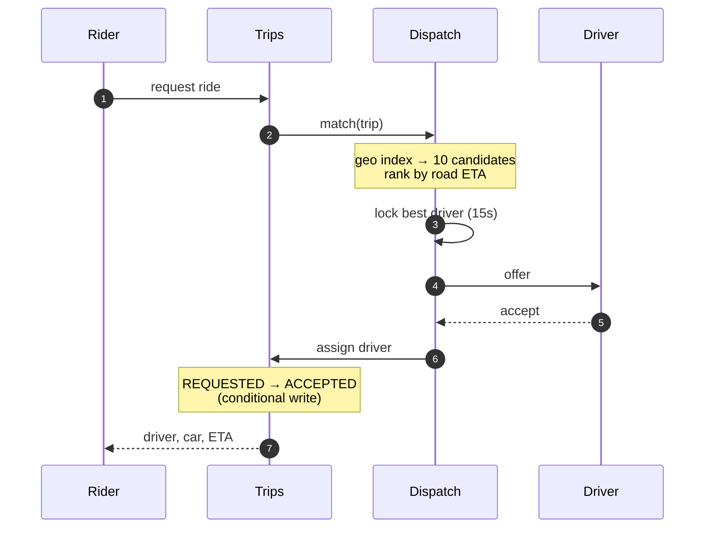
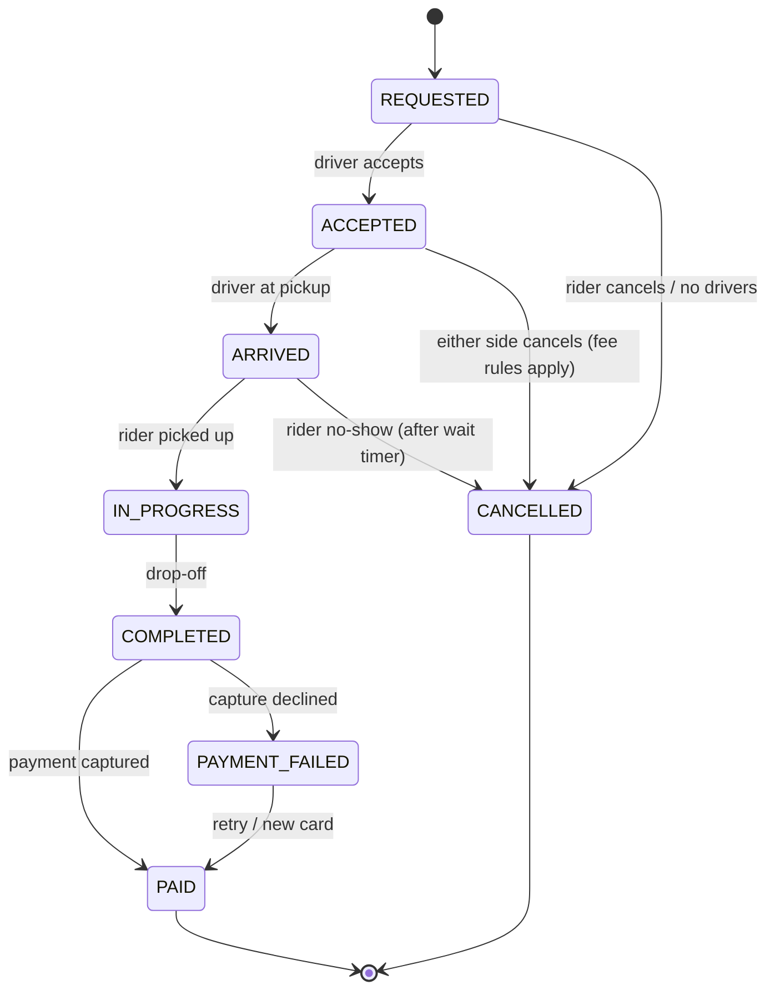
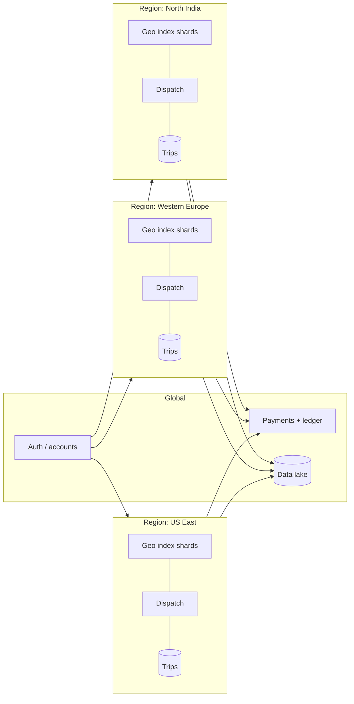

"Design Uber" is the system design question everybody gets eventually, and most answers stop
at *"put the drivers in Redis and find the nearest one."* That works on a whiteboard. It falls apart once
a few million phones send their location every few seconds, two riders ask for the same driver in the same
second, and the payment provider times out halfway through a capture.

This post walks the full path: **a driver's GPS ping → the geo index → matching → the trip → pricing → payment**.
For each piece I cover the design choice and what it costs.

> [!NOTE]
> The numbers below are back-of-the-envelope assumptions for sizing, not Uber's real figures. Where I
> mention how Uber actually does something, it comes from their public engineering blog and open-source projects.

## 1. What are we building?

### Functional requirements

- **Riders** see nearby cars, get a fare estimate, request a ride, track the driver live and pay in the app.
- **Drivers** go online or offline, stream their location, accept or decline offers and navigate the trip.
- **The platform** matches riders with drivers, computes ETAs and prices (including surge), and settles payments.
- **Both sides** rate each other and can see their trip history.

### Non-functional requirements

| Concern | Target | Why it matters |
| --- | --- | --- |
| Match latency | under 1–2 s from request to driver offer | Riders give up quickly |
| Location freshness | under 5 s old | A stale position gives a wrong ETA and a wrong match |
| Availability | 99.99% for request and dispatch | Downtime is money lost for the rider, the driver and Uber |
| Consistency | One driver gets **at most one** active trip | Double-booking is a hard failure |
| Payments | Exactly-once charge | Charge a rider twice and you lose them for good |
| Scale | Hundreds of cities, sharp local peaks | A stadium emptying out hits one cell very hard |

The rule that shapes everything else: **availability and low latency for location and matching,
strong consistency for trip state and money.** These are two different kinds of system, and the
design keeps them apart.

## 2. Back-of-the-envelope sizing

Let's assume:

- 5M drivers online at the global peak, each sending a location ping **every 4 seconds**
- 25M trips per day
- 100M monthly riders, with roughly 10× more "open the app and look" sessions than actual requests

| Metric | Math | Result |
| --- | --- | --- |
| Location writes | 5M ÷ 4 s | **~1.25M writes/s** |
| Ping payload | id, lat, lng, heading, speed, timestamp, status | ~100 bytes |
| Location ingest bandwidth | 1.25M × 100 B | ~125 MB/s |
| Trip requests (average) | 25M ÷ 86,400 | ~290/s |
| Trip requests (peak, ~5× average) | | ~1,500/s |
| Raw location history per day | 1.25M × 100 B × 86,400 | **~10 TB/day** |

Two things stand out:

1. **Location is the firehose.** Writes outnumber trip requests by about 1000:1, so they get a
   dedicated, mostly in-memory path, and only a sample goes to durable storage.
2. **Trips are low-volume but high-value.** A few thousand writes a second is easy for a sharded
   relational or document store, as long as every write is correct.

Demand also comes in waves. In a single city it follows commute peaks and the late-night bar rush:

```chart
{
  "type": "line",
  "caption": "Illustrative ride requests per minute in one large city over a weekday (assumed shape, not real data)",
  "height": 300,
  "data": {
    "labels": ["00", "02", "04", "06", "08", "10", "12", "14", "16", "18", "20", "22"],
    "datasets": [
      { "label": "Requests / min", "data": [620, 310, 140, 520, 1480, 900, 1020, 880, 1150, 1640, 1210, 980], "fill": true }
    ]
  }
}
```

You size for the peaks, not the average, and the peaks are **local**. That's why the system is sharded
by geography, which comes up again in section 12.

## 3. High-level architecture

Here's the request path, everything a rider or driver waits on:



Everything else hangs off Kafka, so nothing on the request path waits for it:



The pieces fall into three groups:

- **Real-time plane**: location, geo index, dispatch and ETA. Latency matters most here, and losing
  a few seconds of state is acceptable.
- **Transactional plane**: trips, payments and the ledger. Correctness matters most here, so writes
  are durable and idempotent.
- **Event backbone**: Kafka carries location and trip events to pricing, notifications, analytics and fraud
  checks, without the hot path waiting on any of them.

## 4. Location ingestion

Every online driver sends a small ping:

```json
{
  "driverId": "d_8f2c",
  "lat": 28.4595,
  "lng": 77.0266,
  "heading": 212,
  "speedMps": 9.4,
  "status": "AVAILABLE",
  "ts": 1767052800123
}
```

### Transport

At 1.25M writes per second, a fresh HTTPS request for each ping wastes a lot of work on TLS handshakes
and headers. Better options:

- A **persistent connection** (WebSocket, MQTT or gRPC streams) per driver, held by a fleet of
  connection-gateway nodes. The gateway is stateless apart from the open socket.
- **Batching** on the client: when the network is poor, the phone buffers pings and sends them together,
  each with its original timestamp.

### What happens to a ping

1. The gateway authenticates the ping and passes it to the **Location service**, sharded by H3 cell
   (section 5).
2. The service checks the ping is plausible. Rejected examples are a driver jumping 30 km in 4 seconds,
   an old timestamp arriving after a newer one, or a mocked GPS flag.
3. It **updates the in-memory index**: removes the driver from the old cell if they've moved, adds them
   to the new one, and stores the latest position with a TTL.
4. It publishes the ping to **Kafka**. Downstream consumers then work independently: the rider's live
   map, surge, fraud checks, and trip-distance tracking for billing.

> [!TIP]
> Give every location key a TTL of about 3× the ping interval (around 12 s here). If a driver's phone dies
> or loses signal, they drop out of the index on their own. No cleanup job is needed, and dispatch never
> offers a ride to a ghost.

### Storage

The *current* position goes in memory (Redis or a custom in-memory service). The *history* is
needed only for billing disputes, ETA model training and safety investigations, so it's sampled and
written to cheap storage: Kafka → object storage (e.g. Parquet on S3/HDFS). Writing 10 TB a day of
pings into an OLTP database is the classic mistake here.

## 5. The geospatial index: finding cars near a point

The core query is *"which available drivers are within X km of this rider?"* Checking the distance to every
driver in a city on every request doesn't scale. The usual options are:

| Approach | How it works | Strengths | Weaknesses |
| --- | --- | --- | --- |
| **Geohash** | Interleaves lat/lng bits into a string prefix | Simple, works with any key-value store, built into Redis `GEOSEARCH` | Cells are rectangles that distort with latitude; points close together can sit in cells with very different prefixes |
| **Quadtree** | Recursively splits busy areas into 4 | Adapts to density (Manhattan vs. a farm) | Has to be rebalanced as drivers move; awkward to shard |
| **S2** (Google) | Projects the sphere onto a cube, then a Hilbert curve | Good cell-range queries | Square cells; neighbour distances vary |
| **H3** (Uber) | Hexagons over an icosahedron, 16 resolutions | Every neighbour is the same distance away; easy rings | Cells don't nest perfectly (7 children only approximately cover a parent) |

Uber built and open-sourced **[H3](https://h3geo.org/)** for exactly this problem. Hexagons matter because
a hexagon's 6 neighbours are all the same distance from its centre, while a square has 4 edge neighbours
and 4 farther corner neighbours. That makes "expand the search by one ring" behave the same in every
direction, which keeps both nearest-driver search and surge smoothing simple.

### Index layout

At resolution 8 or 9 (cells roughly 0.1–0.7 km²) a city has a few thousand to tens of thousands of cells:

```
cell:{h3Index}  → set of driverIds currently AVAILABLE in that cell
driver:{id}     → { lat, lng, heading, cell, status, ts }   (TTL 12s)
```

### Searching outward ring by ring



With Uber's [h3-java](https://github.com/uber/h3-java) library:

```java
public List<String> nearbyDrivers(double lat, double lng, int wanted, int maxRings) {
    long origin = h3.latLngToCell(lat, lng, 9);
    Set<String> found = new LinkedHashSet<>();

    for (int k = 0; k <= maxRings && found.size() < wanted; k++) {
        // gridDisk includes inner rings again; fine for small k.
        // For larger radii, read only the new outer ring.
        for (long cell : h3.gridDisk(origin, k)) {
            found.addAll(geoIndex.availableDriversIn(cell));
        }
    }
    return new ArrayList<>(found);
}
```

> [!IMPORTANT]
> A straight-line nearest driver is not the closest driver. A car 300 m away on the other side of a
> river or a divided highway can be 12 minutes out. The geo index only produces **candidates**. They are
> then **ranked by road-network ETA** (section 7).

## 6. Matching: dispatching a ride

### The happy path



In words: the trip is created as `REQUESTED` with the rider's idempotency key; dispatch asks the
geo index for nearby candidates, ranks them by road ETA, locks the best one and sends the offer;
on accept, the trip moves to `ACCEPTED` and the rider sees the car.

### Never double-book a driver

Two dispatch workers can pick the same driver for two different riders at the same moment. Locking the
driver closes that race:

```java
// Returns true only for the first dispatcher to claim this driver.
boolean claimDriver(String driverId, String tripId) {
    return redis.set(
        "lock:driver:" + driverId,
        tripId,
        SetParams.setParams().nx().px(15_000)  // expires if unanswered
    ) != null;
}
```

The lock is only a fast first guard. The real guarantee is a **conditional write on the trip
store** when the driver accepts:

```sql
UPDATE driver_state
   SET status = 'ON_TRIP', current_trip_id = :tripId, version = version + 1
 WHERE driver_id = :driverId
   AND status = 'AVAILABLE'
   AND version = :expectedVersion;  -- 0 rows = someone else won
```

If the lock service fails over and briefly hands the same driver to two dispatchers, the version
check still lets only one trip win. That's why the lock alone isn't enough.

### Greedy vs. batched matching

**Greedy** matching gives every request the nearest free driver the moment it arrives. It's simple, but
it makes poor choices overall: rider A takes the driver who was the *only* good option for rider B,
who requested 2 seconds later.

**Batched** matching collects requests for a short window (say 2–5 seconds) and solves the whole batch at
once as an assignment problem. It minimises total pickup ETA across all riders, not each rider's ETA
separately. The Hungarian algorithm or a min-cost-flow solver handles a few hundred × a few hundred
easily within the window.

```chart
{
  "type": "bar",
  "height": 280,
  "caption": "Illustrative simulation: average pickup ETA (minutes) by matching strategy at three demand levels (assumed numbers)",
  "data": {
    "labels": ["Low demand", "Normal", "Peak"],
    "datasets": [
      { "label": "Greedy (match immediately)", "data": [3.1, 4.6, 8.9] },
      { "label": "Batched (3 s window)", "data": [3.3, 4.1, 6.4] }
    ]
  }
}
```

The pattern to notice: batching costs a little at low demand, because riders wait for the window to
close, and gains a lot at peak, when choices conflict. A practical design **changes the window length
with load**, close to zero when a cell is quiet and a few seconds when it's busy.

### When the driver says no

An offer can be declined or time out. Dispatch then releases the lock, marks that driver as excluded for
this trip, and moves to the next candidate. After N attempts or T seconds, the rider is told no cars are
available. Every step is logged as a trip event, which later helps tune acceptance-rate models.

## 7. ETA and routing

ETA shows up everywhere: the "4 min" on the home screen, ranking dispatch candidates, the upfront fare,
and the arrival time shown during the trip.

1. **Road graph**: OpenStreetMap-style nodes and edges, with each edge weighted by travel time
   instead of distance.
2. **Fast shortest-path**: plain Dijkstra across a whole city is too slow to run thousands of times
   a second. Techniques like **contraction hierarchies** precompute shortcut edges so a query only
   touches a small part of the graph and returns in milliseconds.
3. **Live traffic**: the location stream from Kafka gives real speeds on each road segment, which
   update edge weights every minute or so.
4. **ML correction**: routing engines are consistently wrong in some places (pickup spots, airports,
   left turns). Uber has written about [DeepETA](https://www.uber.com/blog/deepeta-how-uber-predicts-arrival-times/),
   a model that predicts the *gap* between the routing engine's ETA and the real arrival time.

> [!TIP]
> Dispatch needs ETAs from 10 candidates to 1 pickup point, which is a one-to-many query. Run one
> reverse search from the pickup instead of 10 separate forward searches. It's roughly 10× less work for
> the same answer.

## 8. The trip lifecycle

A trip is a state machine, and the trip service enforces every transition with a conditional write
(`WHERE status = :expected`):



Each transition publishes an event (`TripAccepted`, `TripCompleted`, ...) to Kafka. Notifications,
payments, receipts, driver earnings and analytics all react to these events. None of them calls the
trip service directly, so a slow receipt mailer can never block a rider getting into the car.

> [!WARNING]
> Updating the database and then publishing to Kafka is two writes, and a crash between them loses
> the event. Use the **transactional outbox** pattern: write the event to an `outbox` table in the
> same database transaction as the state change, then have a relay (or CDC tool such as Debezium)
> publish from that table to Kafka.

Long, multi-step flows such as "complete trip → compute fare → capture payment → pay driver → send
receipt" are a good fit for a durable workflow engine. Uber built and open-sourced
[Cadence](https://cadenceworkflow.io/) for this, and Temporal grew out of it. The workflow survives
restarts and retries each step on its own schedule.

## 9. Pricing and surge

### Upfront fare

```
fare = (base + perKm × routeKm + perMin × routeMin) × surgeMultiplier + fees, clamped to the minimum fare
```

The quote gets a `fareQuoteId` and a short expiry (a few minutes), and the trip request has to
reference it. That way the rider pays the price they saw, even if surge changes a second later.

### Surge

Surge balances the market in each H3 cell. When demand (open apps and requests) outgrows supply
(available drivers), the price rises. That reduces demand and draws nearby drivers in.

```chart
{
  "type": "line",
  "height": 300,
  "caption": "Illustrative supply and demand in one cell as a concert lets out (assumed numbers)",
  "data": {
    "labels": ["22:00", "22:05", "22:10", "22:15", "22:20", "22:25", "22:30", "22:35", "22:40"],
    "datasets": [
      { "label": "Ride requests (5 min)", "data": [18, 22, 95, 240, 310, 220, 140, 70, 35] },
      { "label": "Available drivers", "data": [30, 28, 26, 40, 85, 150, 160, 120, 60] }
    ]
  }
}
```

The resulting multiplier for that cell might look like this:

| Window | Demand ÷ supply | Multiplier |
| --- | --- | --- |
| 22:00 | 0.6 | 1.0× |
| 22:15 | 6.0 | 2.1× |
| 22:20 | 3.6 | 1.8× |
| 22:30 | 0.9 | 1.0× |

How it's built:

- A **stream job** (Flink, Kafka Streams or similar) reads `driver-locations` and `trip-events`, counts supply
  and demand for each cell in sliding windows, and writes multipliers to a fast key-value store every
  ~30–60 s.
- **Smoothing** across neighbouring cells (H3 `gridDisk` again) avoids a 2.5× cell sitting next to a
  1.0× cell, which would just make riders walk 100 m.
- **Damping** limits how fast the multiplier can change, so prices don't swing every few seconds.

## 10. Payments: exactly-once in an at-least-once world

### The flow

1. **Authorise at request time**: put a hold on the rider's card for the estimated fare. This catches
   declined cards before the driver drives over.
2. **Capture at trip end**: take the final amount, which can differ from the estimate because of
   route changes, tolls or waiting time.
3. **Record in a double-entry ledger**: each movement is an immutable pair of entries (rider debit,
   driver credit, platform fee). Balances are always *derived* from the entries, never edited in place.
4. **Pay drivers** on a schedule (daily or weekly, or instantly if they request it), driven by the ledger.

### Idempotency everywhere

Networks retry. The mobile app retries. Kafka consumers can see the same message twice. Every operation that
moves money must be safe to repeat:

```java
@Transactional
public PaymentResult capture(String tripId, Money amount) {
    String key = "capture:" + tripId;                     // one capture per trip, ever

    Optional<PaymentRecord> existing = payments.findByIdempotencyKey(key);
    if (existing.isPresent()) return existing.get().toResult();  // replay

    // Unique index on the key: a concurrent retry fails here.
    PaymentRecord pending = payments.save(PaymentRecord.pending(key, tripId, amount));
    // The payment provider dedupes on the same key too.
    PspResponse resp = psp.capture(pending.authId(), amount, key);
    ledger.post(LedgerEntry.tripCharge(tripId, amount, resp.reference()));
    return payments.save(pending.complete(resp)).toResult();
}
```

The **unique index on the idempotency key** turns two concurrent retries into one success and one
constraint violation, which the caller treats as "already done."

> [!CAUTION]
> If the payment provider call times out, you **don't know** whether the charge happened. Never retry with a
> new key. Retry with the *same* key (the provider dedupes it), or run a reconciliation job that asks the
> provider for the real status. "Timeout, so retry with a new key" is how riders get charged twice.

## 11. Data storage: the right store for each job

| Data | Access pattern | Store | Why |
| --- | --- | --- | --- |
| Live driver positions | 1M+ writes/s, radius reads | In-memory (Redis / custom), sharded by cell | Speed; state rebuilds from pings within seconds |
| Trips | Key lookups, conditional updates, per-user history | Sharded MySQL/Postgres or a consistent document store | Strong consistency for state transitions |
| Ledger / payments | Append-only, auditable | Relational DB with strict constraints | Correctness and audit beat everything else |
| Users, drivers, vehicles | Read-heavy profiles | Relational + cache | Small, changes rarely |
| Location history | Write-once, scanned in bulk | Kafka → object storage (Parquet) | ~10 TB/day; cheap and good for analytics |
| Events | Fan-out to many consumers | Kafka | Decoupling, replay, back-pressure |
| Surge multipliers, fare quotes | Hot reads, short TTL | Redis | Recomputed every minute |

Uber has written about building **Schemaless** (a key-value layer on top of sharded MySQL) and later
**Docstore** for its trip-scale data. The lesson isn't "build your own database." It's that a boring,
well-understood storage engine with sharding and idempotent writes layered on top goes a long way.

## 12. Scaling: shard by geography

Almost every interaction is local. A rider in Delhi never needs a driver in São Paulo. So **partition
the real-time plane by region**:



- Inside a region, geo-index shards are keyed by **H3 cell at a coarse resolution** (e.g. res 4–5).
  A dense city spreads across many shards; a sparse region shares one.
- **Hot spots** (an airport, New Year's Eve in one square) are handled by splitting the hot parent cell
  into its children across more shards, and by replicating reads.
- Near shard borders, a ring search may cross into neighbouring cells on another shard, so the query fans out
  to at most a few shards and merges the results.
- Uber's early dispatch used **[Ringpop](https://github.com/uber-node/ringpop-node)**, a
  consistent-hashing ring with gossip membership, so any node could forward a request to the node that
  owns a given cell. Today most teams would get the same result from Kubernetes plus a service mesh,
  or from a sharding library.

## 13. Failure modes and what to do about each

| What breaks | What the user sees | Mitigation |
| --- | --- | --- |
| Driver loses signal mid-trip | Car "freezes" on the rider's map | Client buffers pings and sends them on reconnect; server interpolates; billing uses the reconciled route afterwards |
| Geo-index node dies | Fewer cars visible briefly | Replicas; rebuild from the next 4 s of pings; the TTL removes stale entries |
| Dispatch node dies mid-offer | Rider waits longer | Lock TTL expires; trip still `REQUESTED`; another dispatcher's sweeper picks it up |
| Kafka consumer lag | Surge or live map slightly stale | Alert on lag; surge falls back to the last good value; the real-time plane doesn't depend on it |
| Payment provider outage | Capture fails | Trip goes to `PAYMENT_FAILED`; retry with the same idempotency key; let the ride finish and settle later |
| Region-wide outage | App unavailable in that region | Active-passive standby region with trips replicated; drivers reconnect, and the in-memory index rebuilds from pings |

The common thread: **real-time state is disposable and rebuilds itself from the stream, while
transactional state is durable and protected by conditional, idempotent writes.**

## 14. Interview cheat sheet

If you're presenting this in 45 minutes, this order works:

- [x] Requirements and the **1000:1 write ratio** between location and trips
- [x] Location ingest over persistent connections, **in-memory index with TTL**, Kafka for everything else
- [x] **H3** (or geohash) index, ring search, then **rank by road ETA**
- [x] Dispatch with a **driver lock + conditional write**; mention batched matching
- [x] Trip **state machine**, outbox pattern, events to consumers
- [x] **Surge** per cell with smoothing
- [x] Payments: **authorise → capture**, idempotency keys, ledger
- [x] **Shard by geography**; failure modes

Each of these sections could be its own post, and I'll probably write a deeper one on the dispatch
matcher. If there's a part you'd like covered in more depth, [tell me](mailto:tanmaysinghx@gmail.com).
