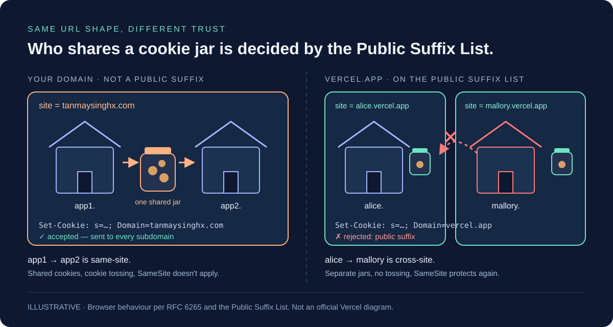
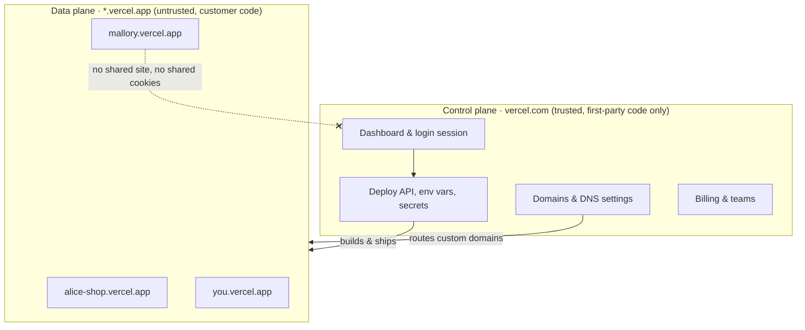

You push a side project to Vercel. Thirty seconds later you have a URL:

```text
https://my-side-project.vercel.app
```

Not `my-side-project.vercel.com`. Vercel owns `vercel.com`, it is the brand everyone knows, and it is shorter to explain to your mum. So why a whole separate domain, on a TLD most people had never heard of before 2018?

Because **your project's neighbours are strangers**. Millions of people deploy code onto Vercel, and some of it is written by people who would love to read your users' cookies. The `.app` domain isn't branding. It's a wall, and it's built from a few quiet browser rules most developers never look at.

Those rules don't only apply to Vercel. They apply to **your** domain too. If you run `app1.tanmaysinghx.com` and `app2.tanmaysinghx.com`, you've built the same neighbourhood, just without the wall.

> [!IMPORTANT]
> **How to read this post.** Vercel hasn't published one official paragraph explaining the domain choice. The browser rules (origins, sites, the Public Suffix List, cookie scoping, HSTS preloading) are documented standards. The reasoning about *why* a platform would pick a separate `.app` domain is an engineering explanation built on those rules and on the public history of other platforms, like GitHub, that made the same move.

## 1. A thought experiment: everyone lives on vercel.com

Imagine Vercel had gone the obvious way:

| URL | Who controls it |
| --- | --- |
| `vercel.com` | Vercel: dashboard, billing, your login session |
| `alice-shop.vercel.com` | Alice: her online store, with logged-in customers |
| `mallory-free-stuff.vercel.com` | Mallory: a "free gift card" page that is anything but |

Three different people, one parent domain. To a browser, that parent domain is a hint that these sites belong together, and browsers give "belonging together" a lot of trust.

Mallory doesn't need to hack Vercel. She just needs a free account, a deploy, and one line of JavaScript:

```js
// Running on mallory-free-stuff.vercel.com
document.cookie = "session=mallorys-session; Domain=vercel.com; Path=/; Secure";
```

The browser accepts it. Mallory's page has just set a cookie that will be sent to **Vercel's dashboard and to Alice's store**. Section 3 shows what that one line can do.

### Even worse: paths instead of subdomains

The cheapest design of all is to skip subdomains: `vercel.com/alice-shop`, `vercel.com/mallory-free-stuff`. One certificate, one DNS record, no wildcard routing. It's also the most dangerous, because every project is now the **same origin** as the dashboard:

| What Mallory's code can touch | `vercel.com/mallory` (path) | `mallory.vercel.com` (subdomain) | `mallory.vercel.app` (separate, PSL-listed) |
| --- | --- | --- | --- |
| Dashboard's `localStorage` / IndexedDB (where many apps keep tokens) | **Yes**, same origin | No | No |
| Read the dashboard's DOM in an iframe, call its APIs with the user's cookies | **Yes** | No | No |
| Register a service worker that sits in front of other paths | **Possibly**, if the platform lets her serve a root-scoped worker | No | No |
| Read cookies set for `vercel.com` (non-`HttpOnly`) | **Yes** | **Yes** | No |
| Toss cookies onto the dashboard | **Yes** | **Yes** | No |
| Ride the user's `SameSite` cookies into the dashboard | **Yes** | **Yes** | No |

A path is not a security boundary at all. Hosting someone's code under your path is the same as letting them run an XSS on your site whenever they like. Subdomains fix the origin-level rows but leave the cookie rows open. Only a separate registrable domain closes all of them.

## 2. Two words that decide everything: origin and site

Browsers have two security boundaries that sound alike and behave very differently.

- **Origin** = scheme + full host + port. `https://app1.tanmaysinghx.com:443`.
  `localStorage`, IndexedDB, `fetch` without CORS, and reading another page's DOM are all locked to the **origin**.
- **Site** = scheme + **registrable domain** (also called eTLD+1: the public suffix plus one label). `https://tanmaysinghx.com`.
  **Cookies**, `SameSite`, and the `Sec-Fetch-Site` header all think in **sites**.

| Page A | Page B | Same origin? | Same site? |
| --- | --- | --- | --- |
| `https://app1.tanmaysinghx.com` | `https://app1.tanmaysinghx.com/settings` | Yes | Yes |
| `https://app1.tanmaysinghx.com` | `https://app2.tanmaysinghx.com` | **No** | **Yes** |
| `https://app1.tanmaysinghx.com` | `https://tanmaysinghx.com` | No | Yes |
| `https://alice.vercel.app` | `https://mallory.vercel.app` | No | **No** |
| `https://alice.github.io` | `https://mallory.github.io` | No | **No** |

Look at rows two and four. They're shaped the same: two subdomains under one parent. Yet the browser treats `app1`/`app2` as **one site** and `alice`/`mallory` as **two sites**.

The difference isn't in the URL. It's in a text file.

## 3. Cookies: the leakiest wall in the browser

Cookies were designed in 1994, before anyone thought hard about origins. They ignore the port. Over plain HTTP they ignore the scheme. And with the `Domain` attribute, they deliberately cross subdomains.

```http
# Response from app1.tanmaysinghx.com
Set-Cookie: theme=dark; Domain=tanmaysinghx.com; Path=/; Secure
```

That cookie now goes to `tanmaysinghx.com`, `app1.tanmaysinghx.com`, `app2.tanmaysinghx.com`, and every other subdomain you will ever create.

Any subdomain can set a cookie for its parent domain. That's how "log in once, stay logged in across `app1` and `app2`" usually gets built, and it turns into three separate problems.

### Problem 1: every sibling sees the shared cookie

Say you set your login cookie on the parent so both apps can use it:

```http
Set-Cookie: sso=eyJhbGciOi...; Domain=tanmaysinghx.com; Path=/; Secure; HttpOnly
```

`HttpOnly` stops JavaScript from reading it. It does **not** stop the browser from **sending** it. Every request to every subdomain carries the token, including:

- the marketing site a contractor built on `www`
- the old `staging.` box nobody has patched since 2023
- the `docs.` site that runs a third-party plugin

Compromise **any** one of them on the server side and you collect every user's session as they browse in. Your security is only as strong as your weakest subdomain.

### Problem 2: cookie tossing

Now flip it. The attacker doesn't read your cookie. They **plant** one.

```mermaid
sequenceDiagram
  participant V as Victim's browser
  participant E as app1.tanmaysinghx.com (compromised)
  participant B as app2.tanmaysinghx.com (your bank-like app)
  V->>E: Visits a page on app1
  E-->>V: Set-Cookie: session=ATTACKER; Domain=tanmaysinghx.com; Path=/account
  Note over V: Browser now holds two "session" cookies
  V->>B: GET /account/cards
  Note over V,B: Cookie: session=ATTACKER; session=victim-real
  B-->>V: Shows the attacker's account
  V->>B: Saves a new card (into the attacker's account)
```

Why does the attacker's cookie win? The cookie spec ([RFC 6265 §5.4](https://www.rfc-editor.org/rfc/rfc6265#section-5.4)) says browsers should list cookies with **longer paths first**. `Path=/account` beats `Path=/`, and most frameworks read the first `session` they see.

The victim is logged in, just to the wrong account. They add a card, upload a document, or link a bank account, and it all lands where the attacker can see it. This is **session fixation** or **login CSRF**, and it didn't need any bug in `app2`.

### Problem 3: SameSite won't save you

You might reach for `SameSite=Strict`. It blocks cookies on **cross-site** requests. But look at the table again: `app1` → `app2` is **same-site**.

```html
<!-- Hosted on app1.tanmaysinghx.com -->
<form action="https://app2.tanmaysinghx.com/transfer" method="POST">
  <input name="to" value="attacker" />
  <input name="amount" value="50000" />
</form>
<script>document.forms[0].submit()</script>
```

The browser treats that as a same-site request and attaches `app2`'s `SameSite=Strict` cookies. SameSite protects you from **other sites**, and your siblings aren't other sites.

> [!WARNING]
> Every subdomain under one registrable domain is part of one trust zone. If you would not give a team or a vendor access to your main app's cookies, don't give them a subdomain of it.

## 4. The text file that makes vercel.app different

That text file is the **[Public Suffix List](https://publicsuffix.org/)** (PSL). Mozilla started it and still hosts it, and every major browser ships a copy. It's a community-maintained list of "suffixes under which unrelated people can register names". It started out holding only things like `com`, `co.uk` and `gov.in`. It now has a **private section** where platforms list their own user-content domains:

```text
// A small sample of the private section
github.io
vercel.app
netlify.app
pages.dev
herokuapp.com
web.app
```

When a domain is on that list, every browser treats it like a TLD. That flips three rules at once.

1. **Each project becomes its own site.** `alice.vercel.app` and `mallory.vercel.app` are cross-site, just like `alice.com` and `mallory.com`.
2. **Nobody can set a cookie for the suffix itself.** `Domain=vercel.app` is rejected exactly like `Domain=com` would be.
3. **SameSite starts protecting you again**, because siblings are now different sites.



> [!TIP]
> **Try it yourself.** Open any `*.vercel.app` site, open DevTools, and run:
> `document.cookie = "probe=1; Domain=vercel.app; Secure"` then `document.cookie`.
> `probe` isn't there. The browser silently refused it. Now try `Domain=` plus the site's full hostname and it works.

## 5. "Fine, but why not put vercel.com on the list?"

You can't put `vercel.com` itself on the PSL. Then `vercel.com` would become a public suffix, and the dashboard couldn't set cookies for its own domain. You could list a sub-zone like `projects.vercel.com`, and some platforms have done things like that. A completely separate domain still wins for reasons that have nothing to do with cookies:

| Concern | User content on `*.vercel.com` | User content on `*.vercel.app` |
| --- | --- | --- |
| A phishing page gets flagged by Safe Browsing or corporate filters | The brand domain's reputation takes the hit | Damage stays on the content domain |
| Email deliverability (`@vercel.com` mail) | Shares a domain reputation with abuse | Separate |
| A misconfigured cookie on the dashboard | One typo away from exposing every project | Different registrable domain, no overlap |
| Explaining to users "this site isn't run by us" | Hard: it literally says vercel.com | The URL itself tells them |
| Security review of a new feature | Must reason about millions of untrusted neighbours | The first-party domain has no strangers |

This is the same lesson **GitHub** learned in public. In April 2013 it moved GitHub Pages from `username.github.com` to `username.github.io`, citing security: user-written pages sharing a parent domain with `github.com` could interfere with GitHub's own sessions ([GitHub blog](https://github.blog/2013-04-05-new-github-pages-domain-github-io/)). Google has done it for years with `googleusercontent.com`. Heroku has `herokuapp.com`, Cloudflare has `pages.dev` and `workers.dev`, Firebase has `web.app`.

> **Rule of thumb from big platforms: the domain your login lives on should never host code you didn't write.**

### The system design view: control plane vs data plane

Step back from browsers and this is a familiar architecture pattern. Vercel runs two planes, and each one gets its own domain:



| | Control plane (`vercel.com`) | Data plane (`*.vercel.app`) |
| --- | --- | --- |
| Who writes the code | Vercel | Millions of customers, some hostile |
| What it holds | Sessions, API tokens, secrets, billing | Customers' public apps |
| Failure you fear | Account takeover across every customer | One project misbehaving |
| Traffic | Small, sensitive | Huge, mostly public |
| Domain | Brand domain, tightly controlled | Separate, PSL-listed, HSTS-preloaded |

Commands go **down** from the control plane to the data plane: build this, route that domain, set these env vars. Nothing in the data plane gets to reach back **up** with the user's identity. The domain split is how that rule gets enforced **in the browser**, where Vercel can't run a firewall.

Your own systems have the same shape: an admin panel and a customer-facing app, an internal tool and a public status page, a CMS and the sites it publishes. Whenever one side holds the keys and the other runs content you don't fully control, give them different registrable domains.

## 6. Why .app, specifically?

A separate domain explains `vercel-something`. It doesn't explain the `.app` part. Vercel could have registered `vercelusercontent.com`. When ZEIT rebranded to Vercel in 2020, deployments moved from `*.now.sh` to `*.vercel.app`, and `.app` brings one property `.com` cannot.

**The entire `.app` TLD is HTTPS-only, enforced by the browser.** Google Registry, which runs `.app`, put the whole TLD on the **HSTS preload list** that ships inside Chrome, Firefox, Safari and Edge. A browser won't make a plain-HTTP request to *any* `.app` domain, not even the very first one. `.dev` works the same way.

Why that matters for cookies:

- On a `.com` without HSTS, the first visit can go over `http://`. Someone on the same café Wi-Fi can answer that request and **inject `Set-Cookie` headers**. That's cookie tossing without even owning a subdomain.
- They can also strip the redirect to HTTPS and keep the user on plaintext.
- On `.app`, there is no first plaintext request to hijack. Every one of millions of projects gets this for free, on day one, without its owner knowing what HSTS is.

So the full answer to the title:

| Choice | What it buys |
| --- | --- |
| **Separate domain** from `vercel.com` | Your dashboard session never shares a site with strangers' code; brand reputation stays clean |
| **On the Public Suffix List** | Each project is its own site: no cross-project cookies, SameSite works between projects |
| **On `.app`** | HTTPS is enforced for every project by the browser itself, so nobody on the network can inject cookies |
| Short, readable, says "app" | A nice bonus, not the reason |

## 7. Where webhooks get bitten

Cookies are the browser side of the story. Webhooks are the server side, and the same "who is my neighbour?" question shows up there in four ways.

### 7.1 Wildcard trust: `endsWith` is not a security check

The most common bug in this whole area fits on one line:

```ts
// ❌ "Only allow our own deployments"
if (origin.endsWith('.vercel.app')) allow();
```

That allows **every project on Vercel**, including one an attacker deploys in thirty seconds. The same goes for CORS allowlists, OAuth redirect URIs, `postMessage` origin checks, and "trusted webhook destination" lists.

And on your own domain it's often worse:

```ts
// ❌ Also matches https://eviltanmaysinghx.com
if (origin.endsWith('tanmaysinghx.com')) allow();
```

Match exact origins instead:

```ts
// ✅ Exact origins, parsed, not string-sniffed
const ALLOWED = new Set([
  'https://app1.tanmaysinghx.com',
  'https://app2.tanmaysinghx.com',
]);

export function isAllowedOrigin(value: string | null): boolean {
  if (!value) return false;
  try {
    return ALLOWED.has(new URL(value).origin);
  } catch {
    return false;
  }
}
```

If you really need preview deployments in that list, match the **exact** pattern for your project and team (`my-app-git-*-myteam.vercel.app`) with a strict regex, and keep previews away from production data.

### 7.2 Preview URLs move, and your webhook provider doesn't know

Every Vercel deployment gets its own URL, like `my-app-k3j9x2-myteam.vercel.app`. You register `https://my-app-k3j9x2-myteam.vercel.app/api/stripe` in the Stripe dashboard, merge the next PR, and the webhook is still hitting yesterday's code. Or nothing.

Then you turn on **Deployment Protection** so strangers can't see your previews, and every webhook starts getting `401`. Stripe can't log in to Vercel.

The fixes, best first:

1. Send webhooks only to a **stable domain**, like `hooks.tanmaysinghx.com` or your production alias, never to a per-deployment URL.
2. For previews, point the provider's *test mode* at the stable **branch URL** (`my-app-git-staging-myteam.vercel.app`).
3. If a protected preview must receive them, use Vercel's [protection bypass for automation](https://vercel.com/docs/deployment-protection) secret, not "turn protection off".

### 7.3 Never trust where a webhook came from — verify what it says

"It came from GitHub's IP" or "the URL is secret" are not authentication. URLs leak into logs, screenshots and browser history. Webhook providers sign each delivery with a shared secret. Check that signature, on the **raw** body, in constant time:

```ts
// app/api/github-webhook/route.ts (Next.js on Vercel)
import { createHmac, timingSafeEqual } from 'node:crypto';

export async function POST(req: Request) {
  const raw = await req.text(); // raw bytes: a parsed-then-restringified body won't match
  const header = req.headers.get('x-hub-signature-256') ?? '';
  const expected = 'sha256=' + createHmac('sha256', process.env.GITHUB_WEBHOOK_SECRET!)
    .update(raw)
    .digest('hex');

  const a = Buffer.from(header);
  const b = Buffer.from(expected);
  if (a.length !== b.length || !timingSafeEqual(a, b)) {
    return new Response('bad signature', { status: 401 });
  }

  const deliveryId = req.headers.get('x-github-delivery');
  if (await alreadyProcessed(deliveryId)) return new Response('ok'); // retries happen

  await handle(JSON.parse(raw));
  return new Response('ok');
}
```

Three habits matter more than the exact code:

- **Raw body.** JSON parsing reorders and re-spaces things, and the HMAC breaks.
- **Idempotency.** Providers retry, and the same event will arrive twice. Key on the delivery or event ID.
- **Replay window.** If the provider signs a timestamp (Stripe does), reject anything older than a few minutes.

### 7.4 The forgotten subdomain that takes over your hooks

Back on your own domain. Six months ago you made `app2.tanmaysinghx.com`, pointed a CNAME at some hosting provider, and registered it as a webhook endpoint with three services. Then you deleted the project. You left the DNS record.

That's a **dangling DNS record**. If someone else can claim that hostname on the same provider (an unclaimed bucket name, app name, or custom domain), they now:

- receive every webhook still pointed at `app2`, with order details, user emails and payment events
- sit **same-site** with `app1`, with every cookie power from section 3: tossing, CSRF, reading parent-domain cookies

Platforms have added ownership checks to make this harder, but the fix on your side is simple. **Delete DNS records when you delete the thing they point at**, and audit your zone file once a quarter.

## 8. A playbook for app1 and app2 on your own domain

Vercel solved this for its users by giving them separate sites. On `tanmaysinghx.com`, you have to do it yourself.

### Cookies on your domain

- Default to **host-only** cookies: leave `Domain` out completely.
- Name sensitive cookies with the **`__Host-`** prefix. The browser only accepts `__Host-session` if it's `Secure`, `Path=/`, and has **no** `Domain`. A sibling can't toss it, and it can't leak to siblings.

```http
Set-Cookie: __Host-session=9f8a...; Path=/; Secure; HttpOnly; SameSite=Lax
```

- Need login across apps? Use a central `auth.tanmaysinghx.com` that redirects back with a short-lived code (OAuth/OIDC style). Each app swaps it for **its own** host-only session. Don't share a parent-domain cookie.

### Requests between your apps

- Treat `same-site` as untrusted for state-changing requests. Check `Sec-Fetch-Site`: browsers send `same-origin` only for genuine same-origin requests and `same-site` for a sibling subdomain.
- Keep CSRF tokens on forms, even with SameSite cookies.
- Allowlist **exact** origins for CORS, redirects and `postMessage`.

### Domains and DNS

- Anything with **untrusted or user-generated content** (uploads, customer sites, docs plugins, a hackathon project) goes on a **different registrable domain**, like `tanmaysinghx-usercontent.com`. That's the Vercel move on a small scale.
- Turn on HSTS with `includeSubDomains`, and consider [preloading](https://hstspreload.org/) your domain.
- If you ever let users get their own `*.yourdomain.com`, apply to the Public Suffix List for that zone **before** you launch, because inclusion takes time to reach browsers.
- Clean up dangling DNS.

| Put it on a subdomain of your main domain if… | Put it on a separate domain if… |
| --- | --- |
| Your team writes and deploys all its code | Users, customers or vendors control any of its content |
| It should share login with the main app | It runs third-party plugins or scripts you can't review |
| You'd be fine if it read your main app's cookies | A breach there must not touch your main app |

## 9. Quick quiz

Test yourself before you go. Answers below.

1. `app1.tanmaysinghx.com` sets a cookie with no `Domain` attribute. Does `app2.tanmaysinghx.com` receive it?
2. `app2` uses `SameSite=Strict` on its session. Can a form on `app1` still trigger a logged-in POST to `app2`?
3. Can `alice.vercel.app` set a cookie that `mallory.vercel.app` receives?
4. Why does `origin.endsWith("tanmaysinghx.com")` fail as a check?
5. Your webhook handler calls `JSON.stringify(await req.json())` before checking the HMAC. What breaks?

> [!NOTE]
> **Answers.** **1** — No. Without `Domain` it's host-only. **2** — Yes. `app1` → `app2` is same-site, so Strict cookies are sent. **3** — No. `vercel.app` is a public suffix, so `Domain=vercel.app` is rejected and the projects are different sites. **4** — It also matches `eviltanmaysinghx.com`, and any attacker-controlled subdomain of yours. **5** — The re-serialized body differs byte-for-byte from what was signed, so valid webhooks fail (or, worse, someone "fixes" it by removing the check).

## TL;DR

- Hosting user code on a **path** (`company.com/alice`) shares the origin: `localStorage`, DOM, APIs, everything.
- Browsers lock most things to the **origin**, but cookies and SameSite work at the **site** level, and every subdomain of one registrable domain is one site.
- Vercel splits a **control plane** (`vercel.com`: dashboard, secrets, DNS) from a **data plane** (`*.vercel.app`: your code), and the domain is the wall between them.
- That's why `app1` and `app2.tanmaysinghx.com` can read, plant and ride each other's cookies.
- Vercel puts projects on **`vercel.app`**: a separate domain (keeps `vercel.com` clean), listed on the **Public Suffix List** (each project is its own site), on a TLD that is **HSTS-preloaded** (HTTPS-only for everyone).
- With webhooks, match **exact** origins, send to **stable** URLs, verify **signatures** on the raw body, and delete **dangling DNS**.

Your users never see any of this. They just see a URL that ends in `.app`, and their cookies stay where they belong.
